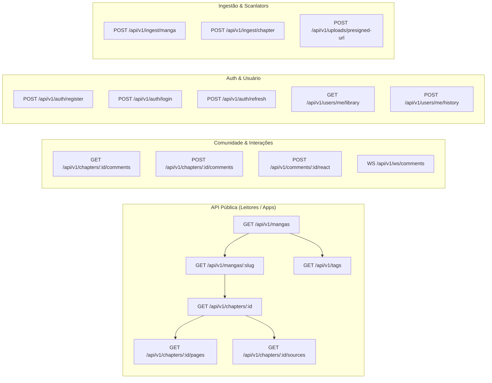

# 🔌 Honbakoo RESTful API Specification (Headless Contract)

> **Versão da API:** `v1`  
> **Protocolo:** HTTP/2 ou HTTP/3 sobre TLS + WebSockets (RFC 6455)  
> **Formato de Dados:** JSON (RFC 8259)  
> **Autenticação:** Bearer JWT (Access Token) + HttpOnly Cookie / Header (Refresh Token)  
> **Convenção de Paginação:** Cursor-based pagination (`cursor` baseado em UUIDv7 / CreatedAt) para performance extrema e compatibilidade total com cache de CDN.

---

## 1. Princípios de Design da API

1. **Edge-Cache Friendly:** Rotas de catálogo e leitura (`GET /api/v1/mangas/*` e `GET /api/v1/chapters/*`) geram cabeçalhos de cache otimizados (`ETag`, `Cache-Control: public, max-age=...`) para que CDNs (Cloudflare / Caddy) absorvam mais de 90% do tráfego.
2. **Cursor Pagination:** Elimina o lento `OFFSET` em tabelas com milhares de registros. O cliente envia `limit=20&cursor=018d45...` garantindo consultas em tempo constante $O(1)$.
3. **Respostas Padronizadas:** Todas as respostas seguem uma estrutura previsível:

```json
{
  "success": true,
  "data": { ... },
  "meta": {
    "next_cursor": "018d45f3-...",
    "has_more": true,
    "total": 1250
  }
}
```

Em caso de erro:
```json
{
  "success": false,
  "error": {
    "code": "RESOURCE_NOT_FOUND",
    "message": "O mangá solicitado não existe ou foi removido.",
    "details": null
  }
}
```

---

## 2. Mapa Completo de Endpoints



---

## 3. Especificação Detalhada por Módulo

### 3.1 Módulo de Catálogo & Busca (`/api/v1/mangas`)

#### `GET /api/v1/mangas`
Listagem de catálogo com filtros universais e busca booleana por tags.

* **Query Parameters:**
  * `format` (opcional): `manga`, `manhwa`, `manhua`, `doujinshi`, `anime_h`, `anime_m`
  * `tags_include` (opcional): Array de slugs ou IDs (`12,45` ou `romance,mind-break`)
  * `tags_exclude` (opcional): Array de slugs ou IDs a proibir (`netorare,gore`)
  * `search` (opcional): Texto para busca com trigramas no título
  * `sort` (opcional): `trending`, `popular`, `latest`, `rating` (default: `trending`)
  * `limit` (opcional): Padrão `24`, máx `100`
  * `cursor` (opcional): UUIDv7 da última obra recebida

* **Resposta de Sucesso (`200 OK`):**
```json
{
  "success": true,
  "data": [
    {
      "id": "018d45f3-a12b-7c3d-9e4f-5a6b7c8d9e0f",
      "title": "Aventuras no Outro Mundo",
      "slug": "aventuras-no-outro-mundo",
      "format": "manhwa",
      "reading_direction": "vertical_scroll",
      "is_gallery": false,
      "is_nsfw": false,
      "cover_url": "https://cdn.honbakoo.org/covers/018d45f3...webp",
      "views_all_time": 154200,
      "views_weekly": 12800,
      "rating_score": "9.45",
      "tags": [
        {"id": 1, "name": "Ação", "slug": "acao", "category": "general"},
        {"id": 14, "name": "Fantasia", "slug": "fantasia", "category": "general"}
      ],
      "latest_chapter": {
        "id": "018d4610-b23c-7d4e-af5a-6b7c8d9e0f1a",
        "chapter_number": 42.0,
        "language": "pt-br",
        "created_at": "2026-11-06T12:00:00Z"
      }
    }
  ],
  "meta": {
    "next_cursor": "018d45f3-a12b-7c3d-9e4f-5a6b7c8d9e0f",
    "has_more": true
  }
}
```

#### `GET /api/v1/mangas/:slug`
Retorna todos os detalhes de uma obra, incluindo a lista agrupada de capítulos e grupos de tradução.

---

### 3.2 Módulo de Leitor & Player (`/api/v1/chapters`)

#### `GET /api/v1/chapters/:id`
Metadados do capítulo/episódio, incluindo verificação de acesso VIP/antecipado.

* **Headers de Resposta:**
  * `Cache-Control: public, max-age=3600` (se já liberado para todos)
  * `ETag: W/"chap-018d4610-..."`

#### `GET /api/v1/chapters/:id/pages` (Para Mangá / Manhwa / Doujinshi)
Retorna as páginas ordenadas para renderização no leitor.

* **Resposta de Sucesso (`200 OK`):**
```json
{
  "success": true,
  "data": {
    "chapter_id": "018d4610-b23c-7d4e-af5a-6b7c8d9e0f1a",
    "reading_direction": "vertical_scroll",
    "pages_count": 28,
    "pages": [
      {
        "page_number": 1,
        "url": "https://cdn.honbakoo.org/media/a1/b2/c3/a1b2c3d4e5f6...webp?token=hmac_signature&exp=1794000000",
        "width": 1200,
        "height": 1800,
        "byte_size": 245100
      },
      {
        "page_number": 2,
        "url": "https://cdn.honbakoo.org/media/f4/e5/d6/f4e5d6a7b8c9...webp?token=hmac_signature&exp=1794000000",
        "width": 1200,
        "height": 1800,
        "byte_size": 289400
      }
    ]
  }
}
```

#### `GET /api/v1/chapters/:id/sources` (Para Anime / Anime-H / Vídeo)
Retorna os servidores de streaming e faixas de legenda para o player de vídeo.

* **Resposta de Sucesso (`200 OK`):**
```json
{
  "success": true,
  "data": {
    "chapter_id": "018d4610-b23c-7d4e-af5a-6b7c8d9e0f1a",
    "sources": [
      {
        "server_name": "Main HLS Local",
        "source_type": "direct_hls",
        "resolution": "1080p",
        "stream_url": "https://stream.honbakoo.org/hls/ep01/master.m3u8"
      },
      {
        "server_name": "Mirror Embed (Zero Egress)",
        "source_type": "external_embed",
        "resolution": "auto",
        "stream_url": "https://streamtape.com/e/abc123xyz/"
      }
    ],
    "subtitles": [
      {
        "language": "pt-br",
        "label": "Português",
        "subtitle_url": "https://cdn.honbakoo.org/subs/ep01_pt.vtt",
        "is_default": true
      }
    ]
  }
}
```

---

### 3.3 Módulo de Comunidade & Comentários (`/api/v1/comments`)

#### `GET /api/v1/chapters/:id/comments`
Retorna a árvore hierárquica de comentários montada via `ltree`.

* **Resposta de Sucesso (`200 OK`):**
```json
{
  "success": true,
  "data": [
    {
      "id": "018d4650-1111-7777-8888-999999999999",
      "parent_id": null,
      "user": {
        "username": "OtakuMaster",
        "avatar_url": "https://cdn.honbakoo.org/avatars/user1.webp",
        "role": "vip"
      },
      "content": "Esse capítulo foi sensacional! O plot twist no final me pegou.",
      "likes_count": 42,
      "dislikes_count": 1,
      "created_at": "2026-11-06T13:10:00Z",
      "replies": [
        {
          "id": "018d4655-2222-7777-8888-999999999999",
          "parent_id": "018d4650-1111-7777-8888-999999999999",
          "user": {
            "username": "ScanReader",
            "avatar_url": "https://cdn.honbakoo.org/avatars/user2.webp",
            "role": "user"
          },
          "content": "Concordo totalmente! Ansioso pelo próximo.",
          "likes_count": 8,
          "dislikes_count": 0,
          "created_at": "2026-11-06T13:15:00Z",
          "replies": []
        }
      ]
    }
  ]
}
```

#### `POST /api/v1/chapters/:id/comments`
* **Autenticação Obrigatória:** Bearer JWT
* **Body:**
  * `parent_id` (opcional): UUIDv7 do comentário pai se for uma resposta
  * `content`: Texto do comentário (máx 2.000 caracteres)

#### `WS /api/v1/ws/comments?chapter_id=...`
WebSocket leve em Go para recebimento de novos comentários em tempo real enquanto o usuário lê o capítulo.

---

### 3.4 Módulo de Ingestão & Upload (`/api/v1/ingest` & `/api/v1/uploads`)

#### `POST /api/v1/uploads/presigned-url`
Gera URLs pré-assinadas com expiração para que o frontend/CLI envie as páginas diretamente para o storage (S3 ou Disco Local via backend), sem travar a conexão HTTP da API.

* **Autenticação:** Bearer Token de Scanlator/Admin ou `X-API-Key`
* **Request:**
```json
{
  "files": [
    {
      "filename": "page_001.webp",
      "byte_size": 245100,
      "sha256_hash": "a1b2c3d4e5f6...",
      "mime_type": "image/webp"
    }
  ]
}
```
* **Resposta (`200 OK`):**
```json
{
  "success": true,
  "data": {
    "upload_slots": [
      {
        "filename": "page_001.webp",
        "sha256_hash": "a1b2c3d4e5f6...",
        "upload_url": "https://storage.honbakoo.org/incoming/temp_a1b2c3...?token=...",
        "already_exists": false
      }
    ]
  }
}
```
*(Se `already_exists` for `true`, o arquivo já existe no banco por deduplicação de hash; o cliente nem precisa fazer o upload!)*

#### `POST /api/v1/ingest/chapter`
Comunica o término do upload e registra o novo capítulo no catálogo.

---

## 4. Rate Limiting e Códigos de Status HTTP

* **`200 OK`**: Sucesso comum.
* **`201 Created`**: Recurso criado (novo comentário, upload concluído).
* **`304 Not Modified`**: Conteúdo em cache do cliente ainda válido (baseado no `ETag`).
* **`400 Bad Request`**: Parâmetros inválidos.
* **`401 Unauthorized`**: Token ausente ou expirado.
* **`403 Forbidden`**: Conteúdo restrito para VIPs ou usuário banido.
* **`404 Not Found`**: Obra ou capítulo inexistente ou removido por DMCA.
* **`429 Too Many Requests`**: Rate limit excedido (retorna header `Retry-After: 60`).
* **`500 Internal Server Error`**: Erro inesperado do servidor.

### Políticas de Rate Limit (Controladas via Redis):
* **Rotas Públicas de Leitura (`GET`):** 120 requisições / minuto por IP.
* **Rotas de Criação de Comentários (`POST`):** 5 comentários / minuto por usuário.
* **Rotas de Autenticação (`/auth/login`):** 5 tentativas / minuto por IP com bloqueio exponencial contra força bruta.
