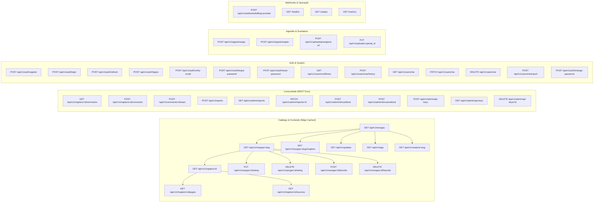

# 🔌 Honbakoo RESTful API Specification (Headless Contract)

> **Versão da API:** `v1`  
> **Protocolo:** HTTP/2 ou HTTP/3 sobre TLS (Stateless puro, zero WebSockets para máxima eficiência e compatibilidade com CDNs)  
> **Formato de Dados:** JSON (RFC 8259)  
> **Autenticação:** Bearer JWT (Access Token) + HttpOnly Cookie / Header (Refresh Token)  
> **Convenção de Paginação:** Cursor opaco (base64url) com a tupla `(sort_key, id)` e fingerprint do `sort`; custo O(1) por página, sem `OFFSET`.

---

## 1. Princípios de Design da API

1. **Edge-Cache Friendly (Stateless):** Rotas públicas de catálogo e comentários geram cabeçalhos de cache otimizados (`ETag`, `Cache-Control: public, max-age=...`) para que CDNs (Cloudflare / Caddy) absorvam mais de 90% do tráfego sem tocar na CPU do servidor. Respostas personalizadas (manifesto do leitor, biblioteca, histórico) são sempre `private, no-store`.
2. **Cursor Pagination (Keyset):** Elimina o lento `OFFSET` em tabelas com milhares de registros. O cursor é **opaco** (base64url) e codifica `(sort_key, id)` + fingerprint do `sort`; o cliente nunca o interpreta. Reutilizar um cursor com outro `sort` retorna `CURSOR_SORT_MISMATCH`. Ver [ADR-0002](./adr/0002-paginacao-keyset-cursor-opaco.md).
3. **Mutações Otimistas no Frontend:** O envio de comentários e reações atualiza a interface do usuário instantaneamente enquanto o `POST` é processado em segundo plano, entregando a sensação de tempo real sem os custos e instabilidades de WebSockets contínuos.
4. **Respostas Padronizadas:**

```json
{
  "success": true,
  "data": { ... },
  "meta": {
    "next_cursor": "018d45f3-...",
    "has_more": true
  }
}
```

---

## 2. Mapa Completo de Endpoints



---

## 3. Especificação Detalhada por Módulo

### 3.1 Módulo de Catálogo & Busca (`/api/v1/mangas`)

#### `GET /api/v1/mangas`
Listagem de catálogo com filtros universais e busca booleana por tags.

* **Query Parameters:**
  * `format` (opcional): `manga`, `manhwa`, `manhua`, `doujinshi`, `anime_h`, `anime_m`
  * `lang` (opcional): Código de idioma preferido para título/sinopse (default: `pt-br`)
  * `tags_include` (opcional): Array de slugs ou IDs (`12,45` ou `romance,action`)
  * `tags_exclude` (opcional): Array de slugs ou IDs a proibir (`netorare,gore`)
  * `creator` (opcional): Slug de artista ou roteirista
  * `search` (opcional): Texto para busca com trigramas no título
  * `sort` (opcional): `trending`, `popular`, `latest`, `rating` (default: `trending`)
  * Cada `sort` tem cursor próprio: `popular`/`trending` usam `(views_all_time, id)`, `latest` usa `(published_at, id)` e `rating` usa `(rating_score, id)`. Reutilizar cursor de outro `sort` retorna `CURSOR_SORT_MISMATCH`.
  * `limit` (opcional): Padrão `24`, máx `100`
  * `cursor` (opcional): Cursor opaco retornado em `meta.next_cursor`. Codifica `(sort_key, id)` + fingerprint do `sort`; não é um UUID nem deve ser montado pelo cliente.

* **Resposta de Sucesso (`200 OK`):**
```json
{
  "success": true,
  "data": [
    {
      "id": "018d45f3-a12b-7c3d-9e4f-5a6b7c8d9e0f",
      "display_title": "Aventuras no Outro Mundo",
      "original_title": "Otherworldly Adventures",
      "original_language": "ko",
      "slug": "aventuras-no-outro-mundo",
      "format": "manhwa",
      "reading_direction": "vertical_scroll",
      "is_gallery": false,
      "is_nsfw": false,
      "cover_url": "https://cdn.honbakoo.org/covers/018d45f3...webp",
      "views_all_time": 154200,
      "views_weekly": 12800,
      "rating_score": 9.45,
      "tags": [
        {"id": 1, "name": "Ação", "slug": "acao", "category": "general"},
        {"id": 14, "name": "Fantasia", "slug": "fantasia", "category": "general"}
      ],
      "creators": [
        {"name": "Park Jin-Woo", "slug": "park-jin-woo", "role": "story"},
        {"name": "Studio Red", "slug": "studio-red", "role": "art"}
      ]
    }
  ],
  "meta": {
    "next_cursor": "eyJzIjoicG9wdWxhciIsImsiOjE1NDIwMCwiaWQiOiIwMThkNDVmMy1hMTJiLTdjM2QtOWU0Zi01YTZiN2M4ZDllMGYifQ",
    "has_more": true
  }
}
```

> **Anti-N+1:** tags e creators são agregados com `jsonb_agg` (ou `pgx.Batch`) em uma única ida ao banco. A listagem nunca executa uma query por obra.

#### `GET /api/v1/mangas/:slug`
Detalhe público da obra, incluindo metadados editoriais e agregados.

* **Query Parameters:**
  * `lang` (opcional): idioma preferido para título/sinopse (default: `pt-br`)
* **Headers de Resposta:** `Cache-Control: public, max-age=300, s-maxage=600`
* **Resposta de Sucesso (`200 OK`):**
```json
{
  "success": true,
  "data": {
    "id": "018d45f3-a12b-7c3d-9e4f-5a6b7c8d9e0f",
    "display_title": "Aventuras no Outro Mundo",
    "original_title": "Otherworldly Adventures",
    "original_language": "ko",
    "alt_titles": ["Aventuras em Outro Mundo"],
    "slug": "aventuras-no-outro-mundo",
    "description": "Um herói comum acorda em um mundo onde a magia é rotina.",
    "format": "manhwa",
    "status": "ongoing",
    "reading_direction": "vertical_scroll",
    "is_gallery": false,
    "is_nsfw": false,
    "cover_url": "https://cdn.honbakoo.org/covers/018d45f3...webp",
    "views_all_time": 154200,
    "views_weekly": 12800,
    "rating_score": 9.45,
    "rating_count": 3120,
    "favorites_count": 8400,
    "published_at": "2026-01-12T00:00:00Z",
    "tags": [
      {"id": 1, "name": "Ação", "slug": "acao", "category": "general"},
      {"id": 14, "name": "Fantasia", "slug": "fantasia", "category": "general"}
    ],
    "creators": [
      {"name": "Park Jin-Woo", "slug": "park-jin-woo", "role": "story"},
      {"name": "Studio Red", "slug": "studio-red", "role": "art"}
    ],
    "magazine": {"name": "Weekly Webtoon", "slug": "weekly-webtoon"},
    "publisher": {"name": "Editora Exemplo", "slug": "editora-exemplo"}
  }
}
```
* **Erros:** `NOT_FOUND` para slug inexistente, não publicado ou bloqueado por DMCA.
* **Personalização:** `is_favorited` não entra nesta resposta para preservar o cache público; o estado do usuário vem de `GET /users/me/library`.

#### `PUT /api/v1/mangas/:id/rating`
Cria ou atualiza a avaliação do usuário autenticado (1 a 10). A operação é idempotente por natureza: o mesmo usuário tem no máximo uma avaliação por obra.

* **Autenticação:** Bearer JWT (e-mail verificado)
* **Body:** `{"score": 9}`
* **Resposta (`200 OK`):** `{"success": true, "data": {"manga_id": "...", "score": 9}}`
* **Efeito:** o trigger `trg_manga_ratings_aggregate` recalcula `mangas.rating_score` e `rating_count`; o cache de `GET /mangas/:slug` é invalidado por TTL curto.

#### `DELETE /api/v1/mangas/:id/rating`
Remove a avaliação do usuário autenticado.

* **Autenticação:** Bearer JWT
* **Resposta (`204 No Content`)**; o agregado da obra é recalculado pelo trigger.

#### `POST /api/v1/mangas/:id/favorite`
Adiciona a obra à biblioteca do usuário. Idempotente: repetir não duplica nem altera `created_at`.

* **Autenticação:** Bearer JWT (e-mail verificado)
* **Resposta (`204 No Content`)**; o trigger `trg_manga_favorites_count` mantém `mangas.favorites_count`.

#### `DELETE /api/v1/mangas/:id/favorite`
Remove a obra da biblioteca. Idempotente.

* **Autenticação:** Bearer JWT
* **Resposta (`204 No Content`)**; o contador é recalculado pelo trigger.

#### `GET /api/v1/mangas/:slug/chapters`
Lista os capítulos de uma obra, com filtro por idioma e grupo de scanlation.

* **Query Parameters:**
  * `lang` (opcional): código do idioma (default: todos)
  * `group` (opcional): slug do grupo de scanlation
  * `order` (opcional): `asc` ou `desc` (default: `desc`)
  * `limit` (opcional): padrão `50`, máx `100`
  * `cursor` (opcional): cursor opaco keyset `(chapter_number, id)`
* **Headers de Resposta:** `Cache-Control: public, max-age=60, stale-while-revalidate=120`

#### `GET /api/v1/tags`
Lista tags canônicas com contagem de uso e nome localizado.

* **Query Parameters:**
  * `category` (opcional): `general`, `artist`, `circle`, `parody`, `character`, `language`
  * `lang` (opcional): idioma do nome (default: `pt-br`)
  * `search` (opcional): prefixo/fuzzy no nome localizado
  * `sort` (opcional): `usage` ou `name` (default: `usage`)
  * `limit` (opcional): padrão `100`, máx `500`
  * `cursor` (opcional): cursor opaco keyset `(usage_count, id)` ou `(name, id)` conforme `sort`
* **Headers de Resposta:** `Cache-Control: public, max-age=3600`
* **Resposta (`200 OK`):** `{"success":true,"data":[{"id":1,"slug":"acao","name":"Ação","category":"general","usage_count":8421}],"meta":{"next_cursor":"...","has_more":true}}`

#### `GET /api/v1/creators/:slug`
Perfil público do criador e suas obras.

* **Query Parameters:** `lang` (opcional), `limit` (padrão `24`), `cursor` (opaco keyset `(views_all_time, id)`)
* **Headers de Resposta:** `Cache-Control: public, max-age=600`
* **Resposta (`200 OK`):** dados do criador (`name`, `native_name`, `biography`, links) e `works[]` com `id`, `display_title`, `slug`, `cover_url`, `role`.
* **Erros:** `NOT_FOUND`.

#### `GET /api/v1/updates`
Feed global de capítulos recém-publicados (home do leitor).

* **Query Parameters:**
  * `lang` (opcional): filtra pelo idioma do capítulo
  * `format` (opcional): filtra pelo formato da obra
  * `limit` (opcional): padrão `30`, máx `100`
  * `cursor` (opcional): cursor opaco keyset `(published_at, id)`
* **Headers de Resposta:** `Cache-Control: public, max-age=30, stale-while-revalidate=60`

---

### 3.2 Módulo de Leitor & Player (`/api/v1/chapters`)

#### `GET /api/v1/chapters/:id`
Metadados públicos do capítulo, sem o manifesto de páginas.

* **Headers de Resposta:** `Cache-Control: public, max-age=300`
* **Resposta (`200 OK`):**
```json
{
  "success": true,
  "data": {
    "id": "018d4610-b23c-7d4e-af5a-6b7c8d9e0f1a",
    "manga_id": "018d45f3-a12b-7c3d-9e4f-5a6b7c8d9e0f",
    "manga_slug": "aventuras-no-outro-mundo",
    "title": "O despertar",
    "chapter_number": 12.5,
    "volume_number": "2",
    "language_code": "pt-br",
    "group": {"name": "Scanlation Exemplo", "slug": "scanlation-exemplo"},
    "media_type": "image_pages",
    "pages_count": 28,
    "is_vip_early_access": false,
    "available_public_at": null,
    "published_at": "2026-11-06T12:00:00Z"
  }
}
```
* **Erros:** `NOT_FOUND`; capítulos em early access sem entitlement retornam `403 FORBIDDEN` com `available_public_at` no `details`.

#### `GET /api/v1/chapters/:id/pages` (Mangá / Manhwa / Doujinshi)
Retorna as páginas ordenadas para renderização.

* **Headers de Resposta:** `Cache-Control: private, no-store` (manifesto personalizado). As imagens referenciadas são content-addressed e imutáveis.
* **Resposta de Sucesso (`200 OK`):**
```json
{
  "success": true,
  "data": {
    "chapter_id": "018d4610-b23c-7d4e-af5a-6b7c8d9e0f1a",
    "reading_direction": "vertical_scroll",
    "pages_count": 28,
    "pages": [
      {
        "page_number": 1,
        "url": "https://cdn.honbakoo.org/media/a1/b2/c3/a1b2c3d4e5f6...webp",
        "etag": "\"sha256:a1b2c3d4e5f6...\"",
        "width": 1200,
        "height": 1800,
        "byte_size": 245100
      }
    ]
  }
}
```
> As imagens são content-addressed (`/media/{sha256}.webp`, com sharding por prefixo do hash), públicas e imutáveis (`Cache-Control: public, max-age=31536000, immutable`). O manifesto é personalizado (`private, no-store`) e, em VIP/early access, pode devolver URLs assinadas de curta duração — a assinatura fica no manifesto, nunca na imagem cacheável.

#### `GET /api/v1/chapters/:id/sources` (Anime / Anime-H / Vídeo)
Retorna os servidores de streaming e legendas.

* **Headers de Resposta:** `Cache-Control: private, no-store` (URLs assinadas/efêmeras)
* **Resposta de Sucesso (`200 OK`):**
```json
{
  "success": true,
  "data": {
    "chapter_id": "018d4610-b23c-7d4e-af5a-6b7c8d9e0f1a",
    "sources": [
      {
        "server_name": "Main Server",
        "source_type": "direct_hls",
        "resolution": "1080p",
        "stream_url": "https://stream.honbakoo.org/hls/ep01/master.m3u8"
      },
      {
        "server_name": "Mirror Embed (Zero Egress)",
        "source_type": "external_embed",
        "resolution": "auto",
        "stream_url": "https://streamtape.com/e/abc123xyz/"
      }
    ],
    "subtitles": [
      {
        "language_code": "pt-br",
        "label": "Português",
        "subtitle_url": "https://cdn.honbakoo.org/subs/ep01_pt.vtt",
        "is_default": true
      }
    ]
  }
}
```

---

### 3.3 Módulo de Comunidade & Comentários (`/api/v1/comments` - REST Puro)

> Decisão e limites em [ADR-0009](./adr/0009-comentarios-ltree-rest.md).

#### `GET /api/v1/chapters/:id/comments`
Retorna a árvore hierárquica de comentários (construída via `ltree`).

* **Headers de Resposta:** `Cache-Control: public, max-age=30, stale-while-revalidate=60`
* **Resposta de Sucesso (`200 OK`):**
```json
{
  "success": true,
  "data": [
    {
      "id": "018d4650-1111-7777-8888-999999999999",
      "parent_id": null,
      "user": {
        "username": "OtakuMaster",
        "avatar_url": "https://cdn.honbakoo.org/avatars/user1.webp",
        "role": "user",
        "is_vip": true
      },
      "content": "Esse capítulo foi sensacional!",
      "likes_count": 42,
      "dislikes_count": 1,
      "created_at": "2026-11-06T13:10:00Z",
      "replies": [
        {
          "id": "018d4655-2222-7777-8888-999999999999",
          "parent_id": "018d4650-1111-7777-8888-999999999999",
          "user": {
            "username": "ScanReader",
            "avatar_url": "https://cdn.honbakoo.org/avatars/user2.webp",
            "role": "user",
            "is_vip": false
          },
          "content": "Concordo totalmente!",
          "likes_count": 8,
          "dislikes_count": 0,
          "created_at": "2026-11-06T13:15:00Z",
          "replies": []
        }
      ]
    }
  ]
}
```

#### `POST /api/v1/chapters/:id/comments`
* **Autenticação:** Bearer JWT
* **Body:**
  * `parent_id` (opcional): UUIDv7 do comentário pai se for resposta
  * `content`: Texto do comentário (máx 2.000 caracteres)

#### `POST /api/v1/comments/:id/react`
* **Autenticação:** Bearer JWT
* **Body:** `{"is_like": true}`

---

### 3.4 Módulo de Ingestão & Upload (`/api/v1/ingest` & `/api/v1/uploads`)

> Decisão e validação server-side em [ADR-0010](./adr/0010-uploads-ingestao-cas.md).

#### `POST /api/v1/uploads/presigned-url`
Negocia o upload de mídia e a deduplicação prévia por SHA-256. O comportamento depende do perfil:

* **`PROFILE=scale`:** retorna URL pré-assinada do S3/R2 (PUT direto no storage).
* **`PROFILE=budget`:** retorna `upload_url` apontando para a própria API (`PUT /api/v1/uploads/:upload_id`), pois não há S3.

* **Autenticação:** Bearer Token de Scanlator/Admin ou `X-API-Key`
* **Request:**
```json
{
  "files": [
    {
      "filename": "page_001.webp",
      "byte_size": 245100,
      "sha256_hash": "a1b2c3d4e5f6...",
      "mime_type": "image/webp"
    }
  ]
}
```
* **Resposta (`200 OK`):**
```json
{
  "success": true,
  "data": {
    "upload_slots": [
      {
        "filename": "page_001.webp",
        "sha256_hash": "a1b2c3d4e5f6...",
        "upload_id": "018d4700-3333-7777-8888-999999999999",
        "upload_url": "https://storage.honbakoo.org/incoming/temp_a1b2c3...?token=...",
        "already_exists": false,
        "media_id": null
      }
    ]
  }
}
```
> Se `already_exists = true`, `upload_url` vem nulo e `media_id` aponta para o objeto existente: o cliente não deve reenviar os bytes.

#### `PUT /api/v1/uploads/:upload_id` (somente `PROFILE=budget`)
Recebe os bytes diretamente na API quando não há S3/R2.

* **Autenticação:** Bearer Token de Scanlator/Admin ou `X-API-Key`
* **Headers:** `Content-Type` do arquivo e `Content-Length` ≤ 5MB.
* **Resposta (`204 No Content`)**; o objeto fica em `pending` até o `POST /uploads/complete`.
* **Erros:** `UPLOAD_EXPIRED` (TTL vencido), `PAYLOAD_TOO_LARGE`, `UNSUPPORTED_MEDIA_TYPE`.

#### `POST /api/v1/uploads/complete`
Confirma o upload após o `PUT`. O servidor lê o objeto, valida **magic bytes** (não confia no `Content-Type`), recalcula o SHA-256, extrai dimensões/EXIF e só então cria `media_objects` com `status = ready` e `ref_count = 0`.

* **Autenticação:** Bearer Token de Scanlator/Admin ou `X-API-Key`
* **Body:** `{"upload_ids": ["018d4700-3333-7777-8888-999999999999"]}`
* **Resposta (`200 OK`):** `{"success": true, "data": {"media": [{"upload_id": "...", "media_id": "...", "status": "ready"}]}}`
* **Erros:** `UPLOAD_HASH_MISMATCH`, `MEDIA_BLOCKED`, `UPLOAD_EXPIRED`.

#### `POST /api/v1/ingest/manga`
Cria ou atualiza metadados de uma obra via CLI/scraper.

* **Autenticação:** `X-API-Key` de scanlator/admin
* **Idempotência:** `Idempotency-Key` obrigatório
* **Body:** `{"title": "...", "original_title": "...", "format": "manga", "language": "pt-br", "cover_url": "https://cdn.../cover.webp", "publisher_slug": "...", "magazine_slug": "...", "tag_slugs": ["action", "romance"], "alt_titles": ["..."], "is_nsfw": false}`
* **Resposta (`201 Created`):** `{"success": true, "data": {"manga_id": "...", "slug": "...", "status": "ongoing"}}`
* **Erros:** `CONFLICT` (slug duplicado), `VALIDATION_ERROR`, `MEDIA_BLOCKED`.

#### `POST /api/v1/ingest/chapter`
Cria um capítulo a partir de mídia já enviada e validada.

* **Autenticação:** `X-API-Key` de scanlator/admin
* **Idempotência:** `Idempotency-Key` obrigatório
* **Body:** `{"manga_id": "...", "chapter_number": 12.5, "language_code": "pt-br", "group_id": "...", "title": "...", "media_ids": ["..."]}`
* **Resposta (`202 Accepted`):** `{"success": true, "data": {"chapter_id": "...", "status": "processing"}}`
* **Erros:** `CONFLICT` (mesma release), `VALIDATION_ERROR`, `MEDIA_BLOCKED`.

---

### 3.5 Módulo de Autenticação & Usuário (`/api/v1/auth` & `/api/v1/users`)

> Decisão de auth/VIP em [ADR-0008](./adr/0008-auth-jwt-argon2-vip.md).

> Todas as respostas deste módulo são `Cache-Control: private, no-store`.
> Access token curto (15 min) + refresh token opaco rotativo; o refresh nunca é exposto em URL.

#### `POST /api/v1/auth/register`
Cria a conta e dispara o e-mail de verificação.

* **Body:** `{"username": "...", "email": "...", "password": "...", "preferred_language": "pt-br"}`
* **Resposta (`201 Created`):** `{"success": true, "data": {"user": {...}, "email_verification_required": true}}`
* **Erros:** `CONFLICT` (username/e-mail), `VALIDATION_ERROR` (senha fraca), `RATE_LIMITED`.

#### `POST /api/v1/auth/login`
Autentica por e-mail **ou** username.

* **Body:** `{"identifier": "...", "password": "..."}`
* **Resposta (`200 OK`):**
```json
{
  "success": true,
  "data": {
    "access_token": "eyJ...",
    "token_type": "Bearer",
    "expires_in": 900,
    "refresh_token": "opaque-token",
    "user": {"id": "...", "username": "...", "role": "user", "is_vip": false, "email_verified": true}
  }
}
```
* **Erros:** `INVALID_CREDENTIALS` (não revela se o e-mail existe), `EMAIL_NOT_VERIFIED`, `ACCOUNT_DELETED`, `RATE_LIMITED`.

#### `POST /api/v1/auth/refresh`
Rotaciona o refresh token. O token antigo é revogado e substituído.

* **Body:** `{"refresh_token": "..."}`
* **Resposta (`200 OK`):** novo par `access_token` + `refresh_token`.
* **Erros:** `UNAUTHORIZED` (expirado/inválido), `TOKEN_REUSED` (reuso detectado; revoga a família inteira).

#### `POST /api/v1/auth/logout`
Revoga a família do refresh token atual.

* **Autenticação:** Bearer JWT
* **Body:** `{"refresh_token": "..."}` (opcional se o cookie HttpOnly for usado)
* **Resposta (`204 No Content`).**

#### `POST /api/v1/auth/verify-email`
Confirma o e-mail com token de uso único.

* **Body:** `{"token": "..."}`
* **Resposta (`204 No Content`)**; token expirado/used retorna `UNAUTHORIZED`.

#### `POST /api/v1/auth/forgot-password`
Solicita reset. Responde sempre `202 Accepted` para não permitir enumeração de e-mails.

* **Body:** `{"email": "..."}`
* **Resposta (`202 Accepted`):** `{"success": true, "data": {"message": "Se o e-mail existir, enviaremos instruções."}}`

#### `POST /api/v1/auth/reset-password`
Define nova senha e revoga todas as famílias de refresh do usuário.

* **Body:** `{"token": "...", "new_password": "..."}`
* **Resposta (`204 No Content`)**; erros `UNAUTHORIZED`, `VALIDATION_ERROR`.

#### `GET /api/v1/users/me`
Perfil do usuário autenticado (inclui `is_vip`, `vip_until`, `email_verified`).

#### `PATCH /api/v1/users/me`
Atualiza `username`, `avatar_url` e `preferred_language`; mudança de e-mail exige novo fluxo de verificação.

#### `DELETE /api/v1/users/me`
Soft-delete + anonimização (LGPD): revoga sessões, remove dados pessoais e mantém agregados. Resposta `204 No Content`.

#### `POST /api/v1/users/me/export`
Solicita exportação LGPD dos dados do usuário (perfil, favoritos, histórico, comentários e ratings).

* **Resposta (`202 Accepted`):** job assíncrono; o link de download é enviado por e-mail e expira em 24h.
* **Rate limit:** 1 pedido a cada 24h por usuário.

#### `POST /api/v1/auth/change-password`
Troca a senha do usuário autenticado.

* **Body:** `{"current_password": "...", "new_password": "..."}`
* **Resposta (`204 No Content`)**; revoga todas as famílias de refresh exceto a atual.
* **Erros:** `INVALID_CREDENTIALS`, `VALIDATION_ERROR`, `RATE_LIMITED`.

#### `GET /api/v1/users/me/library`
Lista favoritos e histórico do usuário. Cada seção tem seu cursor: favoritos `(created_at, manga_id)`, histórico `(updated_at, manga_id)`.

#### `POST /api/v1/users/me/history`
Atualiza o progresso de leitura (`manga_id`, `last_chapter_id`, `last_page`, `last_video_position_seconds`). Idempotente por `(user_id, manga_id)`.

---

### 3.6 Módulo de Denúncias (`/api/v1/reports`)

#### `POST /api/v1/reports`
Registra denúncia de obra, capítulo, comentário ou usuário.

* **Autenticação:** Bearer JWT (e-mail verificado)
* **Body:** `{"target_type": "comment", "target_id": "...", "reason": "spam", "details": "..."}`
* **Resposta (`201 Created`):** `{"success": true, "data": {"report_id": "...", "status": "open"}}`
* **Erros:** `REPORT_DUPLICATE` (mesmo usuário/alvo nas últimas 24h), `VALIDATION_ERROR`.
* **Moderação:** `GET /api/v1/admin/reports?status=open` (role `moderator`/`admin`) e `PATCH /api/v1/admin/reports/:id` para resolver; toda ação grava `audit_log`.

---

### 3.7 Moderação (`/api/v1/admin`)

> Exige role `moderator` ou `admin`; todas as mutações gravam `audit_log`.

#### `GET /api/v1/admin/reports`
Lista a fila de denúncias.

* **Query:** `status` (`open|reviewing|resolved|dismissed`), `target_type`, `limit`, `cursor`.
* **Resposta (`200 OK`):** itens com `report_id`, `target_type`, `target_id`, `reason`, `status`, `created_at` e `next_cursor`.
* **Cache:** `private, no-store`.

#### `PATCH /api/v1/admin/reports/:id`
Atualiza o status e registra a resolução.

* **Body:** `{"status": "resolved", "resolution": "removed", "resolution_note": "..."}`.
* **Resposta (`200 OK`):** denúncia atualizada; `resolved_by`/`resolved_at` preenchidos.
* **Efeito:** se a resolução for remoção, o alvo entra em soft-delete e o hash de mídia (quando aplicável) vai para `blocked_media_hashes`.

#### `POST /api/v1/admin/dmca/block`
Bloqueia uma obra ou capítulo por DMCA e, opcionalmente, blacklista os hashes das mídias.

* **Body:** `{"target_type": "chapter", "target_id": "...", "reason": "copyright", "block_hashes": true}`
* **Resposta (`202 Accepted`):** `{"success":true,"data":{"target_type":"chapter","target_id":"...","hashes_queued":28}}`
* **Efeito:** `is_dmca_blocked = TRUE` é síncrono; a coleta/inserção de hashes em `blocked_media_hashes` roda como job idempotente. Toda ação grava `audit_log`.

#### `POST /api/v1/admin/dmca/unblock`
Reverte o bloqueio após revisão. Não remove hashes da blacklist automaticamente (isso exige decisão explícita).

* **Body:** `{"target_type": "chapter", "target_id": "...", "reason": "counter_notice_accepted"}`
* **Resposta (`200 OK`).**

#### `POST /api/v1/admin/api-keys`
Cria uma API key de automação. O token em claro aparece **uma única vez**.

* **Autenticação:** Bearer JWT com role `admin`
* **Body:** `{"name": "CLI ingest", "user_id": "...", "group_id": "...", "scopes": ["ingest"], "expires_at": "2027-01-01T00:00:00Z"}`
* **Resposta (`201 Created`):** `{"success":true,"data":{"id":"...","key_prefix":"hbk_live_ab12","token":"hbk_live_...","scopes":["ingest"],"expires_at":"..."}}`
* **Regra:** `scopes:["admin"]` exige `user_id` com role `admin`; o token nunca é retornado de novo.

#### `GET /api/v1/admin/api-keys`
Lista chaves com `key_prefix`, `name`, `user_id`, `group_id`, `scopes`, `last_used_at`, `expires_at` e `revoked_at`. Nunca retorna `key_hash` nem o token.

#### `DELETE /api/v1/admin/api-keys/:id`
Revoga a chave imediatamente (`revoked_at = NOW()`). Resposta `204 No Content`; auditoria obrigatória.

---

### 3.8 Webhooks de Billing (`/api/v1/webhooks`)

#### `POST /api/v1/webhooks/billing/:provider`
Recebe eventos do provedor de assinatura (`stripe`, `pix`, `crypto`).

* **Autenticação:** assinatura HMAC do provedor sobre o corpo bruto; nunca JWT.
* **Idempotência:** `UNIQUE (provider, external_id)` em `webhook_events`; evento repetido responde `202` sem reprocessar.
* **Resposta (`202 Accepted`):** `{"success":true,"data":{"received":true}}` — o processamento é assíncrono.
* **Erros:** `401 UNAUTHORIZED` para assinatura inválida, `400 VALIDATION_ERROR` para payload inválido, `503 SERVICE_UNAVAILABLE` quando a fila está indisponível (o provedor deve reenviar).
* **Efeito:** atualiza `vip_subscriptions` e `users.vip_until` na mesma transação; replay é seguro.

---

## 4. Rate Limiting, Cache e Contrato de Erros

### 4.1 Rate Limiting
| Rota | Limite | Chave |
| :--- | :--- | :--- |
| `GET /mangas`, `/chapters`, `/tags`, `/updates` | 120 req/min | IP |
| `POST /chapters/:id/comments` | 5/min | `user_id` |
| `POST /comments/:id/react` | 30/min | `user_id` |
| `POST /auth/login` | 5/min | IP + username |
| `POST /auth/register` | 3/min | IP |
| `POST /auth/refresh` | 30/min | IP + user |
| `POST /auth/verify-email`, `/forgot-password`, `/reset-password` | 5/min | IP |
| `POST /reports` | 10/min | `user_id` |
| `POST /auth/change-password` | 5/min | `user_id` |
| `POST /users/me/export` | 1/24h | `user_id` |
| `POST /uploads/*`, `/ingest/*` | 30/min | API key/usuário |
| `POST /webhooks/billing/:provider` | 120/min | provedor + IP validado |

* **Implementação:** token bucket em memória no `PROFILE=budget`; Redis (GCRA/sliding window) no `scale`, para compartilhar contadores entre réplicas.
* **IP real:** `CF-Connecting-IP` só é aceito quando a conexão vem de um proxy confiável (`TRUSTED_PROXIES`); caso contrário, usa-se `RemoteAddr`. Nunca confiar no header cru.
* **Headers de resposta:** `X-RateLimit-Limit`, `X-RateLimit-Remaining`, `X-RateLimit-Reset`; em `429`, `Retry-After` em segundos.

### 4.2 Cache por Rota
| Rota | `Cache-Control` | Observação |
| :--- | :--- | :--- |
| `GET /mangas` | `public, max-age=60, stale-while-revalidate=300` | filtros entram na cache key |
| `GET /mangas/:slug` | `public, max-age=300, s-maxage=600` | |
| `GET /mangas/:slug/chapters` | `public, max-age=60, stale-while-revalidate=120` | |
| `GET /updates` | `public, max-age=30, stale-while-revalidate=60` | |
| `GET /chapters/:id` | `public, max-age=300` | |
| `GET /chapters/:id/pages` | `private, no-store` | manifesto personalizado |
| `GET /chapters/:id/sources` | `private, no-store` | URLs assinadas |
| `GET /chapters/:id/comments` | `public, max-age=30, stale-while-revalidate=60` | |
| `GET /tags` | `public, max-age=3600` | |
| `GET /creators/:slug` | `public, max-age=600` | |
| `GET /users/me/*`, `POST /users/me/export` | `private, no-store` | perfil, biblioteca, histórico, exportação |
| `GET /auth/*`, `POST /auth/*` | `private, no-store` | nunca cachear tokens |
| `POST /reports` | `private, no-store` | mutação autenticada |
| `GET /admin/reports` | `private, no-store` | fila de moderação |
| `POST /webhooks/billing/:provider` | `no-store` | corpo bruto assinado; nunca cachear |
| `GET /healthz`, `/readyz`, `/metrics` | `no-store` | endpoints operacionais |

* **Cache de Borda:** respostas `GET` usam `ETag` + `Cache-Control`. Se os dados não mudaram, o servidor retorna `304 Not Modified`.

### 4.3 Modelo de Erro
Toda resposta de erro segue o mesmo envelope:
```json
{
  "success": false,
  "error": {
    "code": "VALIDATION_ERROR",
    "message": "O campo 'content' excede 2000 caracteres.",
    "details": [{"field": "content", "issue": "too_long"}],
    "request_id": "req_018d47..."
  }
}
```
| HTTP | `code` | Quando |
| :--- | :--- | :--- |
| 400 | `VALIDATION_ERROR` | payload/query inválido |
| 400 | `CURSOR_SORT_MISMATCH` | cursor reutilizado com outro `sort` |
| 401 | `UNAUTHORIZED` | token ausente/expirado |
| 401 | `INVALID_CREDENTIALS` | login/senha inválidos (sem revelar qual) |
| 403 | `FORBIDDEN` | sem permissão |
| 403 | `EMAIL_NOT_VERIFIED` | ação exige e-mail verificado |
| 403 | `ACCOUNT_DELETED` | conta em soft-delete |
| 404 | `NOT_FOUND` | recurso inexistente |
| 409 | `CONFLICT` | duplicidade (ex.: username) |
| 409 | `TOKEN_REUSED` | refresh token reutilizado; família revogada |
| 409 | `REPORT_DUPLICATE` | denúncia repetida para o mesmo alvo |
| 409 | `IDEMPOTENCY_CONFLICT` | mesma chave com payload diferente |
| 409 | `UPLOAD_HASH_MISMATCH` | hash do upload ≠ declarado |
| 410 | `UPLOAD_EXPIRED` | slot de upload expirado |
| 413 | `PAYLOAD_TOO_LARGE` | upload acima do limite de 5MB |
| 415 | `UNSUPPORTED_MEDIA_TYPE` | magic bytes/MIME não permitido |
| 422 | `MEDIA_BLOCKED` | hash na blacklist DMCA |
| 429 | `RATE_LIMITED` | limite excedido |
| 500 | `INTERNAL` | erro inesperado (sem stack trace) |
| 503 | `SERVICE_UNAVAILABLE` | dependência indisponível; usar `Retry-After` |

### 4.4 Segurança e Idempotência
* **Headers de segurança:** `Strict-Transport-Security`, `X-Content-Type-Options: nosniff`, `Referrer-Policy: strict-origin-when-cross-origin`, `Cross-Origin-Resource-Policy: same-site`, CORS por allowlist.
* **Correlação:** toda resposta inclui `X-Request-Id`; o mesmo valor aparece em `error.request_id` e nos logs.
* **Idempotência:** `Idempotency-Key` obrigatório em `POST /comments`, `/uploads/complete`, `/reports` e `/ingest/*`; a chave é armazenada por 24h (`idempotency_keys`) e o replay devolve a mesma resposta. Mesma chave + payload diferente retorna `IDEMPOTENCY_CONFLICT`.
* **OpenAPI 3.1:** `api/openapi.yaml` (no repositório da engine) é a fonte de verdade do contrato; CI valida o spec e gera clientes tipados.

### 4.5 Operação
* **`GET /healthz`:** liveness; não toca em dependências.
* **`GET /readyz`:** readiness; verifica PostgreSQL, Redis (quando configurado) e storage.
* **`GET /metrics`:** Prometheus; exposto apenas na rede interna/admin, nunca na borda pública.
* **Logs:** JSON estruturado (`slog`) com `request_id`, rota, status, latência e `user_id` quando autenticado.
* **Indisponibilidade:** dependência fora retorna `503 SERVICE_UNAVAILABLE` com `Retry-After`; o cliente deve fazer backoff exponencial.
