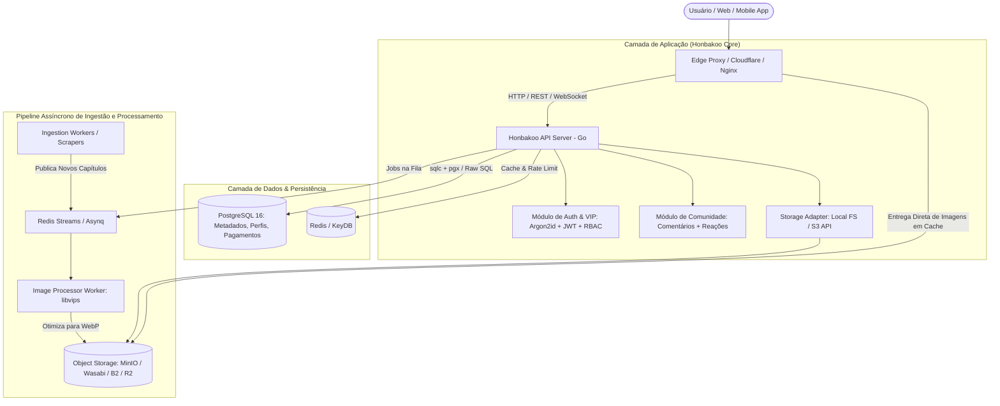

# 🏛️ Honbakoo Architecture & Engineering Specification

> **Honbakoo Engine**: Backend modular, headless e de altíssima performance para plataformas de mangá, doujinshi, manhwa e anime/h-anime, projetado para operar com custo mínimo de infraestrutura e zero atrito de instalação.

---

## 1. Visão Geral e Princípios de Design

A arquitetura do Honbakoo foi desenhada com base nos seguintes princípios fundamentais:

1. **Eficiência de Recursos (Low Footprint):** Capaz de rodar de forma suave em instâncias pequenas (ex: VPS de 1 vCPU e 1GB RAM) suportando milhares de requisições simultâneas.
2. **Zero Vendor Lock-in & 100% Self-Hostable:** Um comando (`docker compose up -d`) sobe toda a infraestrutura funcional para desenvolvimento ou produção.
3. **Sem ORM Pesado:** Uso de SQL nativo com **`sqlc`** (Type-safe SQL compiler). Queries SQL puras, validadas em tempo de compilação, com zero alocações desnecessárias ou overhead de reflexão em runtime.
4. **Desacoplamento Radical:** A API de metadados nunca serve binários pesados de imagens diretamente do seu processo principal. A entrega de arquivos é delegada para camadas de storage compatíveis com S3 (ou driver de filesystem local otimizado).
5. **Arquitetura Baseada em Conectores (Ingestão Modular):** Módulos de scraping/crawling isolados em workers desacoplados via mensageria, impedindo que instabilidades de sites de terceiros afetem a API de usuários.

---

## 2. Decisão Técnica: Linguagem e Ferramentas do Core

### 2.1 Por que **Go (Golang)** para o Core?

Comparado a Rust e linguagens dinâmicas, Go oferece a combinação ideal para o escopo do Honbakoo:

* **Ecossistema Comprovado:** Soluções maduras e robustas para autenticação segura (OAuth2, Argon2id, JWT rotativo), billing/webhooks (Stripe, cripto, pix) e rate-limiting distribuído.
* **Velocidade de Compilação e Manutenção:** Permite que qualquer desenvolvedor da comunidade clone o repositório, entenda o código e contribua sem a curva de aprendizado extrema de Rust.
* **Concorrência Nativa com Goroutines:** Excelente para gerenciar conexões WebSockets (comentários em tempo real, notificações) com consumo de apenas ~2KB por conexão.
* **Consumo de Memória:** Mantém a API ociosa em torno de 20MB a 45MB de RAM.

### 2.2 Stack de Tecnologias

| Domínio | Tecnologia / Ferramenta | Motivo da Escolha |
| :--- | :--- | :--- |
| **Linguagem Core** | **Go (Golang 1.22+)** | Alta concorrência, baixo consumo de RAM, compilação estática em binário único. |
| **Roteamento HTTP** | **chi** ou **Fiber** | Roteadores ultraleves e idiomáticos, sem dependências inchadas. |
| **Acesso a Banco** | **`sqlc` + `pgx`** | Sem ORM. SQL nativo compilado para código Go fortemente tipado e performático. |
| **Banco Principal** | **PostgreSQL 16+** | Suporte robusto a JSONB, índices Trigram (`pg_trgm`) para busca textual rápida sem exigir Elasticsearch inicial. |
| **Cache & Filas** | **Redis / Dragonfly / KeyDB** | Gerenciamento de sessões, contadores atômicos (views), rate limiting e filas de background. |
| **Processador de Imagens** | **libvips** (via wrapper Go `bimg`) | Conversão para WebP/AVIF até 8x mais rápida que ImageMagick, com 1/10 do consumo de RAM. |
| **Storage Abstraction** | **MinIO Go SDK / AWS S3 SDK** | Driver universal unificado para armazenamento local (MinIO/FS) e nuvens econômicas (Wasabi, Backblaze B2, Cloudflare R2). |
| **Testes de Carga / Ingestão** | **k6 (Grafana)** | Simulação realística de tráfego massivo, picos de leitura e concorrência de usuários em scripts declarativos. |

---

## 3. Diagrama Geral da Arquitetura



---

## 4. Módulos Críticos do Backend

### 4.1 Autenticação Segura e Gestão de Sessões
* **Hashing de Senhas:** `Argon2id` (resistente a ataques de força bruta e aceleração via GPU).
* **Estratégia de Tokens:**
  * `Access Token` (JWT stateless em memória, tempo de vida curto: ex. 15 minutos).
  * `Refresh Token` rotativo e revogável, armazenado no Redis com hash no banco relacional.
* **Fingerprint & Rate Limiting:** Proteção nativa contra brute-force em rotas sensíveis (`/login`, `/register`, `/comments`).

### 4.2 Sistema de Assinatura, VIP e Permissões (RBAC)
* Modelo de permissões granular:
  * Papéis: `Guest`, `User`, `VIP / Donator`, `Moderator`, `Admin`.
* **Capítulos e Conteúdo Exclusivo / Acesso Antecipado:**
  * Suporte nativo a trava temporal (ex: "capítulo disponível para VIPs por 48 horas antes da liberação pública").
  * Webhooks desacoplados para provedores de pagamento (Stripe, Pix, Cripto).

### 4.3 Sistema de Comunidade e Comentários de Alta Performance
* **Árvore de Comentários Otimizada:**
  * Uso de hierarquia relacional via `Materialized Path` ou `LTree` no PostgreSQL para recuperar threads completas em uma única query rápida, sem recursão pesada.
* **Anti-Spam & Moderação:**
  * Rate-limiting por reputação e filtros automatizados antes da persistência.
  * Notificações e atualizações em tempo real via WebSockets leves gerenciados por goroutines.

### 4.4 Processamento de Mídia & Imagens
* **Conversão On-Ingestion:**
  * Imagens brutas (JPEG/PNG) são processadas por workers em background com `libvips`.
  * Conversão imediata para **WebP** com compressão perceptual (qualidade ~80-85), gerando economia de até 70% de espaço em disco e tráfego.
  * Geração automática de thumbnails leves para listagens.

---

## 5. Simulação de Carga e Benchmark (Ingestão de Usuários)

Para garantir que o Honbakoo suporte picos reais em servidores de baixo custo, o repositório incluirá scripts padronizados de teste com **k6**:

1. **Smoke Test:** Validação rápida de saúde das rotas principais.
2. **Load Test:** Carga sustentada (ex: 1.000 usuários simultâneos lendo capítulos e comentando).
3. **Stress & Spike Test:** Picos repentinos de tráfego simulando o lançamento de um capítulo popular.

---

## 6. Estrutura do Monorepo Proposta

```text
honbakoo/
├── cmd/
│   ├── api/               # Ponto de entrada do servidor HTTP / WebSocket
│   ├── worker/            # Ponto de entrada dos workers assíncronos (mídia / ingestão)
│   └── cli/               # Utilitários de linha de comando e migrations
├── internal/
│   ├── auth/              # Lógica de login, tokens e segurança
│   ├── billing/           # Sistema VIP, assinaturas e webhooks
│   ├── community/         # Comentários, reações e feeds
│   ├── content/           # Mangás, capítulos, tags, metadados
│   ├── storage/           # Abstração de armazenamento (Local / S3)
│   └── database/          # Queries SQL nativas e código gerado pelo sqlc
├── migrations/            # Arquivos SQL puros de migração do banco
├── benchmarks/
│   └── k6/                # Scripts de teste de estresse e carga de usuários
├── docker-compose.yml     # Orquestração local em 1 comando
└── Makefile               # Comandos de atalho para build, lint e testes
```
