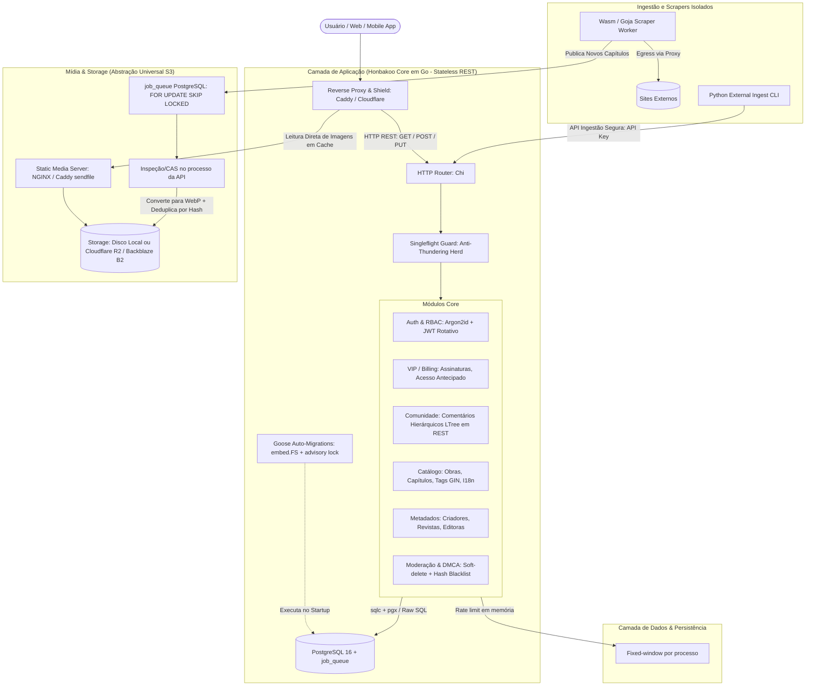

# 🏛️ Honbakoo Architecture & Engineering Specification

> **Honbakoo Engine**: Backend modular, headless e de altíssima performance para plataformas de mangá, doujinshi, manhwa e anime/h-anime, projetado para operar com custo mínimo (inclusive R$ 0,00 / budget mode) e zero atrito de instalação.

---

## 1. Visão Geral e Filosofia de Design

A arquitetura do Honbakoo foi desenhada para resolver os maiores problemas reais da indústria de entretenimento visual (alto volume de I/O, custos proibitivos de egress de banda, sobrecarga em banco de dados e instabilidade sob picos de tráfego), viabilizando operações tanto para quem tem **orçamento zero (VPS de 1 vCPU / 512MB-1GB RAM)** quanto para quem deseja **escalar horizontalmente**.

### Princípios Fundamentais:
1. **Zero-Friction Setup ("Clone & Play"):** Um único comando (`docker compose up -d`) inicializa todo o ecossistema pronto para uso local ou em produção.
2. **Single-Deployable por Papel com Migrations Automáticas (Goose + `embed.FS`):** A API (`cmd/api`) é compilada estaticamente (`CGO_ENABLED=0`); o worker de mídia (`cmd/worker`) usa `libvips` via CGO e roda em imagem própria. As migrações são embutidas no binário da API e aplicadas no startup sob *advisory lock* do PostgreSQL, sem ferramentas externas. "Single-binary" aqui significa **um deployable por papel**, não um único processo com todas as dependências nativas.
3. **Sem Conexões Persistentes Desnecessárias (Zero-WebSocket):** Eliminação de WebSockets para comentários. Todas as interações comunitárias usam **RESTful puro stateless com cache na borda (CDN)** e mutações otimistas no frontend, prevenindo esgotamento de descritores de arquivo (`ulimit`) e timeouts de CDN sob milhares de leitores simultâneos.
4. **Zero Vendor Lock-in & Dual-Profile:** Suporte nativo ao modo `budget` (100% autocontido, sem dependências externas pagas) e ao modo `scale` (S3 externo, CDNs distribuídas e proxies).
5. **Sem ORM Pesado (Zero Runtime Reflection):** Utilização estrita de SQL nativo compilado com **`sqlc` + `pgx`**. Queries validadas em tempo de compilação sem custos ocultos de CPU/RAM.
6. **Desacoplamento de Metadados vs. Mídia:** A API de dados nunca bloqueia o runtime para ler e servir arquivos pesados de imagem ou vídeo.
7. **Prevenção Ativa de Gargalos Clássicos:** Mídia content-addressed com `Cache-Control` imutável para absorver picos na borda, variantes best-effort para capas/previews, paginação keyset sem `OFFSET` e índices GIN/trigram para busca. Contagem de views usa eventos duráveis e rollup em lote (ver §8.2); cache de aplicação e `singleflight` são roadmap (ver §7.1 e §8.3).
8. **Benchmark Seletivo com Decisão Registrada:** Toda escolha nasce de "como o mercado resolve isso?" e é dividida em **o que copiar** e **o que não copiar**. As decisões vivem em [`DECISIONS.md`](./DECISIONS.md) e [`adr/`](./adr/), com o motivo da rejeição explícito — é isso que preserva a vantagem de custo e simplicidade.

### 1.1 O que copiamos e o que não copiamos

| Prática de mercado | Decisão | Racional |
| :--- | :--- | :--- |
| CDN + cache imutável | **Copiar** | Torna R2/zero-egress viável e absorve picos |
| URL assinada por imagem/usuário na CDN | **Não copiar** | Destrói a cache key da CDN; capability curta fica no manifesto e aponta para a API |
| Image slicing / DRM | **Não no MVP** | Custo de UX e infraestrutura; só com licenciamento |
| REST + OpenAPI 3.1 | **Copiar** | Contrato executável e clientes previsíveis |
| Cursor keyset opaco | **Copiar** | Estável sob escrita concorrente; sem `OFFSET` |
| GraphQL / WebSocket público | **Não copiar** | Complexidade de cache/autorização sem ganho no budget |
| Monolito modular | **Copiar** | Simplicidade operacional com fronteiras claras |
| Microservices / Kafka | **Não copiar** | Custo operacional incompatível com 1 VPS |
| Redis obrigatório | **Não** | O runtime usa `job_queue` no PostgreSQL; Redis/Asynq ficam como roadmap de scale, não como dependência |
| Postgres FTS + trigram | **Copiar** | Uma dependência a menos que Elasticsearch |
| ORM pesado | **Não copiar** | `sqlc` dá tipagem sem reflection em runtime |
| VIP como role permanente | **Não copiar** | Entitlement expira; role não |
| Ads / DRM como core | **Não copiar** | Modelo de negócio e UX diferentes; plugins/gatilho |
| Observabilidade + backup | **Copiar (P1)** | Sem isso não existe operação confiável |

> Matriz completa, critérios e gatilhos de revisão: [`DECISIONS.md`](./DECISIONS.md).
> Regra: se uma decisão não tem um "não copiamos" explícito, ela ainda não foi realmente discutida.

---

## 2. Decisão de Stack & Tecnologias

### 2.1 Por que **Go (Golang 1.22+)** no Core?

* **Eficiência sob Pouca RAM:** Uma API completa em Go consome entre **20MB e 45MB de RAM** em modo ocioso, permitindo rodar em servidores de \$3-\$4/mês sem risco de OOM (*Out Of Memory*).
* **Concorrência Leve com Goroutines:** Requisições HTTP concorrentes tratadas em milissegundos com stack memory inicial de apenas ~2KB.
* **Concorrência Nativa com Limites Explícitos:** `pgxpool` controla o número de conexões ao PostgreSQL; goroutines leves atendem requisições concorrentes sem threads por conexão. Deduplicação com `singleflight` é roadmap (§8.3).
* **Ecossistema Maduro de Segurança:** Suporte comprovado e auditado para `Argon2id` (hash de senhas resistente a GPUs), JWT rotativo, middlewares de rate limiting em memória e throttle de login durável no PostgreSQL.

### 2.2 Tabela de Componentes

| Domínio | Escolha Técnica | Alternativas Consideradas | Motivo da Decisão |
| :--- | :--- | :--- | :--- |
| **Linguagem** | **Go (Golang)** | Rust, Node.js, Python | Baixo consumo de RAM, compilação estática rápida, manutenção simples pela comunidade. |
| **Padrão de API** | **RESTful Stateless Puro** ([ADR-0005](./adr/0005-rest-openapi-erros-idempotencia.md)) | GraphQL, WebSockets, gRPC | 100% amigável para cache HTTP em CDNs de borda (Cloudflare Free), zero risco de esgotar conexões TCP persistentes. |
| **Identificadores** | **UUIDv7** | UUIDv4, Auto-increment | Ordenação cronológica, não fragmenta índices B-Tree no PostgreSQL e não vaza números sequenciais. |
| **Ferramenta de Migrations** | **Goose (`pressly/goose`)** ([ADR-0011](./adr/0011-operacao-observabilidade-backup-ci.md)) | `golang-migrate`, Atlas | Suporte a `embed.FS` (migrations embutidas no binário único Go), `down` e suporte híbrido (SQL puro + lógica Go se necessária). |
| **Camada de Banco** | **`sqlc` + `pgx`** ([ADR-0006](./adr/0006-postgres-sqlc-busca.md)) | GORM, Ent, Prisma | **Sem ORM**. SQL nativo compilado para structs Go estáticas. Performance máxima e queries transparentes. |
| **Banco Relacional**| **PostgreSQL 16+** ([ADR-0006](./adr/0006-postgres-sqlc-busca.md)) | MySQL, SQLite, MongoDB | Suporte avançado a índices GIN (para tags booleanas ultra-rápidas), `tsvector` e trigramas (`pg_trgm`/`unaccent`) para busca textual de títulos. |
| **Cache & Buffers** | **Sem cache de aplicação; mídia imutável cacheada na borda/CDN** ([ADR-0007](./adr/0007-cache-fila-rate-limit.md)) | Memcached, Redis | O MVP consulta o PostgreSQL diretamente. Cache compartilhado é roadmap; views usam eventos duráveis no PostgreSQL (§8.2), não buffer em memória. A mídia content-addressed dispensa cache de objeto no servidor. |
| **Processamento Img**| **Client-Side + libvips (worker)** ([ADR-0010](./adr/0010-uploads-ingestao-cas.md)) | ImageMagick, PIL | Otimização pré-upload no navegador poupa banda e CPU; `libvips` roda apenas no `cmd/worker` (CGO + imagem com libvips), com `vips_concurrency_set(1)` no perfil budget. |
| **Abstração Storage** | **Local FS / Cloudflare R2** ([ADR-0001](./adr/0001-midia-content-addressed-cdn.md), [ADR-0010](./adr/0010-uploads-ingestao-cas.md)) | Wasabi, AWS S3, Cloudinary | Abstração universal compatível com S3. Modo `budget` usa disco local; modo nuvem usa Cloudflare R2 com **tráfego de saída 100% gratuito (Zero Egress)**. |
| **Reverse Proxy / SSL**| **Caddy** ou **NGINX** | Traefik, Apache | 100% gratuitos e open source. Caddy gera certificados HTTPS automáticos via Let's Encrypt com zero esforço. |
| **Edge / Proteção** | **Cloudflare (Free) / Tunnels** | DDoS-Guard | Opcional e sem custo. O `cloudflared` esconde o IP da VPS sem precisar abrir portas ou expor dados pessoais. |
| **Testes de Carga** | **k6 (Grafana)** | Apache Bench, Locust | Scripts declarativos em JS para simular picos de tráfego, leitores e comentários simultâneos. |

---

## 3. Diagrama de Arquitetura



---

## 4. Otimizações de Banco de Dados: Sistema de Tags e Metadados (Estilo NHentai)

Em plataformas de entretenimento visual adulto e mangá, os usuários realizam buscas com filtros booleanos complexos (ex: `+color -lolicon artist:"shindol" language:portuguese tag:"mind break"`). 

Fazer múltiplos `JOINs` relacionais clássicos degrada a performance do banco sob alta concorrência. O Honbakoo adota a modelagem de alta escala:

### 4.1 Modelagem com Índice GIN (Generalized Inverted Index)
1. **Tabela Canônica de Tags (`tags`) & Localização (`tag_localizations`):**
   * Metadados canônicos universais com slugs únicos e traduções estruturadas por idioma (`name`, `description`).
2. **Vetor de Tags na Obra (`mangas`):**
   * A tabela de obras mantém uma coluna indexada `tag_ids INT[]`.
   * Um índice **GIN** é criado sobre essa coluna:
     ```sql
     CREATE INDEX idx_mangas_tag_ids ON mangas USING GIN (tag_ids);
     ```
3. **Execução de Busca Instantânea:**
   * **Contém todas (+tag1 +tag2):** `WHERE tag_ids @> ARRAY[12, 45]`
   * **Contém qualquer uma (+tag1 OR +tag2):** `WHERE tag_ids && ARRAY[12, 45]`
   * **Excluir (-tag3):** `WHERE NOT (tag_ids @> ARRAY[99])`
   * Executa filtros de inclusão via GIN em poucos milissegundos; exclusão (`NOT @>`) é pós-filtro e pode custar mais. Metas de p95 devem ser medidas com `EXPLAIN (ANALYZE, BUFFERS)` — não prometemos "sub-milissegundo" para qualquer combinação de filtros + sort.

---

## 5. Estratégia de Upload, Ingestão e Processamento de Mídia ([ADR-0010](./adr/0010-uploads-ingestao-cas.md))

### 5.1 Otimização Client-Side (Economia de Banda e CPU)
* **Processamento no Navegador/App:** Antes do upload de um capítulo de 50 a 100 páginas, o cliente web comprime as imagens para WebP utilizando Canvas API nativa ou WebAssembly.
* **Benefícios:**
  * O tamanho do payload de upload do usuário é reduzido em até 80%.
  * O servidor economiza ciclos pesados de CPU, não precisando reprocessar centenas de imagens simultaneamente.

### 5.2 Validação e Limites Rígidos no Backend (Defesa contra Bombas de Descompressão)
* **Validação dos Primeiros 32 Bytes (Magic Bytes e Dimensões):** Antes de enviar o stream para o `libvips`, a aplicação inspeciona o cabeçalho.
  * Se `byte_size > 50MB` (constante `storage.MaxMediaUploadBytes`, não configurável), o upload é abortado imediatamente (`413 Payload Too Large`).
  * Se `width * height > 50_000_000` (50 Megapixels, constante `media.MaxMegapixels`), o arquivo é sumariamente rejeitado para evitar **Pixel Flood Attack / Zip Bomb** que causaria estouro de RAM (OOM) no servidor.
* **Semáforo Estrito de Processamento de Imagens (Concurrency Limiter):**
  * No perfil `budget`, o worker de conversão `libvips` é limitado a concorrência **1** (1 imagem por vez), com `nice -n 19` (prioridade mínima de CPU). Isso impede que uploads paralelos travem a CPU em 100% e derrubem a API de leitura.
* **Quarentena de Uploads Órfãos (Garbage Collection):**
  * Slots de upload abertos cujas mídias não forem vinculadas a nenhum capítulo publicado em até **2 horas** são automaticamente purgados do storage para evitar esgotamento de disco por flood de lixo.

### 5.3 Arquitetura de Scrapers Híbrida
* **Scrapers Leves no Servidor (WASM / JS Sandboxed via Goja):**
  * Para rodar dentro do próprio host com consumo ínfimo de memória, os conectores de sites externos rodam em WebAssembly ou scripts leves interpretados em sandbox no Go (via `goja`).
* **Scrapers Externos em Python (Ingestão Local do Administrador):**
  * Scrapers complexos (Selenium, navegadores headless, proxies rotativos) rodam na máquina pessoal do administrador.
  * O script em Python extrai os dados e importa as páginas via `POST /api/v1/editorial/chapters/{id}/pages/import` (1–50 URLs por chamada, com teto agregado de 512 MiB) usando `X-API-Key` ou Bearer. O cliente HTTP é compartilhado e aplica anti-SSRF (bloqueio de IP privado/loopback/metadata) em cada URL; conectores dedicados de ingestão ainda são roadmap.
  * A chave vive em `api_keys` com hash, escopo `ingest`, expiração e revogação; o ator e o `request_id` entram em `audit_log` ([ADR-0014](./adr/0014-api-keys-automacao.md)).

---

## 6. Sistema de Moderação e DMCA "Zero Pânico" ([ADR-0012](./adr/0012-modelo-negocio-vip-sem-ads-drm.md))

1. **Soft-Delete Imediato (`is_dmca_blocked`):**
   * Uma obra ou capítulo pode ter o status alterado instantaneamente para `is_dmca_blocked = TRUE` via painel ou `POST /admin/dmca/block`.
   * O conteúdo deixa de ser servido imediatamente para o público sem quebrar a integridade referencial do banco de dados ou histórico de transações.
2. **Blacklist de Hashes SHA-256:**
   * Quando uma mídia é removida por DMCA, o hash criptográfico dos arquivos é registrado na tabela `blocked_media_hashes`.
   * Se um scraper ou usuário tentar re-enviar a mesma obra no futuro, a ingestão é rejeitada automaticamente antes de salvar no disco.

---

## 7. Otimizações Críticas para Ambientes de Baixo Custo (Budget Mode)

Para garantir que uma pessoa consiga rodar o Honbakoo em uma máquina de \$3/mês (ou até em um PC antigo/Raspberry Pi) com fluidez:

### 7.1 O Perfil Dual no `.env` ([ADR-0003](./adr/0003-perfil-dual-budget-scale.md))
O sistema se autoconfigura a partir da variável `HONBAKOO__SERVER__PROFILE`. A regra é: **nenhuma dependência paga ou pesada é obrigatória no budget**.

| Capacidade | Implementado hoje (ambos perfis) | Alvo `scale` (roadmap) |
| :--- | :--- | :--- |
| **Cache de aplicação** | Nenhum; mídia imutável cacheada na borda/CDN | Cache compartilhado |
| **Fila de jobs** | `job_queue` durável no PostgreSQL (`FOR UPDATE SKIP LOCKED`) | Mesma fila + workers dedicados |
| **Views** | Evento durável por leitor/capítulo/dia + rollup em lote no PostgreSQL | Mesmo desenho; workers dedicados |
| **Storage** | Local (`sendfile`) ou S3/R2/B2 via `HONBAKOO__STORAGE__BACKEND` | S3/R2/B2 |
| **Rate limit** | Fixed-window em memória + throttle de login durável no PostgreSQL | Compartilhado na borda/Redis |
| **Mídia** | Inspeção de header + CAS no processo da API | Workers distribuídos com `libvips` |

> **Estado real (2026-11-12):** `HONBAKOO__SERVER__PROFILE` é hoje informativo (aparece no `/api/v1/config` e na telemetria) e não troca implementações. A seleção de storage é feita por `HONBAKOO__STORAGE__BACKEND`; a fila é sempre PostgreSQL; não há Redis/Asynq nem cache de aplicação. Views são contabilizadas por eventos no PostgreSQL (§8.2), variantes de mídia são geradas pelo worker (§8.5) e o lock de login é durável (§8.6).

* **`PROFILE=budget` (Padrão):**
  * Salva imagens diretamente no disco local (sem S3).
  * Serve arquivos estáticos via Caddy/NGINX com `sendfile`.
  * PostgreSQL tunado para no máximo 150MB (`shared_buffers = 128MB`), `work_mem = 4MB`, `max_connections = 20`.
* **`PROFILE=scale`:**
  * Use `HONBAKOO__STORAGE__BACKEND=s3` apontando para **Cloudflare R2** (zero egress) ou **Backblaze B2**.
  * A API é stateless e pode rodar em N réplicas; todas compartilham PostgreSQL, `job_queue` e o bucket.

### 7.2 Eliminação de Custos de Banda (Zero Egress com Cloudflare R2 e Cache)
* **Cloudflare R2:** Oferece 10GB de storage grátis e **taxa zero de egress (tráfego de saída ilimitado gratuito)**. Elimina o maior gargalo financeiro de plataformas de leitura.
* **Cache Imutável no Navegador do Leitor:**
  * Toda **imagem de página** (content-addressed) é servida com os headers:
    ```http
    Cache-Control: public, max-age=31536000, immutable
    ```
  * Se o leitor reler ou navegar pelas páginas do capítulo, 0 bytes saem do servidor — a imagem carrega instantaneamente da memória do dispositivo do leitor.

### 7.3 Vídeo sem Sobrecarga de CPU (Remux & HTTP Range Requests)
* Em servidores fracos, rodar transcodificação contínua com FFmpeg trava a CPU em 100%.
* **Solução:** O Honbakoo suporta **HTTP Range Requests (Status 206 Partial Content)** sobre arquivos MP4 com `moov atom` no início (*FastStart*). O leitor de vídeo pode pausar, pular e carregar trechos sob demanda sem necessidade de reprocessar o vídeo no servidor.

### 7.4 Cloudflare Tunnels (Zero Port Forwarding & Proteção de IP Gratuita)
* O usuário pode rodar o container oficial `cloudflared` (100% gratuito).
* A máquina se conecta via túnel criptografado de saída à rede da Cloudflare.
* **Benefícios:** Não precisa de IP fixo, não precisa abrir portas no roteador/firewall e o IP real da hospedagem fica completamente invisível contra ataques.

---

## 8. Resolução de Gargalos Clássicos da Indústria

### 8.1 Proteção contra Hot-Linking sem Matar o Cache de CDN ([ADR-0001](./adr/0001-midia-content-addressed-cdn.md))
* **Mídia é content-addressed e pública:** cada arquivo é servido em `/uploads/media/{sha256}.{ext}` no backend local (ou em `S3_PUBLIC_URL/media/...` no S3, com sharding por prefixo do hash) com `Cache-Control: public, max-age=31536000, immutable`. O hash de 256 bits funciona como capability: é impossível adivinhar a URL, e o cache de borda atinge >90% de hit ratio. Variantes `thumb` e `preview` usam os mesmos headers e chaves derivadas do hash (`...-thumb.jpg`).
* **Controle de acesso fica no manifesto, não na imagem:** `GET /chapters/:id/pages` é `private, no-store`, aplica a checagem de entitlement (VIP/early access) e devolve cada página com `url`, `access` (`cdn`, `protected` ou `unavailable`) e metadados. Página pública aponta para a CDN e inclui `storage_key` + variantes; página NSFW/VIP/early-access aponta para `/api/v1/chapters/{id}/pages/{page}/media?token=<capability>`, omite `storage_key` e variantes, e a API faz o stream com `Cache-Control: private, no-store`. A capability é um HMAC de 10 minutos vinculado a capítulo, página, leitor e flags de entitlement; ela existe porque `` não envia `Authorization`, não é um JWT longo e nunca é usada na CDN. URLs assinadas por imagem na CDN continuam fora do escopo: destruiriam o cache key e o hit ratio.
* **Bloqueio de Referer na aplicação:** com `HONBAKOO__STORAGE__HOTLINK_PROTECTION=true`, o backend local rejeita `Referer` de host diferente de `SERVER__PUBLIC_URL`. Cabeçalhos `Cross-Origin-Resource-Policy`, regras de WAF e cache ficam a cargo do proxy/CDN. Isso é fricção contra hotlink, não autorização.
* **Por que não token por IP/sessão:** token único por leitor destrói o cache key da CDN e transforma cada imagem em um miss. O modelo anterior contradizia a estratégia de R2 + cache imutável.

### 8.2 Contagem de Views por Eventos + Rollup em Lote ([ADR-0007](./adr/0007-cache-fila-rate-limit.md))
* **Caminho de leitura:** ao abrir o reader com sucesso, a API insere um evento em `chapter_view_events(chapter_id, viewer_key, day)`. O insert é `INSERT ... ON CONFLICT DO NOTHING` e tem timeout curto; falha de analytics nunca transforma um leitor válido em `5xx`.
* **Deduplicação:** a unique `(chapter_id, viewer_key, day)` conta no máximo uma view por leitor, capítulo e dia. Usuário autenticado usa `u:<user_id>`; anônimo usa HMAC-SHA256 de IP + User-Agent + dia, sem persistir IP bruto. O HMAC usa o segredo JWT da instância.
* **Rollup:** o worker roda a cada 30 segundos, trava um lote com `FOR UPDATE SKIP LOCKED`, agrega por capítulo e por `(manga, dia)`, faz `UPSERT` em `manga_view_daily`, incrementa `chapters.views_count` e `mangas.views_all_time`, recalcula `views_daily/weekly/monthly` e marca os eventos como processados **na mesma transação**. Os três passos de escrita são set-based (arrays + `generate_subscripts`), então um lote de 500 eventos custa três statements, não milhares. Retry e múltiplas réplicas não duplicam contagem.
* **Janelas e retenção:** `views_daily` é o dia UTC atual, `weekly` são 7 dias e `monthly` 30 dias, sempre derivados de `manga_view_daily`. Um refresh global a cada 15 minutos corrige a virada do dia para obras sem leitura recente. Eventos processados são removidos após 2 dias.
* **Por que não `UPDATE mangas SET views = views + 1` por request:** isso cria contenção na mesma linha quente, gera WAL por leitura e perde deduplicação. O evento é distribuído pelo `viewer_key`; a linha diária só é tocada em lote.

### 8.3 Anti-Thundering Herd — roadmap, não implementado ([ADR-0007](./adr/0007-cache-fila-rate-limit.md))
* **Estado atual:** não há `singleflight` nem cache de resposta; cada requisição consulta o PostgreSQL.
* Alvo: dentro de cada processo, `singleflight` faria apenas uma consulta ao banco e compartilharia o resultado entre as requisições concorrentes.
* Com N réplicas isso ainda geraria N consultas; a mitigação planejada é cache compartilhado de TTL curto (5–30s) + jitter, nunca aplicado a respostas personalizadas.

### 8.4 Deduplicação de Imagens via Hash (Economia de até 40% de Disco) ([ADR-0010](./adr/0010-uploads-ingestao-cas.md))
* Imagens repetidas (avisos de scanlators, créditos, capas idênticas) são analisadas por SHA-256 antes do salvamento.
* Se a imagem já existe, apenas uma referência em `chapter_pages` é criada. `media_objects.ref_count` é incrementado; um job de GC remove objetos com `ref_count = 0` e arquivos órfãos após um período de carência.
* O hash do cliente é apenas uma dica de deduplicação: o servidor **sempre** recalcula o SHA-256 após o upload antes de confirmar o objeto.

### 8.5 Variantes de mídia sem pipeline externo
* **Problema:** servir a página original é aceitável para leitura em tela cheia, mas capas e cards baixam arquivos grandes; um pipeline libvips obrigatório quebraria o perfil `budget`.
* **Solução:** o worker gera variantes best-effort em Go puro, sem CGO: `thumb` (320px de largura) e `preview` (1280×4096). A geração roda a cada 2 minutos em lotes de 50, fora do request de upload.
* **Limites de memória:** só processa originais até 24 MP e 20 MB; acima disso a mídia é marcada como `skipped` em `media_objects.variants`. Imagens já menores que a largura alvo não geram variante.
* **Contrato:** `variants` é JSONB em `media_objects` e só é exposto no manifesto para páginas `cdn`. Páginas protegidas nunca revelam a chave do objeto nem variantes.
* **Trade-off:** é um gerador conservador para capas e previews, não substitui CDN Image Resizing ou libvips. Se o volume de páginas justificar, o mesmo contrato aceita um worker dedicado sem mudar a API. O GC de mídia órfã remove o original **e** as chaves de variantes retornadas em `media_objects.variants`.

### 8.6 Throttle de credenciais durável
* **Por que não só memória:** um atacante distribuído entre réplicas ou um restart zera o fixed-window local. O limite em memória continua como primeira camada, mas o lock de login precisa sobreviver ao processo.
* **Chave sem PII:** `HMAC-SHA256(JWT_SECRET, ip + NUL + email)` em `auth_login_throttles.key_hash`. IP e e-mail em claro não são persistidos.
* **Política:** 10 falhas em 15 minutos bloqueiam a chave por 15 minutos; login bem-sucedido limpa a linha; `ErrUserBanned` também limpa. O lock é checado antes do Argon2 para não gastar CPU com credenciais já bloqueadas.
* **Falha do banco:** o throttle é fail-open com log de warning. Um incidente no PostgreSQL não pode impedir todo login; o rate limit em memória e a borda continuam ativos.
* **Escopo:** é um limite por IP + conta, não um limite global por IP. Limite global distribuído continua exigindo edge/WAF ou Redis (P2).

---

## 9. Simulação de Carga e Benchmark (k6) ([ADR-0011](./adr/0011-operacao-observabilidade-backup-ci.md))

O repositório inclui suítes padronizadas de testes com **k6 (Grafana)** na pasta `benchmarks/k6/`:

1. **`smoke-test.js`:** Validação de estabilidade com pouca carga (5 a 10 VUs - Virtual Users).
2. **`reader-load-test.js`:** Simulação de 500 a 2.000 leitores simultâneos folheando capítulos página a página.
3. **`spike-test.js`:** Disparo repentino de carga (ex: 0 a 3.000 usuários em 10 segundos) para validar latência do catálogo/reader, pool do PostgreSQL e rate limiter.

---

## 10. Estrutura Proposta do Repositório ([ADR-0004](./adr/0004-monolito-modular-deployable-por-papel.md))

```text
honbakoo/
├── cmd/
│   ├── api/               # Servidor HTTP REST Stateless (Go)
│   ├── worker/            # Workers de imagem (libvips), views e background jobs
│   └── cli/               # Comandos de setup, seed e migrations
├── internal/
│   ├── auth/              # Argon2id, JWT rotativo e RBAC
│   ├── billing/           # Sistema VIP, assinaturas e webhooks
│   ├── community/         # Comentários (LTree) em REST puro
│   ├── content/           # Catálogo: obras, capítulos, tags (GIN), criadores, revistas
│   ├── storage/           # Abstração de armazenamento (Local FS / S3 API: Cloudflare R2 / B2)
│   ├── moderation/        # Soft-delete DMCA e blacklist de hashes
│   ├── platform/          # Config, logging, telemetry, health, graceful shutdown
│   ├── queue/             # Fila durável no PostgreSQL (FOR UPDATE SKIP LOCKED)
│   ├── search/            # Busca textual (tsvector/trigram/pg_bigm)
│   ├── auth/ratelimit     # Fixed-window em memória por processo (Redis é roadmap)
│   ├── singleflight/      # Roadmap: deduplicação de requisições concorrentes
│   └── database/          # Queries SQL nativas e código gerado pelo sqlc
├── api/
│   └── openapi.yaml       # Contrato OpenAPI 3.1 (fonte de verdade)
├── migrations/            # Migrações versionadas em SQL puro gerenciadas pelo Goose (embed.FS)
├── deploy/
│   ├── caddy/             # Caddyfile com HTTPS automático e headers de cache
│   └── postgres/          # postgresql.conf tunado para perfil budget (512MB-1GB)
├── benchmarks/
│   └── k6/                # Scripts de estresse e teste de carga
├── docker-compose.yml     # Orquestrador local pronto (1 comando)
├── .env.example           # Configurações claras com perfis 'budget' e 'scale'
└── Makefile               # Comandos rápidos: build, test, migrate, run
```

---

## 11. Registro de Decisões (ADRs)

Este documento descreve **o que** o sistema faz; os ADRs registram **por que** cada escolha existe e **o que foi deliberadamente rejeitado**.

* Índice e matriz de mercado: [`DECISIONS.md`](./DECISIONS.md)
* Decisões individuais: [`adr/`](./adr/)
* Regra de ouro: nenhuma prática de mercado entra sem responder "o que copiamos?" e "o que não copiamos?".

Os ADRs são a fonte de verdade para mudanças futuras: se o código precisar divergir do documento, o ADR é atualizado primeiro.

---

## 12. Operação, Segurança e Qualidade

A arquitetura define o desenho; os documentos abaixo definem como operá-lo sem improviso:

| Documento | Cobre |
| :--- | :--- |
| [`SECURITY.md`](./SECURITY.md) | modelo de ameaça, auth, API keys, upload, borda, segredos |
| [`OPERATIONS.md`](./OPERATIONS.md) | topologia, config, migrations, métricas, SLOs, backup, runbooks |
| [`TESTING.md`](./TESTING.md) | unit, integração, contrato, E2E, k6 e gates de CI |
| [`ROADMAP.md`](./ROADMAP.md) | P0/P1/P2 com critérios de aceite |
| [`adr/0015`](./adr/0015-retencao-lgpd-ciclo-de-vida.md) | retenção, LGPD, DMCA e ciclo de vida de dados |

Regra: nenhum item P1 entra em produção sem cumprir o critério de aceite do roadmap e o checklist de release da segurança.
