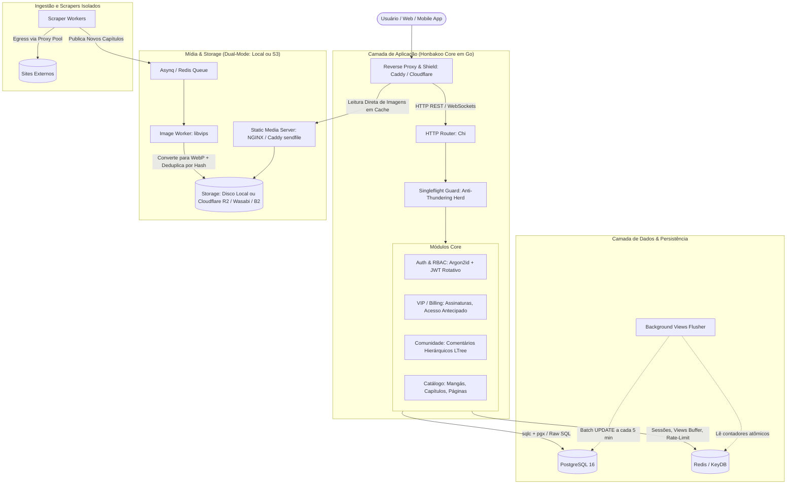

# 🏛️ Honbakoo Architecture & Engineering Specification

> **Honbakoo Engine**: Backend modular, headless e de altíssima performance para plataformas de mangá, doujinshi, manhwa e anime/h-anime, projetado para operar com custo mínimo (inclusive R$ 0,00 / budget mode) e zero atrito de instalação.

---

## 1. Visão Geral e Filosofia de Design

A arquitetura do Honbakoo foi desenhada para resolver os maiores problemas reais da indústria de entretenimento visual (alto consumo de I/O, custos proibitivos de egress de banda e instabilidade sob picos de tráfego), viabilizando operações tanto para quem tem **orçamento zero (VPS de 1 vCPU / 512MB-1GB RAM)** quanto para quem deseja **escalar horizontalmente**.

### Princípios Fundamentais:
1. **Zero-Friction Setup ("Clone & Play"):** Um único comando (`docker compose up -d`) inicializa todo o ecossistema pronto para uso local ou em produção.
2. **Zero Vendor Lock-in & Dual-Profile:** Suporte nativo ao modo `budget` (100% autocontido, sem dependências externas pagas) e ao modo `scale` (S3 externo, CDNs distribuídas e proxies).
3. **Sem ORM Pesado (Zero Runtime Reflection):** Utilização estrita de SQL nativo compilado com **`sqlc` + `pgx`**. Queries em tempo de compilação sem custos ocultos de CPU/RAM.
4. **Desacoplamento de Metadados vs. Mídia:** A API de dados nunca bloqueia o runtime para ler e servir arquivos pesados de imagem ou vídeo.
5. **Prevenção Ativa de Gargalos Clássicos:** Proteção contra *Hot-linking*, *Cache Stampede / Thundering Herd* via `singleflight`, e *Database Locking* por contagem de views via buffer no Redis.

---

## 2. Decisão de Stack & Tecnologias

### 2.1 Por que **Go (Golang 1.22+)** no Core?

* **Eficiência sob Pouca RAM:** Uma API completa em Go consome entre **20MB e 45MB de RAM** em modo ocioso, permitindo rodar em servidores de \$3-\$4/mês sem risco de OOM (*Out Of Memory*).
* **Concorrência Leve com Goroutines:** Cada conexão HTTP ou WebSocket custa apenas ~2KB de stack memory inicial, viabilizando milhares de leitores simultâneos.
* **Ferramental Nativo de Concorrência:** O pacote `golang.org/x/sync/singleflight` elimina requisições duplicadas simultâneas ao banco de dados em picos de lançamento.
* **Ecossistema Maduro de Segurança:** Suporte comprovado e auditado para `Argon2id` (hash de senhas resistente a GPUs), JWT rotativo e middlewares de rate limiting.

### 2.2 Tabela de Componentes

| Domínio | Escolha Técnica | Alternativas Consideradas | Motivo da Decisão |
| :--- | :--- | :--- | :--- |
| **Linguagem** | **Go (Golang)** | Rust, Node.js, Python | Baixo consumo de RAM, compilação estática rápida, manutenção simples pela comunidade. |
| **Roteador HTTP** | **chi** ou **Fiber** | Gin, Echo | Ultraleves, padrão idiomático `net/http` e mínimo consumo de alocações de memória. |
| **Camada de Banco** | **`sqlc` + `pgx`** | GORM, Ent, Prisma | **Sem ORM**. SQL nativo compilado para structs Go estáticas. Performance máxima e queries transparentes. |
| **Banco Relacional**| **PostgreSQL 16+** | MySQL, SQLite, MongoDB | Suporte avançado a JSONB, índices de trigrama (`pg_trgm`) para busca textual rápida sem custo de Elasticsearch. |
| **Cache & Buffers** | **Redis / KeyDB** | Memcached | Suporte a estruturas de dados atômicas (`INCR`, `HSET`, Streams) e expiração configurável. |
| **Processamento Img**| **libvips** (`bimg`) | ImageMagick, PIL | Até 8x mais rápida e usa 1/10 da RAM do ImageMagick. Conversão nativa para WebP. |
| **Reverse Proxy / SSL**| **Caddy** ou **NGINX** | Traefik, Apache | 100% gratuitos e open source. Caddy gera certificados HTTPS automáticos via Let's Encrypt com zero esforço. |
| **Edge / Proteção** | **Cloudflare (Free) / Tunnels** | DDoS-Guard | Opcional e sem custo. O `cloudflared` esconde o IP da VPS sem precisar abrir portas ou expor dados pessoais. |
| **Testes de Carga** | **k6 (Grafana)** | Apache Bench, Locust | Scripts declarativos em JS para simular picos de tráfego, leitores e comentários simultâneos. |

---

## 3. Diagrama de Arquitetura



---

## 4. Otimizações Críticas para Ambientes de Baixo Custo (Zero / Low-Budget)

Para garantir que uma pessoa consiga rodar o Honbakoo em uma máquina de \$3/mês (ou até em um PC antigo/Raspberry Pi) com fluidez:

### 4.1 O Perfil Dual no `.env`
O sistema se autoconfigura a partir da variável `HONBAKOO_PROFILE`:
* **`PROFILE=budget` (Padrão):**
  * Salva imagens diretamente no disco local (sem necessidade de contratar S3).
  * Serve arquivos estáticos via Caddy/NGINX com a syscall `sendfile` do Linux (leitura de disco direto para a placa de rede sem tocar na CPU do Go).
  * PostgreSQL tunado para operar consumindo no máximo 150MB de RAM (`shared_buffers = 128MB`).
* **`PROFILE=scale`:**
  * Habilita driver S3 (Wasabi, Backblaze B2, AWS ou Cloudflare R2).
  * Habilita distribuição de workers em nós separados.

### 4.2 Eliminação de Custos de Banda (Zero Egress com Cloudflare R2 e Cache)
* **Cloudflare R2:** Oferece 10GB de storage grátis e **taxa zero de egress (tráfego de saída ilimitado gratuito)**. Ideal para quem quer storage em nuvem sem pagar por gigabyte baixado.
* **Cache Imutável no Navegador do Leitor:**
  * Todo capítulo servido acompanha os headers:
    ```http
    Cache-Control: public, max-age=31536000, immutable
    ETag: "hash-sha256-da-pagina"
    ```
  * Se o leitor reler ou navegar pelas páginas do capítulo, 0 bytes saem do servidor — a imagem carrega instantaneamente da memória do dispositivo do leitor.

### 4.3 Vídeo sem Sobrecarga de CPU (Remux & HTTP Range Requests)
* Em servidores fracos, rodar transcodificação com FFmpeg trava a CPU em 100%.
* **Solução:** O Honbakoo suporta **HTTP Range Requests (Status 206 Partial Content)** sobre arquivos MP4 com `moov atom` no início (*FastStart*). O leitor de vídeo pode pausar, pular e carregar trechos sob demanda sem necessidade de reprocessar o vídeo no servidor.

### 4.4 Cloudflare Tunnels (Zero Port Forwarding & Proteção de IP Gratuita)
* O usuário pode rodar o container oficial `cloudflared` (100% gratuito).
* A máquina se conecta via túnel criptografado de saída à rede da Cloudflare.
* **Benefícios:** Não precisa de IP fixo, não precisa abrir portas no roteador/firewall e o IP real da hospedagem fica completamente invisível contra ataques.

---

## 5. Resolução de Gargalos Clássicos da Indústria

### 5.1 Proteção contra Hot-Linking (Roubo de Banda)
* Outros sites e bots frequentemente tentam embutir as imagens dos leitores em suas próprias páginas.
* **Mitigação:** 
  1. **URLs Assinadas via HMAC com Expiração:** Cada link de imagem gerado pela API possui um token temporário com validade (ex: 2 horas) baseado no IP/Sessão do leitor.
  2. **Bloqueio de Referer:** NGINX/Caddy rejeita requisições onde o cabeçalho `Referer` não pertença aos domínios autorizados.

### 5.2 Buffer Atômico de Views (Prevenção de Database Lock)
* Em vez de executar `UPDATE mangas SET views = views + 1` a cada requisição (o que causa filas de *row locks* e derruba o PostgreSQL):
* A API executa `INCR manga:views:{id}` no Redis (operação em memória que dura ~0.05ms).
* Um worker periódico (ex: a cada 5 minutos) lê esses contadores e faz um único `UPDATE` em lote (*batch*) no PostgreSQL.

### 5.3 Anti-Thundering Herd com `singleflight`
* Quando um capítulo muito aguardado é lançado e centenas de leitores abrem a página no mesmo segundo:
* Em sistemas comuns, 1.000 requisições simultâneas batem no banco de dados para buscar os mesmos metadados.
* Com `singleflight` em Go, o backend executa apenas **uma única consulta ao banco**; as outras 999 requisições aguardam a resposta da primeira e compartilham o mesmo resultado em memória.

### 5.4 Deduplicação de Imagens via Hash (Economia de até 40% de Disco)
* Imagens repetidas (como páginas de avisos de scanlators, créditos ou capas idênticas de diferentes fontes) são analisadas por seu hash SHA-256 antes do salvamento.
* Se a imagem já existe no storage, apenas uma referência na tabela `chapter_pages` é criada, economizando gigabytes de armazenamento.

---

## 6. Módulos Funcionais do Backend

### 6.1 Autenticação Segura & RBAC
* **Hash de Senhas:** `Argon2id` com parâmetros balanceados para segurança e eficiência.
* **Sessões:** Access Token em memória (JWT com rotação de chaves) e Refresh Token seguro com revogação instantânea via Redis.
* **Papéis (RBAC):**
  * `guest`: Leitura pública, sem permissão para comentários.
  * `user`: Favoritos, histórico, comentários e reações.
  * `vip`: Acesso antecipado a capítulos travados por tempo, sem anúncios/limites.
  * `moderator`: Gestão de comentários, denúncias e conteúdo.
  * `admin`: Controle total do sistema e integrações.

### 6.2 Sistema de Comunidade (Comentários de Alta Performance)
* **Estrutura de Threads:** Implementado via **`Materialized Path` / `LTree`** no PostgreSQL. Permite carregar árvores inteiras de respostas com ordenação em uma única query SQL indexada, sem recursão pesada.
* **Anti-Spam:** Rate-limiting individual por usuário e validação de reputação antes de permitir postagens contínuas.

### 6.3 Ingestão Modular (Scrapers e Connectors)
* O core da API é completamente desacoplado dos scrapers.
* Scrapers rodam como workers independentes consumindo uma interface padronizada:
  * `Search(query, filters)`
  * `GetDetails(id)`
  * `GetChapters(id)`
  * `DownloadPages(chapterId)`
* Suporte a pools de proxies rotativos no worker de ingestão para evitar banimentos de IP da máquina principal.

---

## 7. Simulação de Carga e Benchmark (k6)

O repositório inclui suítes padronizadas de testes com **k6 (Grafana)** na pasta `benchmarks/k6/`:

1. **`smoke-test.js`:** Validação de estabilidade com pouca carga (5 a 10 VUs - Virtual Users).
2. **`reader-load-test.js`:** Simulação de 500 a 2.000 leitores simultâneos folheando capítulos página a página.
3. **`spike-test.js`:** Disparo repentino de carga (ex: 0 a 3.000 usuários em 10 segundos) para validar o comportamento do `singleflight`, do buffer de views e do rate limiter.

---

## 8. Estrutura Proposta do Repositório

```text
honbakoo/
├── cmd/
│   ├── api/               # Servidor HTTP REST & WebSockets (Go)
│   ├── worker/            # Workers de imagem (libvips), views e background jobs
│   └── cli/               # Comandos de setup, seed e migrations
├── internal/
│   ├── auth/              # Argon2id, JWT rotativo e RBAC
│   ├── billing/           # Sistema VIP, assinaturas e webhooks
│   ├── community/         # Comentários (LTree), reações e moderação
│   ├── content/           # Catálogo: obras, capítulos e metadados
│   ├── storage/           # Abstração de armazenamento (Local FS / S3 API)
│   ├── singleflight/      # Gerenciamento de deduplicação de requisições concorrentes
│   └── database/          # Queries SQL nativas e código gerado pelo sqlc
├── migrations/            # Migrações versionadas em SQL puro
├── deploy/
│   ├── caddy/             # Caddyfile com HTTPS automático e headers de cache
│   └── postgres/          # postgresql.conf tunado para perfil budget (512MB-1GB)
├── benchmarks/
│   └── k6/                # Scripts de estresse e teste de carga
├── docker-compose.yml     # Orquestrador local pronto (1 comando)
├── .env.example           # Configurações claras com perfis 'budget' e 'scale'
└── Makefile               # Comandos rápidos: build, test, migrate, run
```
