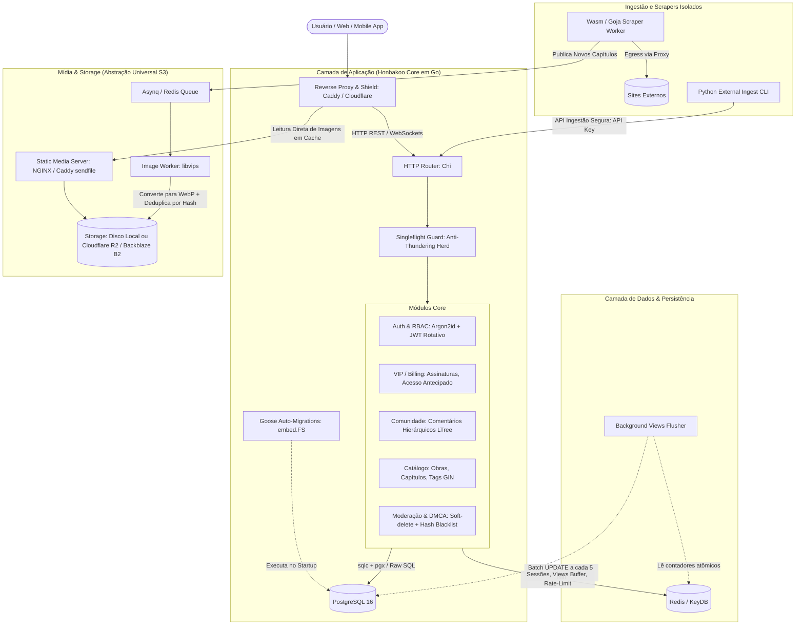

# 🏛️ Honbakoo Architecture & Engineering Specification

> **Honbakoo Engine**: Backend modular, headless e de altíssima performance para plataformas de mangá, doujinshi, manhwa e anime/h-anime, projetado para operar com custo mínimo (inclusive R$ 0,00 / budget mode) e zero atrito de instalação.

---

## 1. Visão Geral e Filosofia de Design

A arquitetura do Honbakoo foi desenhada para resolver os maiores problemas reais da indústria de entretenimento visual (alto volume de I/O, custos proibitivos de egress de banda, sobrecarga em banco de dados e instabilidade sob picos de tráfego), viabilizando operações tanto para quem tem **orçamento zero (VPS de 1 vCPU / 512MB-1GB RAM)** quanto para quem deseja **escalar horizontalmente**.

### Princípios Fundamentais:
1. **Zero-Friction Setup ("Clone & Play"):** Um único comando (`docker compose up -d`) inicializa todo o ecossistema pronto para uso local ou em produção.
2. **Single-Binary com Migrations Automáticas (Goose + `embed.FS`):** As migrações do banco de dados são embutidas dentro do próprio binário executável em Go. Ao subir o servidor, o banco é migrado e validado automaticamente sem exigir instalação de ferramentas de linha de comando externas.
3. **Zero Vendor Lock-in & Dual-Profile:** Suporte nativo ao modo `budget` (100% autocontido, sem dependências externas pagas) e ao modo `scale` (S3 externo, CDNs distribuídas e proxies).
4. **Sem ORM Pesado (Zero Runtime Reflection):** Utilização estrita de SQL nativo compilado com **`sqlc` + `pgx`**. Queries validadas em tempo de compilação sem custos ocultos de CPU/RAM.
5. **Desacoplamento de Metadados vs. Mídia:** A API de dados nunca bloqueia o runtime para ler e servir arquivos pesados de imagem ou vídeo.
6. **Prevenção Ativa de Gargalos Clássicos:** Proteção contra *Hot-linking*, *Cache Stampede / Thundering Herd* via `singleflight`, e *Database Locking* por contagem de views via buffer atômico no Redis.

---

## 2. Decisão de Stack & Tecnologias

### 2.1 Por que **Go (Golang 1.22+)** no Core?

* **Eficiência sob Pouca RAM:** Uma API completa em Go consome entre **20MB e 45MB de RAM** em modo ocioso, permitindo rodar em servidores de \$3-\$4/mês sem risco de OOM (*Out Of Memory*).
* **Concorrência Leve com Goroutines:** Cada conexão HTTP ou WebSocket custa apenas ~2KB de stack memory inicial, viabilizando milhares de leitores simultâneos.
* **Ferramental Nativo de Concorrência:** O pacote `golang.org/x/sync/singleflight` elimina requisições duplicadas simultâneas ao banco de dados em picos de lançamento.
* **Ecossistema Maduro de Segurança:** Suporte comprovado e auditado para `Argon2id` (hash de senhas resistente a GPUs), JWT rotativo e middlewares de rate limiting.

### 2.2 Tabela de Componentes

| Domínio | Escolha Técnica | Alternativas Consideradas | Motivo da Decisão |
| :--- | :--- | :--- | :--- |
| **Linguagem** | **Go (Golang)** | Rust, Node.js, Python | Baixo consumo de RAM, compilação estática rápida, manutenção simples pela comunidade. |
| **Padrão de API** | **RESTful Pragmatic + WS** | GraphQL, gRPC | Altamente amigável para cache HTTP em CDNs de borda, simples de debugar e integrar. |
| **Identificadores** | **UUIDv7** | UUIDv4, Auto-increment | Ordenação cronológica, não fragmenta índices B-Tree no PostgreSQL e não vaza números sequenciais. |
| **Ferramenta de Migrations** | **Goose (`pressly/goose`)** | `golang-migrate`, Atlas | Suporte a `embed.FS` (migrations embutidas no binário único Go) e suporte híbrido (SQL puro + lógica Go se necessária). |
| **Camada de Banco** | **`sqlc` + `pgx`** | GORM, Ent, Prisma | **Sem ORM**. SQL nativo compilado para structs Go estáticas. Performance máxima e queries transparentes. |
| **Banco Relacional**| **PostgreSQL 16+** | MySQL, SQLite, MongoDB | Suporte avançado a índices GIN (para tags booleanas ultra-rápidas) e trigramas (`pg_trgm`) para busca textual de títulos. |
| **Cache & Buffers** | **Redis / KeyDB** | Memcached | Suporte a estruturas de dados atômicas (`INCR`, `HSET`, Streams) e expiração configurável. |
| **Processamento Img**| **Client-Side + libvips** | ImageMagick, PIL | Otimização pré-upload no navegador do usuário poupa banda e CPU; libvips no servidor como fallback/validação. |
| **Abstração Storage** | **Local FS / Cloudflare R2** | Wasabi, AWS S3, Cloudinary | Abstração universal compatível com S3. Modo `budget` usa disco local; modo nuvem usa Cloudflare R2 com **tráfego de saída 100% gratuito (Zero Egress)**. |
| **Reverse Proxy / SSL**| **Caddy** ou **NGINX** | Traefik, Apache | 100% gratuitos e open source. Caddy gera certificados HTTPS automáticos via Let's Encrypt com zero esforço. |
| **Edge / Proteção** | **Cloudflare (Free) / Tunnels** | DDoS-Guard | Opcional e sem custo. O `cloudflared` esconde o IP da VPS sem precisar abrir portas ou expor dados pessoais. |
| **Testes de Carga** | **k6 (Grafana)** | Apache Bench, Locust | Scripts declarativos em JS para simular picos de tráfego, leitores e comentários simultâneos. |

---

## 3. Diagrama de Arquitetura



---

## 4. Otimizações de Banco de Dados: Sistema de Tags e Metadados (Estilo NHentai)

Em plataformas de entretenimento visual adulto e mangá, os usuários realizam buscas com filtros booleanos complexos (ex: `+color -lolicon artist:"shindol" language:portuguese tag:"mind break"`). 

Fazer múltiplos `JOINs` relacionais clássicos degrada a performance do banco sob alta concorrência. O Honbakoo adota a modelagem de alta escala:

### 4.1 Modelagem com Índice GIN (Generalized Inverted Index)
1. **Tabela Canônica de Tags (`tags`):**
   * Armazena metadados da tag: `id` (int), `name`, `slug`, `category` (ex: *artist*, *parody*, *character*, *tag*, *language*), `description` e `usage_count` (contador denormalizado para exibir o total de obras publicadas com aquela tag).
2. **Vetor de Tags na Obra (`mangas`):**
   * A tabela de obras mantém uma coluna indexada `tag_ids INT[]` ou `tag_slugs TEXT[]`.
   * Um índice **GIN** é criado sobre essa coluna:
     ```sql
     CREATE INDEX idx_mangas_tag_ids ON mangas USING GIN (tag_ids);
     ```
3. **Execução de Busca Instantânea:**
   * **Contém todas (+tag1 +tag2):** `WHERE tag_ids @> ARRAY[12, 45]`
   * **Contém qualquer uma (+tag1 OR +tag2):** `WHERE tag_ids && ARRAY[12, 45]`
   * **Excluir (-tag3):** `WHERE NOT (tag_ids @> ARRAY[99])`
   * Esse modelo executa filtros complexos em **sub-milissegundos**, mesmo com centenas de milhares de obras cadastradas.

---

## 5. Estratégia de Upload, Ingestão e Processamento de Mídia

### 5.1 Otimização Client-Side (Economia de Banda e CPU)
* **Processamento no Navegador/App:** Antes do upload de um capítulo de 50 a 100 páginas, o cliente web comprime as imagens para WebP utilizando Canvas API nativa ou WebAssembly.
* **Benefícios:**
  * O tamanho do payload de upload do usuário é reduzido em até 80%.
  * O servidor economiza ciclos pesados de CPU, não precisando reprocessar centenas de imagens simultaneamente.

### 5.2 Validação e Limites Rígidos no Backend
* Limite estrito de tamanho por página (ex: máximo de 5MB por imagem) e validação de *Magic Bytes* no cabeçalho do arquivo para evitar uploads maliciosos disfarçados de imagem.
* Fallback no backend via **`libvips`** apenas se a imagem não estiver no formato WebP otimizado.

### 5.3 Arquitetura de Scrapers Híbrida
* **Scrapers Leves no Servidor (WASM / JS Sandboxed via Goja):**
  * Para rodar dentro do próprio host com consumo ínfimo de memória, os conectores de sites externos podem ser implementados em WebAssembly ou scripts leves interpretados em sandbox no Go (via `goja`).
* **Scrapers Externos em Python (Ingestão Local do Administrador):**
  * Scrapers complexos (que utilizam Selenium, navegadores headless ou proxies rotativos) podem rodar na máquina pessoal do desenvolvedor/administrador.
  * O script em Python extrai os dados e faz a ingestão no servidor via rota autenticada da API (`POST /api/v1/ingest/chapter`) usando uma API Key de ingestão segura (`X-API-Key`).

---

## 6. Sistema de Moderação e DMCA "Zero Pânico"

Projetado para dar resposta instantânea a solicitações legais ou de moderação:

1. **Soft-Delete Imediato (`dmca_blocked`):**
   * Uma obra ou capítulo pode ter o status alterado instantaneamente para `dmca_blocked` via painel ou chamada de API.
   * O conteúdo deixa de ser servido imediatamente para o público sem quebrar a integridade referencial do banco de dados ou histórico de transações.
2. **Blacklist de Hashes SHA-256:**
   * Quando uma mídia é removida por DMCA, o hash criptográfico dos arquivos é registrado em uma tabela de blacklist (`blocked_media_hashes`).
   * Se um scraper ou usuário tentar re-enviar ou re-importar a mesma obra no futuro, a ingestão é rejeitada automaticamente antes de salvar no disco.

---

## 7. Otimizações Críticas para Ambientes de Baixo Custo (Budget Mode)

Para garantir que uma pessoa consiga rodar o Honbakoo em uma máquina de \$3/mês (ou até em um PC antigo/Raspberry Pi) com fluidez:

### 7.1 O Perfil Dual no `.env`
O sistema se autoconfigura a partir da variável `HONBAKOO_PROFILE`:
* **`PROFILE=budget` (Padrão):**
  * Salva imagens diretamente no disco local (sem necessidade de contratar S3).
  * Serve arquivos estáticos via Caddy/NGINX com a syscall `sendfile` do Linux (leitura de disco direto para a placa de rede sem tocar na CPU do Go).
  * PostgreSQL tunado para operar consumindo no máximo 150MB de RAM (`shared_buffers = 128MB`).
* **`PROFILE=scale`:**
  * Habilita driver S3 apontando para **Cloudflare R2** (com taxa zero de saída/egress) ou **Backblaze B2**.
  * Habilita distribuição de workers em nós separados.

### 7.2 Eliminação de Custos de Banda (Zero Egress com Cloudflare R2 e Cache)
* **Cloudflare R2:** Oferece 10GB de storage grátis e **taxa zero de egress (tráfego de saída ilimitado gratuito)**. Elimina o maior gargalo financeiro de plataformas de leitura.
* **Cache Imutável no Navegador do Leitor:**
  * Todo capítulo servido acompanha os headers:
    ```http
    Cache-Control: public, max-age=31536000, immutable
    ETag: "hash-sha256-da-pagina"
    ```
  * Se o leitor reler ou navegar pelas páginas do capítulo, 0 bytes saem do servidor — a imagem carrega instantaneamente da memória do dispositivo do leitor.

### 7.3 Vídeo sem Sobrecarga de CPU (Remux & HTTP Range Requests)
* Em servidores fracos, rodar transcodificação contínua com FFmpeg trava a CPU em 100%.
* **Solução:** O Honbakoo suporta **HTTP Range Requests (Status 206 Partial Content)** sobre arquivos MP4 com `moov atom` no início (*FastStart*). O leitor de vídeo pode pausar, pular e carregar trechos sob demanda sem necessidade de reprocessar o vídeo no servidor.

### 7.4 Cloudflare Tunnels (Zero Port Forwarding & Proteção de IP Gratuita)
* O usuário pode rodar o container oficial `cloudflared` (100% gratuito).
* A máquina se conecta via túnel criptografado de saída à rede da Cloudflare.
* **Benefícios:** Não precisa de IP fixo, não precisa abrir portas no roteador/firewall e o IP real da hospedagem fica completamente invisível contra ataques.

---

## 8. Resolução de Gargalos Clássicos da Indústria

### 8.1 Proteção contra Hot-Linking (Roubo de Banda)
* **URLs Assinadas via HMAC com Expiração:** Cada link de imagem gerado pela API possui um token temporário com validade (ex: 2 horas) baseado no IP/Sessão do leitor.
* **Bloqueio de Referer:** NGINX/Caddy rejeita requisições onde o cabeçalho `Referer` não pertença aos domínios autorizados.

### 8.2 Buffer Atômico de Views (Prevenção de Database Lock)
* Em vez de executar `UPDATE mangas SET views = views + 1` a cada requisição:
* A API executa `INCR manga:views:{id}` no Redis (operação em memória que dura ~0.05ms).
* Um worker periódico (ex: a cada 5 minutos) lê esses contadores e faz um único `UPDATE` em lote (*batch*) no PostgreSQL.

### 8.3 Anti-Thundering Herd com `singleflight`
* Quando um capítulo aguardado é lançado e centenas de leitores abrem a página no mesmo segundo:
* Com `singleflight` em Go, o backend executa apenas **uma única consulta ao banco**; as outras 999 requisições aguardam a resposta da primeira e compartilham o mesmo resultado em memória.

### 8.4 Deduplicação de Imagens via Hash (Economia de até 40% de Disco)
* Imagens repetidas (como páginas de avisos de scanlators, créditos ou capas idênticas de diferentes fontes) são analisadas por seu hash SHA-256 antes do salvamento.
* Se a imagem já existe no storage, apenas uma referência na tabela `chapter_pages` é criada, economizando gigabytes de armazenamento.

---

## 9. Simulação de Carga e Benchmark (k6)

O repositório inclui suítes padronizadas de testes com **k6 (Grafana)** na pasta `benchmarks/k6/`:

1. **`smoke-test.js`:** Validação de estabilidade com pouca carga (5 a 10 VUs - Virtual Users).
2. **`reader-load-test.js`:** Simulação de 500 a 2.000 leitores simultâneos folheando capítulos página a página.
3. **`spike-test.js`:** Disparo repentino de carga (ex: 0 a 3.000 usuários em 10 segundos) para validar o comportamento do `singleflight`, do buffer de views e do rate limiter.

---

## 10. Estrutura Proposta do Repositório

```text
honbakoo/
├── cmd/
│   ├── api/               # Servidor HTTP REST & WebSockets (Go)
│   ├── worker/            # Workers de imagem (libvips), views e background jobs
│   └── cli/               # Comandos de setup, seed e migrations
├── internal/
│   ├── auth/              # Argon2id, JWT rotativo e RBAC
│   ├── billing/           # Sistema VIP, assinaturas e webhooks
│   ├── community/         # Comentários (LTree), reações e moderação
│   ├── content/           # Catálogo: obras, capítulos e tags (GIN)
│   ├── storage/           # Abstração de armazenamento (Local FS / S3 API: Cloudflare R2 / B2)
│   ├── moderation/        # Soft-delete DMCA e blacklist de hashes
│   ├── singleflight/      # Gerenciamento de deduplicação de requisições concorrentes
│   └── database/          # Queries SQL nativas e código gerado pelo sqlc
├── migrations/            # Migrações versionadas em SQL puro gerenciadas pelo Goose (embed.FS)
├── deploy/
│   ├── caddy/             # Caddyfile com HTTPS automático e headers de cache
│   └── postgres/          # postgresql.conf tunado para perfil budget (512MB-1GB)
├── benchmarks/
│   └── k6/                # Scripts de estresse e teste de carga
├── docker-compose.yml     # Orquestrador local pronto (1 comando)
├── .env.example           # Configurações claras com perfis 'budget' e 'scale'
└── Makefile               # Comandos rápidos: build, test, migrate, run
```
