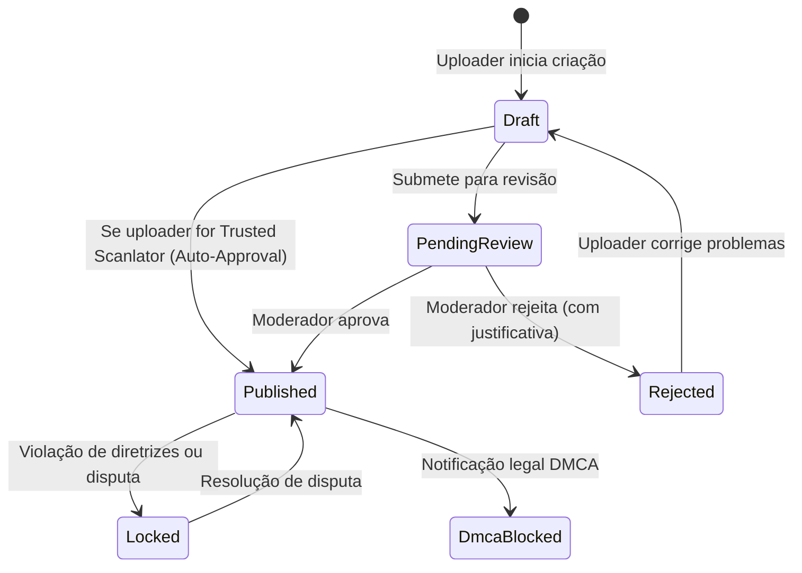
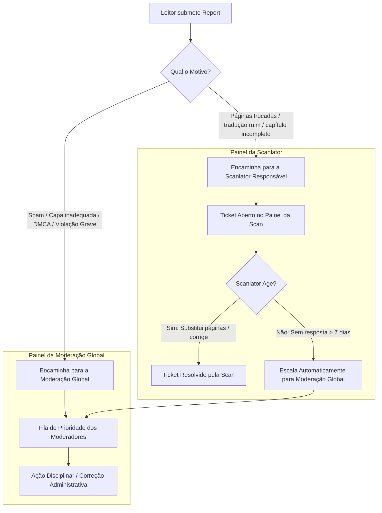

# 🛡️ Honbakoo Content Governance, Moderation & Support Specification

> **Módulo:** Governança Editorial, Taxonomia de Tags, Moderação e Sistema de Suporte/Reports  
> **Objetivo:** Fornecer as ferramentas necessárias para manter o catálogo limpo, dar voz aos leitores com denúncias direcionadas, permitir que scanlators corrijam seus lançamentos e capacitar moderadores a agir com precisão cirúrgica.

---

## 1. Ciclo de Vida e Controle de Publicação Editorial

Nem todo conteúdo pode entrar no ar sem controle. O Honbakoo adota uma máquina de estados rigorosa tanto para obras (`mangas`) quanto para capítulos (`chapters`):

### Níveis de Confiança para Uploaders / Scanlators:
* **Tier 0 (Novo Uploader / Anônimo):** Todo upload entra em `pending_review`. Não aparece no catálogo público até um moderador validar.
* **Tier 1 (Scanlator Verificada / Trusted):** Uploads entram diretamente em `published` (*Auto-Approval*), mas ficam sujeitos a denúncias da comunidade.
* **Tier 2 (Admin / Editor Chefe):** Pode travar edições (`is_locked`), transferir propriedade de obras e aprovar re-traduções oficiais.

---

## 2. Governança Estrita de Tags e Taxonomia

O maior causador de degradação em agregadores é a proliferação desordenada de tags duplicadas (ex: "comédia", "Comedia", "comedinha").

### Regras de Taxonomia:
1. **Criação Restrita:** Usuários comuns **NÃO criam tags**. Apenas moderadores e administradores criam tags canônicas.
2. **Propostas da Comunidade (`tag_proposals`):** Usuários podem sugerir tags para uma obra. A sugestão entra em votação ou fila de moderação.
3. **Sinônimos e Aliases de Tags:** Tags canônicas possuem um array de aliases (`aliases TEXT[]`). Se o usuário buscar por `scifi`, o sistema redireciona internamente para `ficcao-cientifica`.
4. **Merge de Tags:** Ferramenta administrativa para unificar duas tags duplicadas em uma só, atualizando automaticamente os arrays `tag_ids INT[]` de todas as obras vinculadas em uma única transação atômica.

---

## 3. Moderação de Comentários & Tombstone Pattern

Para manter a ordem sem quebrar o fluxo das conversas na comunidade:

1. **Remoção Suave com Preservação da Árvore (Tombstone):**
   * Se um usuário ou moderador apagar um comentário que **possui respostas filhas**, o registro **não é deletado do banco** (para não quebrar a hierarquia do `ltree`).
   * A flag `is_deleted` é marcada como `TRUE`, o conteúdo é sobrescrito para `[Comentário removido pela moderação]` e o `user_id` é desvinculado visualmente.
2. **Denúncia Rápida pelo Leitor:** Qualquer leitor pode denunciar um comentário com 1 clique (motivos: *Spam*, *Assédio/Ódio*, *Spoiler não marcado*, *Conteúdo Ilegal*).
3. **Ocultação Automática por Limiar:** Se um comentário receber 5 denúncias de usuários com boa reputação, ele entra em quarentena automática (`is_flagged = TRUE`) aguardando revisão.

---

## 4. Sistema de Suporte e Denúncias (Reports) com Roteamento Inteligente

Quando um leitor encontra um erro em um mangá, o fluxo depende da natureza do problema:

### Tipos Canônicos de Denúncias:
* `missing_pages`: Páginas faltando no capítulo.
* `wrong_order`: Páginas fora de ordem.
* `corrupted_images`: Imagens quebradas ou não carregam.
* `duplicate_chapter`: Capítulo idêntico postado duas vezes pelo mesmo grupo.
* `bad_translation`: Tradução incompreensível ou máquina de baixa qualidade sem revisão.
* `spoiler_unmarked`: Comentário com spoiler grave sem tag de spoiler.
* `harassment_hate`: Discurso de ódio ou assédio nos comentários.
* `illegal_content`: Conteúdo proibido por lei ou termos de serviço.
* `dmca_copyright`: Notificação de direitos autorais.
* `child_exploitation`: **Protocolo P0 de Emergência** (Abuso ou exploração de menores).

---

## 5. Protocolo de Emergência para Material Ilegal / CSAM e Cadeia de Custódia

A resposta a material envolvendo exploração de menores ou violações graves não segue o fluxo comum de denúncias:

1. **Quarentena Imediata Sub-Milissegundo (`is_emergency_quarantined`):**
   * Assim que a denúncia é recebida com a tag `child_exploitation` (ou via webhook automatizado de moderação), a obra/capítulo recebe `is_emergency_quarantined = TRUE` e é deslistada instantaneamente de toda a API pública.
   * O purge na CDN é disparado na hora.
2. **Isolamento de Evidência e Princípio do Menor Privilégio:**
   * O binário da mídia é transferido para um bucket seguro e isolado de custódia judicial (`/evidence/quarantine/...`).
   * **Zero Visualização por Moderadores Comuns:** Moderadores e scanlators têm acesso completamente revogado ao arquivo para evitar exposição e contaminação de equipe. Apenas administradores designados e auditores legais podem gerar o pacote de evidência com assinatura SHA-256 e timestamp.
3. **Encaminhamento Legal e Denúncia Formal:**
   * O sistema registra os dados de conexão do uploader (IP, User Agent e Timestamp sob custódia encriptada) para cooperação formal com autoridades legais (Polícia Federal / SaferNet Brasil / NCMEC internacional).
4. **Blacklist Criptográfica Permanente:**
   * O hash SHA-256 é inserido na tabela `blocked_media_hashes` com flag permanente `is_severe_illegal = TRUE`, rejeitando preventivamente qualquer tentativa futura de re-upload em qualquer instância do Honbakoo.

---

## 6. Sistema de Sanções e Auditoria (`user_sanctions`)

Moderadores possuem ferramentas proporcionais de sanção registradas em log de auditoria:
* **Warning (Advertência):** Alerta formal no perfil do usuário que exige confirmação de leitura.
* **Mute Temporário (`mute_until`):** O usuário pode continuar lendo e favoritando, mas perde a permissão de comentar ou votar por X dias.
* **Uploader Suspension:** O grupo ou usuário perde a capacidade de subir capítulos, mas sua conta de leitor permanece ativa.
* **Ban Permanente:** Bloqueio total de acesso e invalidação de todos os tokens de sessão.
