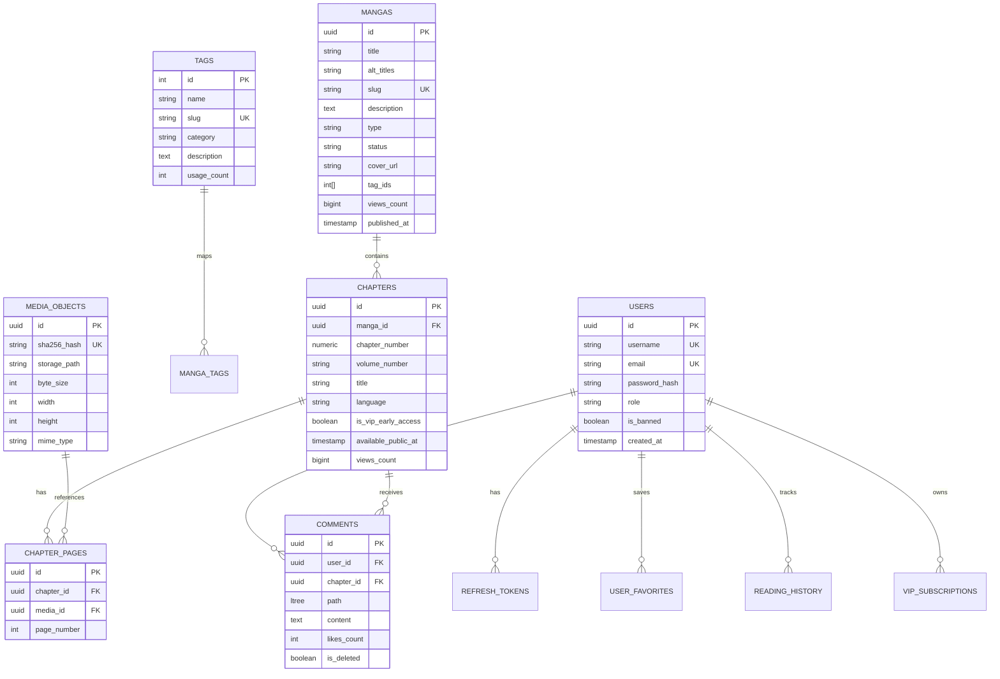

# 🗄️ Honbakoo Database Schema & Data Modeling

> **Engine:** PostgreSQL 16+  
> **Migration Runner:** Goose (`embed.FS`)  
> **Query Engine:** `sqlc` + `pgx/v5` (Zero ORM, SQL Nativo fortemente tipado)  
> **Identificadores:** UUIDv7 (Ordenados por tempo, sem fragmentação de B-Tree)

---

## 1. Princípios da Modelagem de Dados

1. **Hiper-otimização para Leitura e Filtros (Read-Heavy):** Índices GIN sobre arrays de tags (`tag_ids INT[]`) para resolução de filtros booleanos (`+tag1 -tag2`) em menos de 2ms.
2. **Sem Bloqueios de Linha (Row Locks):** Contadores de visualizações (`views_count`) são atualizados em batch via Redis, sem escritas contínuas em tempo real na tabela principal.
3. **Comentários Hierárquicos com LTree:** Árvores de comentários infinitas recuperadas em uma única query SQL indexada (`USING GIST(path)`).
4. **Segurança e Conformidade (DMCA/Moderação):** Blacklist de hashes SHA-256 e suporte a soft-delete em nível de obra/capítulo.

---

## 2. Diagrama de Relacionamento de Entidades (ERD)



---

## 3. Schema DDL Completo (Goose Migration: `00001_initial_schema.sql`)

```sql
-- +goose Up
-- ============================================================================
-- EXTENSÕES POSTGRESQL
-- ============================================================================
CREATE EXTENSION IF NOT EXISTS "uuid-ossp";
CREATE EXTENSION IF NOT EXISTS "pg_trgm";   -- Busca textual eficiente de títulos
CREATE EXTENSION IF NOT EXISTS "ltree";     -- Árvores de comentários de alta performance

-- ============================================================================
-- 1. USUÁRIOS, AUTENTICAÇÃO E VIP
-- ============================================================================
CREATE TYPE user_role AS ENUM ('guest', 'user', 'vip', 'moderator', 'admin');

CREATE TABLE users (
    id UUID PRIMARY KEY,                    -- UUIDv7 gerado pela aplicação
    username VARCHAR(32) NOT NULL UNIQUE,
    email VARCHAR(255) NOT NULL UNIQUE,
    password_hash VARCHAR(255) NOT NULL,    -- Argon2id
    role user_role NOT NULL DEFAULT 'user',
    avatar_url VARCHAR(512),
    is_banned BOOLEAN NOT NULL DEFAULT FALSE,
    created_at TIMESTAMPTZ NOT NULL DEFAULT NOW(),
    updated_at TIMESTAMPTZ NOT NULL DEFAULT NOW()
);

CREATE TABLE refresh_tokens (
    id UUID PRIMARY KEY,
    user_id UUID NOT NULL REFERENCES users(id) ON DELETE CASCADE,
    token_hash VARCHAR(64) NOT NULL UNIQUE, -- SHA-256 do refresh token
    ip_address INET,
    user_agent TEXT,
    expires_at TIMESTAMPTZ NOT NULL,
    created_at TIMESTAMPTZ NOT NULL DEFAULT NOW()
);
CREATE INDEX idx_refresh_tokens_user ON refresh_tokens(user_id);

CREATE TABLE vip_subscriptions (
    id UUID PRIMARY KEY,
    user_id UUID NOT NULL REFERENCES users(id) ON DELETE CASCADE,
    provider VARCHAR(32) NOT NULL,          -- 'stripe', 'pix', 'crypto'
    external_id VARCHAR(255),
    status VARCHAR(32) NOT NULL,            -- 'active', 'canceled', 'past_due'
    starts_at TIMESTAMPTZ NOT NULL DEFAULT NOW(),
    expires_at TIMESTAMPTZ NOT NULL,
    created_at TIMESTAMPTZ NOT NULL DEFAULT NOW()
);
CREATE INDEX idx_vip_user_expires ON vip_subscriptions(user_id, expires_at);

-- ============================================================================
-- 2. TAGS, GÊNEROS E METADADOS
-- ============================================================================
CREATE TYPE tag_category AS ENUM (
    'general',     -- tags de conteúdo (ex: 'mind break', 'netorare', 'romance')
    'artist',      -- autor / artista (ex: 'shindol')
    'circle',      -- círculo / grupo
    'parody',      -- franquia / anime original (ex: 'fate stay night', 'naruto')
    'character',   -- personagem específico
    'language'     -- idioma (ex: 'portuguese', 'english', 'japanese')
);

CREATE TABLE tags (
    id SERIAL PRIMARY KEY,
    name VARCHAR(64) NOT NULL,
    slug VARCHAR(64) NOT NULL UNIQUE,
    category tag_category NOT NULL DEFAULT 'general',
    description TEXT,
    usage_count INT NOT NULL DEFAULT 0,     -- Denormalizado para ordenação rápida
    created_at TIMESTAMPTZ NOT NULL DEFAULT NOW()
);
CREATE INDEX idx_tags_category ON tags(category);
CREATE INDEX idx_tags_usage ON tags(usage_count DESC);

-- ============================================================================
-- 3. OBRAS (MANGAS, DOUJINSHIS, ANIMES)
-- ============================================================================
CREATE TYPE content_type AS ENUM ('manga', 'manhwa', 'manhua', 'doujinshi', 'anime_h', 'anime_m');
CREATE TYPE publication_status AS ENUM ('ongoing', 'completed', 'hiatus', 'cancelled');

CREATE TABLE mangas (
    id UUID PRIMARY KEY,                    -- UUIDv7
    title VARCHAR(255) NOT NULL,
    alt_titles TEXT[] DEFAULT '{}',
    slug VARCHAR(255) NOT NULL UNIQUE,
    description TEXT,
    type content_type NOT NULL DEFAULT 'manga',
    status publication_status NOT NULL DEFAULT 'ongoing',
    is_nsfw BOOLEAN NOT NULL DEFAULT TRUE,
    cover_url VARCHAR(512) NOT NULL,
    
    -- TAGS HIPER-OTIMIZADAS VIA ARRAY + GIN
    tag_ids INT[] NOT NULL DEFAULT '{}',
    
    -- CONTADORES DESNORMALIZADOS (ATUALIZADOS VIA BATCH FLUSH DO REDIS)
    views_count BIGINT NOT NULL DEFAULT 0,
    favorites_count INT NOT NULL DEFAULT 0,
    
    -- MODERAÇÃO E STATUS
    is_published BOOLEAN NOT NULL DEFAULT TRUE,
    is_dmca_blocked BOOLEAN NOT NULL DEFAULT FALSE,
    
    published_at TIMESTAMPTZ,
    created_at TIMESTAMPTZ NOT NULL DEFAULT NOW(),
    updated_at TIMESTAMPTZ NOT NULL DEFAULT NOW()
);

-- ÍNDICES DE PERFORMANCE EXTREMA
CREATE INDEX idx_mangas_tag_ids ON mangas USING GIN (tag_ids);
CREATE INDEX idx_mangas_title_trgm ON mangas USING GIN (title gin_trgm_ops);
CREATE INDEX idx_mangas_views ON mangas(views_count DESC) WHERE is_published = TRUE AND is_dmca_blocked = FALSE;
CREATE INDEX idx_mangas_latest ON mangas(created_at DESC) WHERE is_published = TRUE AND is_dmca_blocked = FALSE;

-- ============================================================================
-- 4. CAPÍTULOS E EPISÓDIOS
-- ============================================================================
CREATE TABLE chapters (
    id UUID PRIMARY KEY,                    -- UUIDv7
    manga_id UUID NOT NULL REFERENCES mangas(id) ON DELETE CASCADE,
    chapter_number NUMERIC(7, 2) NOT NULL,  -- suporta 1, 10.5, etc.
    volume_number VARCHAR(16),
    title VARCHAR(255),
    language VARCHAR(10) NOT NULL DEFAULT 'pt-br',
    
    -- ACESSO VIP / ANTECIPADO
    is_vip_early_access BOOLEAN NOT NULL DEFAULT FALSE,
    available_public_at TIMESTAMPTZ,        -- Quando vira público para free users
    
    views_count BIGINT NOT NULL DEFAULT 0,
    is_published BOOLEAN NOT NULL DEFAULT TRUE,
    is_dmca_blocked BOOLEAN NOT NULL DEFAULT FALSE,
    
    created_at TIMESTAMPTZ NOT NULL DEFAULT NOW(),
    updated_at TIMESTAMPTZ NOT NULL DEFAULT NOW(),

    CONSTRAINT uq_manga_chapter UNIQUE (manga_id, chapter_number, language)
);
CREATE INDEX idx_chapters_manga ON chapters(manga_id, chapter_number ASC);
CREATE INDEX idx_chapters_vip_release ON chapters(available_public_at) WHERE is_vip_early_access = TRUE;

-- ============================================================================
-- 5. STORAGE DEDUPLICADO (CAS) E PÁGINAS DE CAPÍTULO
-- ============================================================================
-- Tabela para evitar arquivos repetidos (deduplicação por Hash SHA-256)
CREATE TABLE media_objects (
    id UUID PRIMARY KEY,                    -- UUIDv7
    sha256_hash CHAR(64) NOT NULL UNIQUE,   -- Hash do arquivo para deduplicação
    storage_path VARCHAR(512) NOT NULL,     -- Caminho relativo no S3 ou Disco Local
    byte_size INT NOT NULL,
    width INT NOT NULL,
    height INT NOT NULL,
    mime_type VARCHAR(64) NOT NULL DEFAULT 'image/webp',
    created_at TIMESTAMPTZ NOT NULL DEFAULT NOW()
);
CREATE INDEX idx_media_hash ON media_objects(sha256_hash);

CREATE TABLE chapter_pages (
    id UUID PRIMARY KEY,
    chapter_id UUID NOT NULL REFERENCES chapters(id) ON DELETE CASCADE,
    media_id UUID NOT NULL REFERENCES media_objects(id) ON DELETE RESTRICT,
    page_number INT NOT NULL,
    created_at TIMESTAMPTZ NOT NULL DEFAULT NOW(),

    CONSTRAINT uq_chapter_page UNIQUE (chapter_id, page_number)
);
CREATE INDEX idx_chapter_pages_lookup ON chapter_pages(chapter_id, page_number ASC);

-- ============================================================================
-- 6. COMUNIDADE: COMENTÁRIOS COM LTREE (ÁRVORE HIERÁRQUICA)
-- ============================================================================
CREATE TABLE comments (
    id UUID PRIMARY KEY,                    -- UUIDv7
    user_id UUID NOT NULL REFERENCES users(id) ON DELETE CASCADE,
    chapter_id UUID NOT NULL REFERENCES chapters(id) ON DELETE CASCADE,
    
    -- HIERARQUIA COM LTREE (ex: 'root', 'root.commentA', 'root.commentA.replyB')
    path LTREE NOT NULL,
    content TEXT NOT NULL,
    
    likes_count INT NOT NULL DEFAULT 0,
    is_deleted BOOLEAN NOT NULL DEFAULT FALSE,
    is_flagged BOOLEAN NOT NULL DEFAULT FALSE,
    
    created_at TIMESTAMPTZ NOT NULL DEFAULT NOW(),
    updated_at TIMESTAMPTZ NOT NULL DEFAULT NOW()
);
CREATE INDEX idx_comments_path ON comments USING GIST (path);
CREATE INDEX idx_comments_chapter ON comments(chapter_id, created_at DESC);

-- ============================================================================
-- 7. FAVORITOS E HISTÓRICO DE LEITURA
-- ============================================================================
CREATE TABLE user_favorites (
    user_id UUID NOT NULL REFERENCES users(id) ON DELETE CASCADE,
    manga_id UUID NOT NULL REFERENCES mangas(id) ON DELETE CASCADE,
    created_at TIMESTAMPTZ NOT NULL DEFAULT NOW(),
    PRIMARY KEY (user_id, manga_id)
);

CREATE TABLE reading_history (
    user_id UUID NOT NULL REFERENCES users(id) ON DELETE CASCADE,
    manga_id UUID NOT NULL REFERENCES mangas(id) ON DELETE CASCADE,
    last_chapter_id UUID NOT NULL REFERENCES chapters(id) ON DELETE CASCADE,
    last_page INT NOT NULL DEFAULT 1,
    updated_at TIMESTAMPTZ NOT NULL DEFAULT NOW(),
    PRIMARY KEY (user_id, manga_id)
);

-- ============================================================================
-- 8. MODERAÇÃO E BLACKLIST DMCA
-- ============================================================================
CREATE TABLE blocked_media_hashes (
    sha256_hash CHAR(64) PRIMARY KEY,
    reason TEXT NOT NULL,
    blocked_by UUID REFERENCES users(id),
    created_at TIMESTAMPTZ NOT NULL DEFAULT NOW()
);

-- +goose Down
DROP TABLE IF EXISTS blocked_media_hashes;
DROP TABLE IF EXISTS reading_history;
DROP TABLE IF EXISTS user_favorites;
DROP TABLE IF EXISTS comments;
DROP TABLE IF EXISTS chapter_pages;
DROP TABLE IF EXISTS media_objects;
DROP TABLE IF EXISTS chapters;
DROP TABLE IF EXISTS mangas;
DROP TABLE IF EXISTS tags;
DROP TABLE IF EXISTS vip_subscriptions;
DROP TABLE IF EXISTS refresh_tokens;
DROP TABLE IF EXISTS users;
DROP TYPE IF EXISTS content_type;
DROP TYPE IF EXISTS publication_status;
DROP TYPE IF EXISTS tag_category;
DROP TYPE IF EXISTS user_role;
```

---

## 4. Exemplos de Queries Críticas em SQL Puro (`sqlc`)

### 4.1 Busca Booleana de Tags Estilo NHentai
```sql
-- name: SearchMangasByTags :many
-- $1 = tag_ids obrigatórias (+tag1 AND +tag2)
-- $2 = tag_ids proibidas (-tag3)
SELECT id, title, slug, cover_url, views_count, tag_ids
FROM mangas
WHERE is_published = TRUE 
  AND is_dmca_blocked = FALSE
  AND tag_ids @> $1::int[]           -- Contém todas as tags obrigatórias
  AND NOT (tag_ids && $2::int[])     -- Não contém nenhuma das proibidas
ORDER BY views_count DESC
LIMIT $3 OFFSET $4;
```

### 4.2 Recuperação de Árvore de Comentários em 1 Query
```sql
-- name: GetChapterCommentsTree :many
SELECT c.id, c.user_id, u.username, u.avatar_url, c.path, c.content, c.likes_count, c.created_at
FROM comments c
JOIN users u ON u.id = c.user_id
WHERE c.chapter_id = $1 
  AND c.is_deleted = FALSE
ORDER BY c.path ASC;
```

### 4.3 Flush em Lote do Buffer de Visualizações (Redis -> Postgres)
```sql
-- name: BatchIncrementMangaViews :exec
UPDATE mangas
SET views_count = views_count + data.inc_views
FROM (SELECT unnest($1::uuid[]) AS manga_id, unnest($2::bigint[]) AS inc_views) AS data
WHERE mangas.id = data.manga_id;
```
