# 🗄️ Honbakoo Universal Database Schema & Data Modeling

> **Engine:** PostgreSQL 16+  
> **Migration Runner:** Goose (`embed.FS`)  
> **Query Engine:** `sqlc` + `pgx/v5` (Zero ORM, SQL Nativo compilado fortemente tipado)  
> **Identificadores:** UUIDv7 (Ordenados temporalmente, sem fragmentação de B-Tree)  
> **Escopo Universal:** Suporte nativo a Mangá, Doujinshi (Galerias/One-shot), Manhwa (Webtoons verticais), Anime e Anime-H (Vídeo HLS/Embeds), com **I18n Multi-idiomas** e **Metadados Editoriais (Artistas, Roteiristas, Revistas/Magazines e Editoras)**.

---

## 1. Princípios da Modelagem Universal, I18n & Metadados Editoriais

1. **Pessoas e Criadores (Autores / Roteiristas e Artistas / Ilustradores):**
   * Uma obra pode ter múltiplos criadores com papéis distintos (ex: *Story/Writer*, *Art/Illustrator* ou *Both*).
   * Perfis de criadores possuem slug, biografia localizada, redes sociais e vinculação com todas as obras que participaram.
2. **Revistas de Serialização & Editoras (Magazines & Publishers):**
   * Obras seriadas (Mangá/Manhwa/Manhua) pertencem a uma revista (*Weekly Shonen Jump*, *Young Comic*, *Webtoon Line*, *KakaoPage*) e a uma editora (*Shueisha*, *Kadokawa*, etc.).
   * Revistas possuem periodicidade (`weekly`, `monthly`, `digital_webtoon`).
3. **Internacionalização Real (I18n):**
   * Obras possuem títulos e sinopses localizados por idioma (`manga_localizations`) com fallback automático para o título original.
   * Tags canônicas possuem nomes traduzidos por idioma (`tag_localizations`).
   * Capítulos, episódios e legendas são estritamente atrelados a códigos de idioma ISO/BCP 47 (`pt-br`, `en`, `ja`, etc.).
4. **Flexibilidade Camaleônica (Manga, Webtoon, Doujinshi, Anime):**
   * Obras podem ser **séries tradicionais**, **galerias one-shot** (doujinshis com leitura direta de páginas) ou **séries de animação** (episódios de vídeo HLS ou embeds).
5. **Hiper-otimização para Tags (Estilo NHentai):**
   * Vetor de tags `tag_ids INT[]` com índice GIN para resolução de filtros booleanos em sub-milissegundos.
6. **Comunidade Hierárquica em Árvore com LTree:**
   * Comentários aninhados infinitos recuperados em uma única query rápida.

---

## 2. Diagrama de Relacionamento de Entidades (ERD Completo)

```mermaid
erDiagram
    LANGUAGES ||--o{ MANGA_LOCALIZATIONS : translates
    LANGUAGES ||--o{ TAG_LOCALIZATIONS : translates
    LANGUAGES ||--o{ CHAPTERS : localized_in
    LANGUAGES ||--o{ EPISODE_SUBTITLES : subtitle_lang

    PUBLISHERS ||--o{ MAGAZINES : publishes
    PUBLISHERS ||--o{ MANGAS : publishes_directly
    MAGAZINES ||--o{ MANGAS : serializes

    CREATORS ||--o{ MANGA_CREATORS : participates_in
    MANGAS ||--o{ MANGA_CREATORS : has_creators

    USERS ||--o{ REFRESH_TOKENS : has
    USERS ||--o{ USER_FAVORITES : saves
    USERS ||--o{ READING_HISTORY : tracks
    USERS ||--o{ COMMENTS : writes
    USERS ||--o{ COMMENT_REACTIONS : reacts
    USERS ||--o{ VIP_SUBSCRIPTIONS : owns
    USERS ||--o{ SCANLATION_MEMBERS : participates

    SCANLATION_GROUPS ||--o{ SCANLATION_MEMBERS : contains
    SCANLATION_GROUPS ||--o{ CHAPTERS : releases

    TAGS ||--o{ TAG_LOCALIZATIONS : has_translations
    TAGS ||--o{ MANGAS : "tag_ids GIN indexed"
    
    MANGAS ||--o{ MANGA_LOCALIZATIONS : has_translations
    MANGAS ||--o{ CHAPTERS : contains
    MANGAS ||--o{ USER_FAVORITES : favorited_in
    MANGAS ||--o{ READING_HISTORY : tracked_in
    
    CHAPTERS ||--o{ CHAPTER_PAGES : has_pages
    CHAPTERS ||--o{ EPISODE_SOURCES : has_videos
    CHAPTERS ||--o{ EPISODE_SUBTITLES : has_subtitles
    CHAPTERS ||--o{ COMMENTS : receives
    CHAPTERS ||--o{ READING_HISTORY : last_read_in
    
    MEDIA_OBJECTS ||--o{ CHAPTER_PAGES : references
    COMMENTS ||--o{ COMMENT_REACTIONS : receives

    PUBLISHERS {
        uuid id PK "UUIDv7"
        varchar name "128 chars"
        varchar slug UK "128 chars"
        varchar website_url
        timestamptz created_at
    }

    MAGAZINES {
        uuid id PK "UUIDv7"
        uuid publisher_id FK "nullable"
        varchar name "128 chars"
        varchar slug UK "128 chars"
        magazine_type type "print_magazine, digital_platform, webtoon_portal"
        varchar frequency "weekly, monthly, bi_weekly, irregular"
        timestamptz created_at
    }

    CREATORS {
        uuid id PK "UUIDv7"
        varchar name "128 chars"
        varchar native_name "nome em kanji/hangul/etc"
        varchar slug UK "128 chars"
        text biography
        varchar twitter_url
        varchar pixiv_url
        varchar website_url
        timestamptz created_at
    }

    MANGA_CREATORS {
        uuid manga_id PK,FK
        uuid creator_id PK,FK
        creator_role role "story, art, story_and_art, assistant"
    }

    MANGAS {
        uuid id PK "UUIDv7"
        uuid magazine_id FK "nullable (revista onde serializa)"
        uuid publisher_id FK "nullable (editora)"
        varchar original_title "255 chars"
        varchar original_language FK "código do idioma de origem"
        text_array alt_titles "títulos alternativos globais"
        varchar slug UK "255 chars"
        content_format format "manga, manhwa, manhua, doujinshi, anime_h, anime_m"
        publication_status status "ongoing, completed, hiatus, cancelled"
        reading_direction reading_direction "right_to_left, left_to_right, vertical_scroll"
        boolean is_gallery "true para one-shots/doujinshis"
        boolean is_nsfw "adult content flag"
        varchar cover_url "512 chars"
        int_array tag_ids "GIN indexed array de tag IDs"
        bigint views_all_time "total view count"
        bigint views_monthly "monthly views"
        bigint views_weekly "weekly views"
        bigint views_daily "daily views"
        integer favorites_count
        numeric rating_score "0.00 a 10.00"
        integer rating_count
        boolean is_published
        boolean is_dmca_blocked
        timestamptz published_at
        timestamptz created_at
        timestamptz updated_at
    }

    MANGA_LOCALIZATIONS {
        uuid manga_id PK,FK
        varchar language_code PK,FK
        varchar title "Título traduzido no idioma"
        text description "Sinopse traduzida no idioma"
        timestamptz updated_at
    }

    LANGUAGES {
        varchar code PK "ISO 639-1 / BCP 47 (pt-br, en, ja, es)"
        varchar name "Nome nativo (Português, English, 日本語)"
        boolean is_active "status de exibição"
    }

    TAGS {
        serial id PK "int4"
        varchar slug UK "64 chars (canônico universal)"
        tag_category category "general, artist, circle, parody, character, language"
        integer usage_count "denormalizado para contagem rápida"
        timestamptz created_at
    }

    TAG_LOCALIZATIONS {
        integer tag_id PK,FK
        varchar language_code PK,FK
        varchar name "Nome traduzido da tag"
        text description "Descrição no idioma"
    }

    CHAPTERS {
        uuid id PK "UUIDv7"
        uuid manga_id FK
        uuid group_id FK "nullable para releases solo/anon"
        numeric chapter_number "numeric(7,2) ex: 10.5"
        varchar volume_number "nullable ex: Vol. 1"
        varchar title "título do capítulo"
        varchar language_code FK "código do idioma do capítulo"
        media_type media_type "image_pages ou video_stream"
        boolean is_vip_early_access
        timestamptz available_public_at
        bigint views_count
        boolean is_published
        boolean is_dmca_blocked
        timestamptz created_at
        timestamptz updated_at
    }

    MEDIA_OBJECTS {
        uuid id PK "UUIDv7"
        char sha256_hash UK "64 hex chars (CAS deduplication)"
        varchar storage_path "512 chars (relative path/key)"
        integer byte_size
        integer width
        integer height
        varchar mime_type
        timestamptz created_at
    }

    CHAPTER_PAGES {
        uuid id PK "UUIDv7"
        uuid chapter_id FK
        uuid media_id FK
        integer page_number "1-indexed page ordering"
        timestamptz created_at
    }

    EPISODE_SOURCES {
        uuid id PK "UUIDv7"
        uuid chapter_id FK
        video_source_type source_type "direct_hls, direct_mp4, external_embed"
        varchar resolution "1080p, 720p, 480p, auto"
        varchar stream_url "1024 chars"
        varchar server_name "64 chars"
        timestamptz created_at
    }

    EPISODE_SUBTITLES {
        uuid id PK "UUIDv7"
        uuid chapter_id FK
        varchar language_code FK "idioma da legenda"
        varchar label "e.g. Português Brasileiro"
        varchar subtitle_url "1024 chars (WebVTT .vtt)"
        boolean is_default "flag de legenda primária"
        timestamptz created_at
    }

    USERS {
        uuid id PK "UUIDv7"
        varchar username UK
        varchar email UK
        varchar password_hash
        user_role role
        varchar preferred_language FK "idioma preferido do leitor"
        varchar avatar_url
        boolean is_banned
        timestamptz created_at
        timestamptz updated_at
    }

    COMMENTS {
        uuid id PK "UUIDv7"
        uuid user_id FK
        uuid chapter_id FK
        ltree path "caminho hierárquico LTree"
        text content
        integer likes_count
        integer dislikes_count
        boolean is_deleted
        boolean is_flagged
        timestamptz created_at
        timestamptz updated_at
    }

    COMMENT_REACTIONS {
        uuid user_id PK,FK
        uuid comment_id PK,FK
        boolean is_like
        timestamptz created_at
    }

    SCANLATION_GROUPS {
        uuid id PK "UUIDv7"
        varchar name
        varchar slug UK
        text description
        varchar website_url
        varchar discord_url
        timestamptz created_at
    }

    SCANLATION_MEMBERS {
        uuid group_id PK,FK
        uuid user_id PK,FK
        varchar role
        timestamptz created_at
    }

    USER_FAVORITES {
        uuid user_id PK,FK
        uuid manga_id PK,FK
        timestamptz created_at
    }

    READING_HISTORY {
        uuid user_id PK,FK
        uuid manga_id PK,FK
        uuid last_chapter_id FK
        integer last_page
        integer last_video_position_seconds
        timestamptz updated_at
    }

    VIP_SUBSCRIPTIONS {
        uuid id PK "UUIDv7"
        uuid user_id FK
        varchar provider
        varchar external_id
        varchar status
        timestamptz starts_at
        timestamptz expires_at
        timestamptz created_at
    }

    REFRESH_TOKENS {
        uuid id PK "UUIDv7"
        uuid user_id FK
        varchar token_hash UK
        inet ip_address
        text user_agent
        timestamptz expires_at
        timestamptz created_at
    }

    BLOCKED_MEDIA_HASHES {
        char sha256_hash PK
        text reason
        uuid blocked_by FK
        timestamptz created_at
    }
```



---

## 3. Schema DDL Completo (Goose Migration: `00001_universal_schema.sql`)

```sql
-- +goose Up
-- ============================================================================
-- EXTENSÕES POSTGRESQL NATIVAS
-- ============================================================================
CREATE EXTENSION IF NOT EXISTS "uuid-ossp";
CREATE EXTENSION IF NOT EXISTS "pg_trgm";   -- Busca textual eficiente de títulos
CREATE EXTENSION IF NOT EXISTS "ltree";     -- Árvores de comentários hierárquicas

-- ============================================================================
-- 1. TIPOS ENUMERADOS DO SISTEMA
-- ============================================================================
CREATE TYPE user_role AS ENUM ('guest', 'user', 'vip', 'moderator', 'admin');
CREATE TYPE tag_category AS ENUM ('general', 'artist', 'circle', 'parody', 'character', 'language');
CREATE TYPE content_format AS ENUM ('manga', 'manhwa', 'manhua', 'doujinshi', 'anime_h', 'anime_m');
CREATE TYPE publication_status AS ENUM ('ongoing', 'completed', 'hiatus', 'cancelled');
CREATE TYPE reading_direction AS ENUM ('right_to_left', 'left_to_right', 'vertical_scroll');
CREATE TYPE media_type AS ENUM ('image_pages', 'video_stream');
CREATE TYPE video_source_type AS ENUM ('direct_hls', 'direct_mp4', 'external_embed');
CREATE TYPE creator_role AS ENUM ('story', 'art', 'story_and_art', 'assistant');
CREATE TYPE magazine_type AS ENUM ('print_magazine', 'digital_platform', 'webtoon_portal');

-- ============================================================================
-- 2. TABELA DE IDIOMAS (I18N CORE)
-- ============================================================================
CREATE TABLE languages (
    code VARCHAR(10) PRIMARY KEY,           -- BCP 47: 'pt-br', 'en', 'ja', 'es', 'ko', 'zh-cn'
    name VARCHAR(64) NOT NULL,
    native_name VARCHAR(64) NOT NULL,
    is_active BOOLEAN NOT NULL DEFAULT TRUE
);

INSERT INTO languages (code, name, native_name) VALUES
    ('pt-br', 'Portuguese (Brazil)', 'Português (Brasil)'),
    ('en', 'English', 'English'),
    ('ja', 'Japanese', '日本語'),
    ('es', 'Spanish', 'Español'),
    ('ko', 'Korean', '한국어'),
    ('zh-cn', 'Chinese (Simplified)', '简体中文'),
    ('fr', 'French', 'Français'),
    ('de', 'German', 'Deutsch'),
    ('ru', 'Russian', 'Русский');

-- ============================================================================
-- 3. CRIADORES, EDITORAS E REVISTAS (METADADOS EDITORIAIS)
-- ============================================================================
CREATE TABLE publishers (
    id UUID PRIMARY KEY,                    -- UUIDv7
    name VARCHAR(128) NOT NULL,
    slug VARCHAR(128) NOT NULL UNIQUE,
    website_url VARCHAR(255),
    created_at TIMESTAMPTZ NOT NULL DEFAULT NOW()
);

CREATE TABLE magazines (
    id UUID PRIMARY KEY,                    -- UUIDv7
    publisher_id UUID REFERENCES publishers(id) ON DELETE SET NULL,
    name VARCHAR(128) NOT NULL,
    slug VARCHAR(128) NOT NULL UNIQUE,
    type magazine_type NOT NULL DEFAULT 'print_magazine',
    frequency VARCHAR(32) DEFAULT 'monthly', -- 'weekly', 'bi_weekly', 'monthly', 'irregular'
    created_at TIMESTAMPTZ NOT NULL DEFAULT NOW()
);

CREATE TABLE creators (
    id UUID PRIMARY KEY,                    -- UUIDv7
    name VARCHAR(128) NOT NULL,             -- Nome ocidentalizado/romanizado
    native_name VARCHAR(128),               -- Kanji / Hangul original
    slug VARCHAR(128) NOT NULL UNIQUE,
    biography TEXT,
    twitter_url VARCHAR(255),
    pixiv_url VARCHAR(255),
    website_url VARCHAR(255),
    created_at TIMESTAMPTZ NOT NULL DEFAULT NOW()
);
CREATE INDEX idx_creators_name_trgm ON creators USING GIN (name gin_trgm_ops);

-- ============================================================================
-- 4. USUÁRIOS, AUTENTICAÇÃO E VIP
-- ============================================================================
CREATE TABLE users (
    id UUID PRIMARY KEY,                    -- UUIDv7 gerado na aplicação
    username VARCHAR(32) NOT NULL UNIQUE,
    email VARCHAR(255) NOT NULL UNIQUE,
    password_hash VARCHAR(255) NOT NULL,    -- Argon2id
    role user_role NOT NULL DEFAULT 'user',
    preferred_language VARCHAR(10) NOT NULL DEFAULT 'pt-br' REFERENCES languages(code),
    avatar_url VARCHAR(512),
    is_banned BOOLEAN NOT NULL DEFAULT FALSE,
    created_at TIMESTAMPTZ NOT NULL DEFAULT NOW(),
    updated_at TIMESTAMPTZ NOT NULL DEFAULT NOW()
);

CREATE TABLE refresh_tokens (
    id UUID PRIMARY KEY,
    user_id UUID NOT NULL REFERENCES users(id) ON DELETE CASCADE,
    token_hash VARCHAR(64) NOT NULL UNIQUE, -- SHA-256 do refresh token
    ip_address INET,
    user_agent TEXT,
    expires_at TIMESTAMPTZ NOT NULL,
    created_at TIMESTAMPTZ NOT NULL DEFAULT NOW()
);
CREATE INDEX idx_refresh_tokens_user ON refresh_tokens(user_id);

CREATE TABLE vip_subscriptions (
    id UUID PRIMARY KEY,
    user_id UUID NOT NULL REFERENCES users(id) ON DELETE CASCADE,
    provider VARCHAR(32) NOT NULL,          -- 'stripe', 'pix', 'crypto'
    external_id VARCHAR(255),
    status VARCHAR(32) NOT NULL,            -- 'active', 'canceled', 'past_due'
    starts_at TIMESTAMPTZ NOT NULL DEFAULT NOW(),
    expires_at TIMESTAMPTZ NOT NULL,
    created_at TIMESTAMPTZ NOT NULL DEFAULT NOW()
);
CREATE INDEX idx_vip_user_expires ON vip_subscriptions(user_id, expires_at);

-- ============================================================================
-- 5. GRUPOS DE TRADUÇÃO / SCANLATION / FANSUBS
-- ============================================================================
CREATE TABLE scanlation_groups (
    id UUID PRIMARY KEY,                    -- UUIDv7
    name VARCHAR(128) NOT NULL,
    slug VARCHAR(128) NOT NULL UNIQUE,
    description TEXT,
    website_url VARCHAR(255),
    discord_url VARCHAR(255),
    created_at TIMESTAMPTZ NOT NULL DEFAULT NOW()
);

CREATE TABLE scanlation_members (
    group_id UUID NOT NULL REFERENCES scanlation_groups(id) ON DELETE CASCADE,
    user_id UUID NOT NULL REFERENCES users(id) ON DELETE CASCADE,
    role VARCHAR(32) NOT NULL DEFAULT 'member', -- 'leader', 'translator', 'editor', 'cleaner'
    created_at TIMESTAMPTZ NOT NULL DEFAULT NOW(),
    PRIMARY KEY (group_id, user_id)
);

-- ============================================================================
-- 6. TAGS E LOCALIZAÇÕES (MULTI-IDIOMA)
-- ============================================================================
CREATE TABLE tags (
    id SERIAL PRIMARY KEY,
    slug VARCHAR(64) NOT NULL UNIQUE,       -- Slug canônico universal (ex: 'romance', 'action')
    category tag_category NOT NULL DEFAULT 'general',
    usage_count INT NOT NULL DEFAULT 0,     -- Denormalizado para ordenação rápida
    created_at TIMESTAMPTZ NOT NULL DEFAULT NOW()
);
CREATE INDEX idx_tags_category ON tags(category);
CREATE INDEX idx_tags_usage ON tags(usage_count DESC);

CREATE TABLE tag_localizations (
    tag_id INT NOT NULL REFERENCES tags(id) ON DELETE CASCADE,
    language_code VARCHAR(10) NOT NULL REFERENCES languages(code) ON DELETE CASCADE,
    name VARCHAR(64) NOT NULL,              -- Nome no idioma
    description TEXT,
    PRIMARY KEY (tag_id, language_code)
);
CREATE INDEX idx_tag_localizations_name_trgm ON tag_localizations USING GIN (name gin_trgm_ops);

-- ============================================================================
-- 7. OBRAS (MANGAS, DOUJINSHIS, WEBTOONS, ANIMES) E LOCALIZAÇÕES
-- ============================================================================
CREATE TABLE mangas (
    id UUID PRIMARY KEY,                    -- UUIDv7
    publisher_id UUID REFERENCES publishers(id) ON DELETE SET NULL,
    magazine_id UUID REFERENCES magazines(id) ON DELETE SET NULL,
    
    original_title VARCHAR(255) NOT NULL,   -- Título original/canônico
    original_language VARCHAR(10) NOT NULL REFERENCES languages(code),
    alt_titles TEXT[] DEFAULT '{}',         -- Variações de títulos (romanizado, oficial, etc.)
    slug VARCHAR(255) NOT NULL UNIQUE,
    format content_format NOT NULL DEFAULT 'manga',
    status publication_status NOT NULL DEFAULT 'ongoing',
    reading_direction reading_direction NOT NULL DEFAULT 'right_to_left',
    
    -- MODO GALERIA / ONE-SHOT (Para doujinshis e galerias onde o leitor abre as páginas direto)
    is_gallery BOOLEAN NOT NULL DEFAULT FALSE,
    is_nsfw BOOLEAN NOT NULL DEFAULT TRUE,
    cover_url VARCHAR(512) NOT NULL,
    
    -- TAGS HIPER-OTIMIZADAS VIA ARRAY + ÍNDICE GIN
    tag_ids INT[] NOT NULL DEFAULT '{}',
    
    -- CONTADORES ATÔMICOS TEMPORAIS (FLUSHED PERIODICAMENTE DO REDIS EM BATCH)
    views_all_time BIGINT NOT NULL DEFAULT 0,
    views_monthly BIGINT NOT NULL DEFAULT 0,
    views_weekly BIGINT NOT NULL DEFAULT 0,
    views_daily BIGINT NOT NULL DEFAULT 0,
    
    favorites_count INT NOT NULL DEFAULT 0,
    rating_score NUMERIC(3, 2) NOT NULL DEFAULT 0.00, -- 0.00 até 10.00
    rating_count INT NOT NULL DEFAULT 0,
    
    -- MODERAÇÃO E STATUS
    is_published BOOLEAN NOT NULL DEFAULT TRUE,
    is_dmca_blocked BOOLEAN NOT NULL DEFAULT FALSE,
    
    published_at TIMESTAMPTZ,
    created_at TIMESTAMPTZ NOT NULL DEFAULT NOW(),
    updated_at TIMESTAMPTZ NOT NULL DEFAULT NOW()
);

-- ÍNDICES DE PERFORMANCE EXTREMA
CREATE INDEX idx_mangas_tag_ids ON mangas USING GIN (tag_ids);
CREATE INDEX idx_mangas_orig_title_trgm ON mangas USING GIN (original_title gin_trgm_ops);
CREATE INDEX idx_mangas_format ON mangas(format) WHERE is_published = TRUE AND is_dmca_blocked = FALSE;
CREATE INDEX idx_mangas_views_all_time ON mangas(views_all_time DESC) WHERE is_published = TRUE AND is_dmca_blocked = FALSE;
CREATE INDEX idx_mangas_views_weekly ON mangas(views_weekly DESC) WHERE is_published = TRUE AND is_dmca_blocked = FALSE;
CREATE INDEX idx_mangas_latest ON mangas(created_at DESC) WHERE is_published = TRUE AND is_dmca_blocked = FALSE;
CREATE INDEX idx_mangas_magazine ON mangas(magazine_id);
CREATE INDEX idx_mangas_publisher ON mangas(publisher_id);

-- VÍNCULO DE CRIADORES COM AS OBRAS (ROTEIRISTAS / ARTISTAS)
CREATE TABLE manga_creators (
    manga_id UUID NOT NULL REFERENCES mangas(id) ON DELETE CASCADE,
    creator_id UUID NOT NULL REFERENCES creators(id) ON DELETE CASCADE,
    role creator_role NOT NULL DEFAULT 'story_and_art',
    PRIMARY KEY (manga_id, creator_id, role)
);
CREATE INDEX idx_manga_creators_creator ON manga_creators(creator_id);

-- LOCALIZAÇÃO DE TÍTULO E SINOPSE DA OBRA POR IDIOMA
CREATE TABLE manga_localizations (
    manga_id UUID NOT NULL REFERENCES mangas(id) ON DELETE CASCADE,
    language_code VARCHAR(10) NOT NULL REFERENCES languages(code) ON DELETE CASCADE,
    title VARCHAR(255) NOT NULL,            -- Título traduzido naquele idioma
    description TEXT,                       -- Sinopse traduzida naquele idioma
    updated_at TIMESTAMPTZ NOT NULL DEFAULT NOW(),
    PRIMARY KEY (manga_id, language_code)
);
CREATE INDEX idx_manga_localizations_title_trgm ON manga_localizations USING GIN (title gin_trgm_ops);

-- ============================================================================
-- 8. CAPÍTULOS E EPISÓDIOS (PÁGINAS OU VÍDEOS) COM IDIOMA
-- ============================================================================
CREATE TABLE chapters (
    id UUID PRIMARY KEY,                    -- UUIDv7
    manga_id UUID NOT NULL REFERENCES mangas(id) ON DELETE CASCADE,
    group_id UUID REFERENCES scanlation_groups(id) ON DELETE SET NULL,
    
    chapter_number NUMERIC(7, 2) NOT NULL DEFAULT 1, -- 1, 10.5, etc.
    volume_number VARCHAR(16),
    title VARCHAR(255),
    language_code VARCHAR(10) NOT NULL REFERENCES languages(code) ON DELETE RESTRICT,
    
    -- TIPO DE MÍDIA: 'image_pages' (mangá/galeria) OU 'video_stream' (anime)
    media_type media_type NOT NULL DEFAULT 'image_pages',
    
    -- ACESSO ANTECIPADO / VIP
    is_vip_early_access BOOLEAN NOT NULL DEFAULT FALSE,
    available_public_at TIMESTAMPTZ,
    
    views_count BIGINT NOT NULL DEFAULT 0,
    is_published BOOLEAN NOT NULL DEFAULT TRUE,
    is_dmca_blocked BOOLEAN NOT NULL DEFAULT FALSE,
    
    created_at TIMESTAMPTZ NOT NULL DEFAULT NOW(),
    updated_at TIMESTAMPTZ NOT NULL DEFAULT NOW(),

    -- Permite múltiplos scanlators para o mesmo capítulo e múltiplos idiomas sem colisão
    CONSTRAINT uq_manga_chapter_group_lang UNIQUE (manga_id, chapter_number, language_code, group_id)
);
CREATE INDEX idx_chapters_manga_lang ON chapters(manga_id, language_code, chapter_number ASC);
CREATE INDEX idx_chapters_vip_release ON chapters(available_public_at) WHERE is_vip_early_access = TRUE;

-- ============================================================================
-- 9. STORAGE DEDUPLICADO (CAS) E PÁGINAS DE MANGÁ
-- ============================================================================
CREATE TABLE media_objects (
    id UUID PRIMARY KEY,                    -- UUIDv7
    sha256_hash CHAR(64) NOT NULL UNIQUE,   -- Hash do arquivo para deduplicação absoluta
    storage_path VARCHAR(512) NOT NULL,     -- Caminho relativo no S3 ou Disco Local
    byte_size INT NOT NULL,
    width INT NOT NULL,
    height INT NOT NULL,
    mime_type VARCHAR(64) NOT NULL DEFAULT 'image/webp',
    created_at TIMESTAMPTZ NOT NULL DEFAULT NOW()
);
CREATE INDEX idx_media_hash ON media_objects(sha256_hash);

CREATE TABLE chapter_pages (
    id UUID PRIMARY KEY,
    chapter_id UUID NOT NULL REFERENCES chapters(id) ON DELETE CASCADE,
    media_id UUID NOT NULL REFERENCES media_objects(id) ON DELETE RESTRICT,
    page_number INT NOT NULL,
    created_at TIMESTAMPTZ NOT NULL DEFAULT NOW(),

    CONSTRAINT uq_chapter_page UNIQUE (chapter_id, page_number)
);
CREATE INDEX idx_chapter_pages_lookup ON chapter_pages(chapter_id, page_number ASC);

-- ============================================================================
-- 10. STREAMING DE VÍDEO (ANIME / ANIME-H): FONTES E LEGENDAS POR IDIOMA
-- ============================================================================
CREATE TABLE episode_sources (
    id UUID PRIMARY KEY,                    -- UUIDv7
    chapter_id UUID NOT NULL REFERENCES chapters(id) ON DELETE CASCADE,
    source_type video_source_type NOT NULL DEFAULT 'direct_hls',
    
    -- Ex: '1080p', '720p', '480p', 'auto'
    resolution VARCHAR(16) NOT NULL DEFAULT '1080p',
    
    -- URL do stream (.m3u8, .mp4) ou URL de iframe de player externo
    stream_url VARCHAR(1024) NOT NULL,
    server_name VARCHAR(64) NOT NULL DEFAULT 'Main Server', -- 'Streamtape', 'Dood', 'HLS Local'
    
    created_at TIMESTAMPTZ NOT NULL DEFAULT NOW()
);
CREATE INDEX idx_episode_sources_chapter ON episode_sources(chapter_id);

CREATE TABLE episode_subtitles (
    id UUID PRIMARY KEY,
    chapter_id UUID NOT NULL REFERENCES chapters(id) ON DELETE CASCADE,
    language_code VARCHAR(10) NOT NULL REFERENCES languages(code) ON DELETE RESTRICT,
    label VARCHAR(32) NOT NULL DEFAULT 'Português',
    subtitle_url VARCHAR(1024) NOT NULL,    -- Arquivo WebVTT (.vtt)
    is_default BOOLEAN NOT NULL DEFAULT FALSE,
    created_at TIMESTAMPTZ NOT NULL DEFAULT NOW()
);
CREATE INDEX idx_episode_subtitles_chapter ON episode_subtitles(chapter_id);

-- ============================================================================
-- 11. COMUNIDADE: COMENTÁRIOS E REAÇÕES
-- ============================================================================
CREATE TABLE comments (
    id UUID PRIMARY KEY,                    -- UUIDv7
    user_id UUID NOT NULL REFERENCES users(id) ON DELETE CASCADE,
    chapter_id UUID NOT NULL REFERENCES chapters(id) ON DELETE CASCADE,
    
    -- Hierarquia indexada LTree (ex: 'root.c1.c2')
    path LTREE NOT NULL,
    content TEXT NOT NULL,
    
    likes_count INT NOT NULL DEFAULT 0,
    dislikes_count INT NOT NULL DEFAULT 0,
    is_deleted BOOLEAN NOT NULL DEFAULT FALSE,
    is_flagged BOOLEAN NOT NULL DEFAULT FALSE,
    
    created_at TIMESTAMPTZ NOT NULL DEFAULT NOW(),
    updated_at TIMESTAMPTZ NOT NULL DEFAULT NOW()
);
CREATE INDEX idx_comments_path ON comments USING GIST (path);
CREATE INDEX idx_comments_chapter ON comments(chapter_id, created_at DESC);

CREATE TABLE comment_reactions (
    user_id UUID NOT NULL REFERENCES users(id) ON DELETE CASCADE,
    comment_id UUID NOT NULL REFERENCES comments(id) ON DELETE CASCADE,
    is_like BOOLEAN NOT NULL,               -- true = like, false = dislike
    created_at TIMESTAMPTZ NOT NULL DEFAULT NOW(),
    PRIMARY KEY (user_id, comment_id)
);

-- ============================================================================
-- 12. HISTÓRICO, FAVORITOS E MODERAÇÃO DMCA
-- ============================================================================
CREATE TABLE user_favorites (
    user_id UUID NOT NULL REFERENCES users(id) ON DELETE CASCADE,
    manga_id UUID NOT NULL REFERENCES mangas(id) ON DELETE CASCADE,
    created_at TIMESTAMPTZ NOT NULL DEFAULT NOW(),
    PRIMARY KEY (user_id, manga_id)
);

CREATE TABLE reading_history (
    user_id UUID NOT NULL REFERENCES users(id) ON DELETE CASCADE,
    manga_id UUID NOT NULL REFERENCES mangas(id) ON DELETE CASCADE,
    last_chapter_id UUID NOT NULL REFERENCES chapters(id) ON DELETE CASCADE,
    last_page INT NOT NULL DEFAULT 1,
    last_video_position_seconds INT NOT NULL DEFAULT 0, -- Progresso de vídeo para animes
    updated_at TIMESTAMPTZ NOT NULL DEFAULT NOW(),
    PRIMARY KEY (user_id, manga_id)
);

CREATE TABLE blocked_media_hashes (
    sha256_hash CHAR(64) PRIMARY KEY,
    reason TEXT NOT NULL,
    blocked_by UUID REFERENCES users(id),
    created_at TIMESTAMPTZ NOT NULL DEFAULT NOW()
);

-- +goose Down
DROP TABLE IF EXISTS blocked_media_hashes;
DROP TABLE IF EXISTS reading_history;
DROP TABLE IF EXISTS user_favorites;
DROP TABLE IF EXISTS comment_reactions;
DROP TABLE IF EXISTS comments;
DROP TABLE IF EXISTS episode_subtitles;
DROP TABLE IF EXISTS episode_sources;
DROP TABLE IF EXISTS chapter_pages;
DROP TABLE IF EXISTS media_objects;
DROP TABLE IF EXISTS chapters;
DROP TABLE IF EXISTS manga_localizations;
DROP TABLE IF EXISTS manga_creators;
DROP TABLE IF EXISTS mangas;
DROP TABLE IF EXISTS creators;
DROP TABLE IF EXISTS magazines;
DROP TABLE IF EXISTS publishers;
DROP TABLE IF EXISTS tag_localizations;
DROP TABLE IF EXISTS tags;
DROP TABLE IF EXISTS scanlation_members;
DROP TABLE IF EXISTS scanlation_groups;
DROP TABLE IF EXISTS vip_subscriptions;
DROP TABLE IF EXISTS refresh_tokens;
DROP TABLE IF EXISTS users;
DROP TABLE IF EXISTS languages;
DROP TYPE IF EXISTS magazine_type;
DROP TYPE IF EXISTS creator_role;
DROP TYPE IF EXISTS video_source_type;
DROP TYPE IF EXISTS media_type;
DROP TYPE IF EXISTS reading_direction;
DROP TYPE IF EXISTS publication_status;
DROP TYPE IF EXISTS content_format;
DROP TYPE IF EXISTS tag_category;
DROP TYPE IF EXISTS user_role;
```

---

## 4. Queries de Alto Rendimento com `sqlc` (com Criadores e Revistas)

### 4.1 Recuperação de Obra com Criadores (Roteirista & Artista) e Revista
```sql
-- name: GetMangaDetails :one
SELECT 
    m.id,
    COALESCE(ml.title, m.original_title) AS display_title,
    COALESCE(ml.description, '') AS display_description,
    m.original_title,
    m.original_language,
    m.slug,
    m.format,
    m.status,
    m.reading_direction,
    m.is_gallery,
    m.cover_url,
    m.views_all_time,
    m.rating_score,
    m.tag_ids,
    mag.name AS magazine_name,
    mag.slug AS magazine_slug,
    pub.name AS publisher_name
FROM mangas m
LEFT JOIN manga_localizations ml 
    ON ml.manga_id = m.id AND ml.language_code = $2
LEFT JOIN magazines mag ON mag.id = m.magazine_id
LEFT JOIN publishers pub ON pub.id = m.publisher_id
WHERE m.slug = $1 
  AND m.is_published = TRUE 
  AND m.is_dmca_blocked = FALSE;

-- name: GetMangaCreators :many
SELECT 
    c.id, c.name, c.native_name, c.slug, mc.role
FROM manga_creators mc
JOIN creators c ON c.id = mc.creator_id
WHERE mc.manga_id = $1;
```

### 4.2 Listagem de Obras por Artista/Autor com Paginação
```sql
-- name: GetMangasByCreator :many
SELECT 
    m.id, m.original_title, m.slug, m.cover_url, m.format, mc.role
FROM mangas m
JOIN manga_creators mc ON mc.manga_id = m.id
WHERE mc.creator_id = $1
  AND m.is_published = TRUE
  AND m.is_dmca_blocked = FALSE
ORDER BY m.views_all_time DESC
LIMIT $2 OFFSET $3;
```
