# 🗄️ Honbakoo Universal Database Schema & Data Modeling

> **Engine:** PostgreSQL 16+  
> **Migration Runner:** Goose (`embed.FS`)  
> **Query Engine:** `sqlc` + `pgx/v5` (Zero ORM, SQL Nativo compilado fortemente tipado)  
> **Identificadores:** UUIDv7 (Ordenados temporalmente, sem fragmentação de B-Tree)  
> **Escopo Universal:** Suporte nativo a Mangá, Doujinshi (Galerias/One-shot), Manhwa (Webtoons verticais), Anime e Anime-H (Vídeo HLS/Embeds).

---

## 1. Princípios da Modelagem Universal

1. **Flexibilidade Camaleônica (Manga, Webtoon, Doujinshi, Anime):**
   * Uma obra pode ser uma **série tradicional** (capítulos seriados), uma **galeria one-shot** (doujinshis de capítulo único com leitura direta de páginas) ou uma **série de animação** (episódios de vídeo).
   * Suporte nativo a direções de leitura: `right_to_left` (mangá tradicional), `left_to_right` (ocidental/manhua) e `vertical_scroll` (webtoon/manhwa).
2. **Suporte a Múltiplos Grupos de Tradução (Scanlators / Fansubs):**
   * Capítulos idênticos podem ser traduzidos e lançados por diferentes grupos sem colisão de constraints no banco.
3. **Dualidade de Vídeo (HLS Próprio vs. Embeds Externos):**
   * Instâncias com orçamento zero de banda podem servir vídeo via provedores externos de embed, sem gastar 1 byte do servidor.
   * Instâncias dedicadas podem servir HLS (`.m3u8`) com múltiplas resoluções e faixas de legenda `.vtt` desacopladas.
4. **Hiper-otimização para Tags (Estilo NHentai):**
   * Vetor de tags `tag_ids INT[]` com índice GIN para resolução de filtros booleanos (`+tag1 -tag2 artist:shindol language:pt`) em menos de 2ms.
5. **Comunidade Hierárquica em Árvore com LTree:**
   * Comentários aninhados infinitos recuperados em uma única query rápida.
6. **Métricas Temporais sem Overhead:**
   * Views agregadas em períodos (`views_all_time`, `views_monthly`, `views_weekly`, `views_daily`) atualizadas periodicamente via batch flush do Redis.

---

## 2. Diagrama de Relacionamento de Entidades (ERD Completo com Tipos)

```mermaid
erDiagram
    USERS ||--o{ REFRESH_TOKENS : has
    USERS ||--o{ USER_FAVORITES : saves
    USERS ||--o{ READING_HISTORY : tracks
    USERS ||--o{ COMMENTS : writes
    USERS ||--o{ COMMENT_REACTIONS : reacts
    USERS ||--o{ VIP_SUBSCRIPTIONS : owns
    USERS ||--o{ SCANLATION_MEMBERS : participates

    SCANLATION_GROUPS ||--o{ SCANLATION_MEMBERS : contains
    SCANLATION_GROUPS ||--o{ CHAPTERS : releases

    TAGS ||--o{ MANGAS : "tag_ids GIN indexed"
    MANGAS ||--o{ CHAPTERS : contains
    MANGAS ||--o{ USER_FAVORITES : favorited_in
    MANGAS ||--o{ READING_HISTORY : tracked_in
    
    CHAPTERS ||--o{ CHAPTER_PAGES : has_pages
    CHAPTERS ||--o{ EPISODE_SOURCES : has_videos
    CHAPTERS ||--o{ EPISODE_SUBTITLES : has_subtitles
    CHAPTERS ||--o{ COMMENTS : receives
    CHAPTERS ||--o{ READING_HISTORY : last_read_in
    
    MEDIA_OBJECTS ||--o{ CHAPTER_PAGES : references
    COMMENTS ||--o{ COMMENT_REACTIONS : receives

    USERS {
        uuid id PK "UUIDv7"
        varchar username UK "32 chars"
        varchar email UK "255 chars"
        varchar password_hash "Argon2id"
        user_role role "guest, user, vip, moderator, admin"
        varchar avatar_url "512 chars"
        boolean is_banned "default false"
        timestamptz created_at
        timestamptz updated_at
    }

    REFRESH_TOKENS {
        uuid id PK "UUIDv7"
        uuid user_id FK
        varchar token_hash UK "SHA-256 (64 chars)"
        inet ip_address
        text user_agent
        timestamptz expires_at
        timestamptz created_at
    }

    VIP_SUBSCRIPTIONS {
        uuid id PK "UUIDv7"
        uuid user_id FK
        varchar provider "stripe, pix, crypto"
        varchar external_id "gateway transaction id"
        varchar status "active, canceled, past_due"
        timestamptz starts_at
        timestamptz expires_at
        timestamptz created_at
    }

    SCANLATION_GROUPS {
        uuid id PK "UUIDv7"
        varchar name "128 chars"
        varchar slug UK "128 chars"
        text description
        varchar website_url "255 chars"
        varchar discord_url "255 chars"
        timestamptz created_at
    }

    SCANLATION_MEMBERS {
        uuid group_id PK,FK
        uuid user_id PK,FK
        varchar role "leader, translator, editor, cleaner"
        timestamptz created_at
    }

    TAGS {
        serial id PK "int4"
        varchar name "64 chars"
        varchar slug UK "64 chars"
        tag_category category "general, artist, circle, parody, character, language"
        text description
        integer usage_count "denormalized for sorting"
        timestamptz created_at
    }

    MANGAS {
        uuid id PK "UUIDv7"
        varchar title "255 chars"
        text_array alt_titles "alternative names"
        varchar slug UK "255 chars"
        text description
        content_format format "manga, manhwa, manhua, doujinshi, anime_h, anime_m"
        publication_status status "ongoing, completed, hiatus, cancelled"
        reading_direction reading_direction "right_to_left, left_to_right, vertical_scroll"
        boolean is_gallery "true for one-shots/doujinshis"
        boolean is_nsfw "adult content flag"
        varchar cover_url "512 chars"
        int_array tag_ids "GIN indexed array of tag IDs"
        bigint views_all_time "total view count"
        bigint views_monthly "monthly views (resettable)"
        bigint views_weekly "weekly views (resettable)"
        bigint views_daily "daily views (resettable)"
        integer favorites_count "denormalized favorites"
        numeric rating_score "0.00 to 10.00"
        integer rating_count "number of ratings"
        boolean is_published "visibility flag"
        boolean is_dmca_blocked "legal takedown flag"
        timestamptz published_at
        timestamptz created_at
        timestamptz updated_at
    }

    CHAPTERS {
        uuid id PK "UUIDv7"
        uuid manga_id FK
        uuid group_id FK "nullable for self/anon releases"
        numeric chapter_number "numeric(7,2) e.g. 10.5"
        varchar volume_number "nullable e.g. Vol. 1"
        varchar title "nullable chapter/episode name"
        varchar language "language code e.g. pt-br, en"
        media_type media_type "image_pages or video_stream"
        boolean is_vip_early_access "early release lock"
        timestamptz available_public_at "unlock time for free users"
        bigint views_count "chapter view counter"
        boolean is_published "visibility flag"
        boolean is_dmca_blocked "legal takedown flag"
        timestamptz created_at
        timestamptz updated_at
    }

    MEDIA_OBJECTS {
        uuid id PK "UUIDv7"
        char sha256_hash UK "64 hex chars (CAS deduplication)"
        varchar storage_path "512 chars (relative path/key)"
        integer byte_size "file size in bytes"
        integer width "image width in px"
        integer height "image height in px"
        varchar mime_type "image/webp, video/mp4"
        timestamptz created_at
    }

    CHAPTER_PAGES {
        uuid id PK "UUIDv7"
        uuid chapter_id FK
        uuid media_id FK
        integer page_number "1-indexed page ordering"
        timestamptz created_at
    }

    EPISODE_SOURCES {
        uuid id PK "UUIDv7"
        uuid chapter_id FK
        video_source_type source_type "direct_hls, direct_mp4, external_embed"
        varchar resolution "1080p, 720p, 480p, auto"
        varchar stream_url "1024 chars"
        varchar server_name "64 chars (e.g. Streamtape, Local)"
        timestamptz created_at
    }

    EPISODE_SUBTITLES {
        uuid id PK "UUIDv7"
        uuid chapter_id FK
        varchar language "e.g. pt-br, en, ja"
        varchar label "e.g. Português"
        varchar subtitle_url "1024 chars (WebVTT .vtt)"
        boolean is_default "primary subtitle flag"
        timestamptz created_at
    }

    COMMENTS {
        uuid id PK "UUIDv7"
        uuid user_id FK
        uuid chapter_id FK
        ltree path "hierarchical tree path e.g. root.c1.c2"
        text content "comment body"
        integer likes_count "positive reactions count"
        integer dislikes_count "negative reactions count"
        boolean is_deleted "soft delete flag"
        boolean is_flagged "reported to moderators"
        timestamptz created_at
        timestamptz updated_at
    }

    COMMENT_REACTIONS {
        uuid user_id PK,FK
        uuid comment_id PK,FK
        boolean is_like "true for like, false for dislike"
        timestamptz created_at
    }

    USER_FAVORITES {
        uuid user_id PK,FK
        uuid manga_id PK,FK
        timestamptz created_at
    }

    READING_HISTORY {
        uuid user_id PK,FK
        uuid manga_id PK,FK
        uuid last_chapter_id FK
        integer last_page "last read page number"
        integer last_video_position_seconds "video playback position in seconds"
        timestamptz updated_at
    }

    BLOCKED_MEDIA_HASHES {
        char sha256_hash PK "64 hex chars"
        text reason "DMCA notice or illegal content justification"
        uuid blocked_by FK "admin user ID"
        timestamptz created_at
    }
```



---

## 3. Schema DDL Completo (Goose Migration: `00001_universal_schema.sql`)

```sql
-- +goose Up
-- ============================================================================
-- EXTENSÕES POSTGRESQL NATIVAS
-- ============================================================================
CREATE EXTENSION IF NOT EXISTS "uuid-ossp";
CREATE EXTENSION IF NOT EXISTS "pg_trgm";   -- Busca textual eficiente de títulos
CREATE EXTENSION IF NOT EXISTS "ltree";     -- Árvores de comentários hierárquicas

-- ============================================================================
-- 1. TIPOS ENUMERADOS DO SISTEMA
-- ============================================================================
CREATE TYPE user_role AS ENUM ('guest', 'user', 'vip', 'moderator', 'admin');
CREATE TYPE tag_category AS ENUM ('general', 'artist', 'circle', 'parody', 'character', 'language');
CREATE TYPE content_format AS ENUM ('manga', 'manhwa', 'manhua', 'doujinshi', 'anime_h', 'anime_m');
CREATE TYPE publication_status AS ENUM ('ongoing', 'completed', 'hiatus', 'cancelled');
CREATE TYPE reading_direction AS ENUM ('right_to_left', 'left_to_right', 'vertical_scroll');
CREATE TYPE media_type AS ENUM ('image_pages', 'video_stream');
CREATE TYPE video_source_type AS ENUM ('direct_hls', 'direct_mp4', 'external_embed');

-- ============================================================================
-- 2. USUÁRIOS, AUTENTICAÇÃO E VIP
-- ============================================================================
CREATE TABLE users (
    id UUID PRIMARY KEY,                    -- UUIDv7 gerado na aplicação
    username VARCHAR(32) NOT NULL UNIQUE,
    email VARCHAR(255) NOT NULL UNIQUE,
    password_hash VARCHAR(255) NOT NULL,    -- Argon2id
    role user_role NOT NULL DEFAULT 'user',
    avatar_url VARCHAR(512),
    is_banned BOOLEAN NOT NULL DEFAULT FALSE,
    created_at TIMESTAMPTZ NOT NULL DEFAULT NOW(),
    updated_at TIMESTAMPTZ NOT NULL DEFAULT NOW()
);

CREATE TABLE refresh_tokens (
    id UUID PRIMARY KEY,
    user_id UUID NOT NULL REFERENCES users(id) ON DELETE CASCADE,
    token_hash VARCHAR(64) NOT NULL UNIQUE, -- SHA-256 do refresh token
    ip_address INET,
    user_agent TEXT,
    expires_at TIMESTAMPTZ NOT NULL,
    created_at TIMESTAMPTZ NOT NULL DEFAULT NOW()
);
CREATE INDEX idx_refresh_tokens_user ON refresh_tokens(user_id);

CREATE TABLE vip_subscriptions (
    id UUID PRIMARY KEY,
    user_id UUID NOT NULL REFERENCES users(id) ON DELETE CASCADE,
    provider VARCHAR(32) NOT NULL,          -- 'stripe', 'pix', 'crypto'
    external_id VARCHAR(255),
    status VARCHAR(32) NOT NULL,            -- 'active', 'canceled', 'past_due'
    starts_at TIMESTAMPTZ NOT NULL DEFAULT NOW(),
    expires_at TIMESTAMPTZ NOT NULL,
    created_at TIMESTAMPTZ NOT NULL DEFAULT NOW()
);
CREATE INDEX idx_vip_user_expires ON vip_subscriptions(user_id, expires_at);

-- ============================================================================
-- 3. GRUPOS DE TRADUÇÃO / SCANLATION / FANSUBS
-- ============================================================================
CREATE TABLE scanlation_groups (
    id UUID PRIMARY KEY,                    -- UUIDv7
    name VARCHAR(128) NOT NULL,
    slug VARCHAR(128) NOT NULL UNIQUE,
    description TEXT,
    website_url VARCHAR(255),
    discord_url VARCHAR(255),
    created_at TIMESTAMPTZ NOT NULL DEFAULT NOW()
);

CREATE TABLE scanlation_members (
    group_id UUID NOT NULL REFERENCES scanlation_groups(id) ON DELETE CASCADE,
    user_id UUID NOT NULL REFERENCES users(id) ON DELETE CASCADE,
    role VARCHAR(32) NOT NULL DEFAULT 'member', -- 'leader', 'translator', 'editor', 'cleaner'
    created_at TIMESTAMPTZ NOT NULL DEFAULT NOW(),
    PRIMARY KEY (group_id, user_id)
);

-- ============================================================================
-- 4. TAGS E METADADOS ESTILO NHENTAI
-- ============================================================================
CREATE TABLE tags (
    id SERIAL PRIMARY KEY,
    name VARCHAR(64) NOT NULL,
    slug VARCHAR(64) NOT NULL UNIQUE,
    category tag_category NOT NULL DEFAULT 'general',
    description TEXT,
    usage_count INT NOT NULL DEFAULT 0,     -- Denormalizado para contagem e ordenação rápida
    created_at TIMESTAMPTZ NOT NULL DEFAULT NOW()
);
CREATE INDEX idx_tags_category ON tags(category);
CREATE INDEX idx_tags_usage ON tags(usage_count DESC);
CREATE INDEX idx_tags_name_trgm ON tags USING GIN (name gin_trgm_ops);

-- ============================================================================
-- 5. OBRAS (MANGAS, DOUJINSHIS, WEBTOONS, ANIMES)
-- ============================================================================
CREATE TABLE mangas (
    id UUID PRIMARY KEY,                    -- UUIDv7
    title VARCHAR(255) NOT NULL,
    alt_titles TEXT[] DEFAULT '{}',
    slug VARCHAR(255) NOT NULL UNIQUE,
    description TEXT,
    format content_format NOT NULL DEFAULT 'manga',
    status publication_status NOT NULL DEFAULT 'ongoing',
    reading_direction reading_direction NOT NULL DEFAULT 'right_to_left',
    
    -- MODO GALERIA / ONE-SHOT (Para doujinshis e galerias onde o leitor abre as páginas direto)
    is_gallery BOOLEAN NOT NULL DEFAULT FALSE,
    is_nsfw BOOLEAN NOT NULL DEFAULT TRUE,
    cover_url VARCHAR(512) NOT NULL,
    
    -- TAGS HIPER-OTIMIZADAS VIA ARRAY + ÍNDICE GIN
    tag_ids INT[] NOT NULL DEFAULT '{}',
    
    -- CONTADORES ATÔMICOS TEMPORAIS (FLUSHED PERIODICAMENTE DO REDIS EM BATCH)
    views_all_time BIGINT NOT NULL DEFAULT 0,
    views_monthly BIGINT NOT NULL DEFAULT 0,
    views_weekly BIGINT NOT NULL DEFAULT 0,
    views_daily BIGINT NOT NULL DEFAULT 0,
    
    favorites_count INT NOT NULL DEFAULT 0,
    rating_score NUMERIC(3, 2) NOT NULL DEFAULT 0.00, -- 0.00 até 10.00
    rating_count INT NOT NULL DEFAULT 0,
    
    -- MODERAÇÃO E STATUS
    is_published BOOLEAN NOT NULL DEFAULT TRUE,
    is_dmca_blocked BOOLEAN NOT NULL DEFAULT FALSE,
    
    published_at TIMESTAMPTZ,
    created_at TIMESTAMPTZ NOT NULL DEFAULT NOW(),
    updated_at TIMESTAMPTZ NOT NULL DEFAULT NOW()
);

-- ÍNDICES DE PERFORMANCE EXTREMA
CREATE INDEX idx_mangas_tag_ids ON mangas USING GIN (tag_ids);
CREATE INDEX idx_mangas_title_trgm ON mangas USING GIN (title gin_trgm_ops);
CREATE INDEX idx_mangas_format ON mangas(format) WHERE is_published = TRUE AND is_dmca_blocked = FALSE;
CREATE INDEX idx_mangas_views_all_time ON mangas(views_all_time DESC) WHERE is_published = TRUE AND is_dmca_blocked = FALSE;
CREATE INDEX idx_mangas_views_weekly ON mangas(views_weekly DESC) WHERE is_published = TRUE AND is_dmca_blocked = FALSE;
CREATE INDEX idx_mangas_latest ON mangas(created_at DESC) WHERE is_published = TRUE AND is_dmca_blocked = FALSE;

-- ============================================================================
-- 6. CAPÍTULOS E EPISÓDIOS (PÁGINAS OU VÍDEOS)
-- ============================================================================
CREATE TABLE chapters (
    id UUID PRIMARY KEY,                    -- UUIDv7
    manga_id UUID NOT NULL REFERENCES mangas(id) ON DELETE CASCADE,
    group_id UUID REFERENCES scanlation_groups(id) ON DELETE SET NULL,
    
    chapter_number NUMERIC(7, 2) NOT NULL DEFAULT 1, -- 1, 10.5, etc.
    volume_number VARCHAR(16),
    title VARCHAR(255),
    language VARCHAR(10) NOT NULL DEFAULT 'pt-br',
    
    -- TIPO DE MÍDIA: 'image_pages' (mangá/galeria) OU 'video_stream' (anime)
    media_type media_type NOT NULL DEFAULT 'image_pages',
    
    -- ACESSO ANTECIPADO / VIP
    is_vip_early_access BOOLEAN NOT NULL DEFAULT FALSE,
    available_public_at TIMESTAMPTZ,
    
    views_count BIGINT NOT NULL DEFAULT 0,
    is_published BOOLEAN NOT NULL DEFAULT TRUE,
    is_dmca_blocked BOOLEAN NOT NULL DEFAULT FALSE,
    
    created_at TIMESTAMPTZ NOT NULL DEFAULT NOW(),
    updated_at TIMESTAMPTZ NOT NULL DEFAULT NOW(),

    -- Permite múltiplos scanlators para o mesmo capítulo sem colisão
    CONSTRAINT uq_manga_chapter_group UNIQUE (manga_id, chapter_number, language, group_id)
);
CREATE INDEX idx_chapters_manga ON chapters(manga_id, chapter_number ASC);
CREATE INDEX idx_chapters_vip_release ON chapters(available_public_at) WHERE is_vip_early_access = TRUE;

-- ============================================================================
-- 7. STORAGE DEDUPLICADO (CAS) E PÁGINAS DE MANGÁ
-- ============================================================================
CREATE TABLE media_objects (
    id UUID PRIMARY KEY,                    -- UUIDv7
    sha256_hash CHAR(64) NOT NULL UNIQUE,   -- Hash do arquivo para deduplicação absoluta
    storage_path VARCHAR(512) NOT NULL,     -- Caminho relativo no S3 ou Disco Local
    byte_size INT NOT NULL,
    width INT NOT NULL,
    height INT NOT NULL,
    mime_type VARCHAR(64) NOT NULL DEFAULT 'image/webp',
    created_at TIMESTAMPTZ NOT NULL DEFAULT NOW()
);
CREATE INDEX idx_media_hash ON media_objects(sha256_hash);

CREATE TABLE chapter_pages (
    id UUID PRIMARY KEY,
    chapter_id UUID NOT NULL REFERENCES chapters(id) ON DELETE CASCADE,
    media_id UUID NOT NULL REFERENCES media_objects(id) ON DELETE RESTRICT,
    page_number INT NOT NULL,
    created_at TIMESTAMPTZ NOT NULL DEFAULT NOW(),

    CONSTRAINT uq_chapter_page UNIQUE (chapter_id, page_number)
);
CREATE INDEX idx_chapter_pages_lookup ON chapter_pages(chapter_id, page_number ASC);

-- ============================================================================
-- 8. STREAMING DE VÍDEO (ANIME / ANIME-H): FONTES E LEGENDAS
-- ============================================================================
CREATE TABLE episode_sources (
    id UUID PRIMARY KEY,                    -- UUIDv7
    chapter_id UUID NOT NULL REFERENCES chapters(id) ON DELETE CASCADE,
    source_type video_source_type NOT NULL DEFAULT 'direct_hls',
    
    -- Ex: '1080p', '720p', '480p', 'auto'
    resolution VARCHAR(16) NOT NULL DEFAULT '1080p',
    
    -- URL do stream (.m3u8, .mp4) ou URL de iframe de player externo
    stream_url VARCHAR(1024) NOT NULL,
    server_name VARCHAR(64) NOT NULL DEFAULT 'Main Server', -- 'Streamtape', 'Dood', 'HLS Local'
    
    created_at TIMESTAMPTZ NOT NULL DEFAULT NOW()
);
CREATE INDEX idx_episode_sources_chapter ON episode_sources(chapter_id);

CREATE TABLE episode_subtitles (
    id UUID PRIMARY KEY,
    chapter_id UUID NOT NULL REFERENCES chapters(id) ON DELETE CASCADE,
    language VARCHAR(10) NOT NULL DEFAULT 'pt-br',
    label VARCHAR(32) NOT NULL DEFAULT 'Português',
    subtitle_url VARCHAR(1024) NOT NULL,    -- Arquivo WebVTT (.vtt)
    is_default BOOLEAN NOT NULL DEFAULT FALSE,
    created_at TIMESTAMPTZ NOT NULL DEFAULT NOW()
);
CREATE INDEX idx_episode_subtitles_chapter ON episode_subtitles(chapter_id);

-- ============================================================================
-- 9. COMUNIDADE: COMENTÁRIOS E REAÇÕES
-- ============================================================================
CREATE TABLE comments (
    id UUID PRIMARY KEY,                    -- UUIDv7
    user_id UUID NOT NULL REFERENCES users(id) ON DELETE CASCADE,
    chapter_id UUID NOT NULL REFERENCES chapters(id) ON DELETE CASCADE,
    
    -- Hierarquia indexada LTree (ex: 'root.c1.c2')
    path LTREE NOT NULL,
    content TEXT NOT NULL,
    
    likes_count INT NOT NULL DEFAULT 0,
    dislikes_count INT NOT NULL DEFAULT 0,
    is_deleted BOOLEAN NOT NULL DEFAULT FALSE,
    is_flagged BOOLEAN NOT NULL DEFAULT FALSE,
    
    created_at TIMESTAMPTZ NOT NULL DEFAULT NOW(),
    updated_at TIMESTAMPTZ NOT NULL DEFAULT NOW()
);
CREATE INDEX idx_comments_path ON comments USING GIST (path);
CREATE INDEX idx_comments_chapter ON comments(chapter_id, created_at DESC);

CREATE TABLE comment_reactions (
    user_id UUID NOT NULL REFERENCES users(id) ON DELETE CASCADE,
    comment_id UUID NOT NULL REFERENCES comments(id) ON DELETE CASCADE,
    is_like BOOLEAN NOT NULL,               -- true = like, false = dislike
    created_at TIMESTAMPTZ NOT NULL DEFAULT NOW(),
    PRIMARY KEY (user_id, comment_id)
);

-- ============================================================================
-- 10. HISTÓRICO, FAVORITOS E MODERAÇÃO DMCA
-- ============================================================================
CREATE TABLE user_favorites (
    user_id UUID NOT NULL REFERENCES users(id) ON DELETE CASCADE,
    manga_id UUID NOT NULL REFERENCES mangas(id) ON DELETE CASCADE,
    created_at TIMESTAMPTZ NOT NULL DEFAULT NOW(),
    PRIMARY KEY (user_id, manga_id)
);

CREATE TABLE reading_history (
    user_id UUID NOT NULL REFERENCES users(id) ON DELETE CASCADE,
    manga_id UUID NOT NULL REFERENCES mangas(id) ON DELETE CASCADE,
    last_chapter_id UUID NOT NULL REFERENCES chapters(id) ON DELETE CASCADE,
    last_page INT NOT NULL DEFAULT 1,
    last_video_position_seconds INT NOT NULL DEFAULT 0, -- Progresso de vídeo para animes
    updated_at TIMESTAMPTZ NOT NULL DEFAULT NOW(),
    PRIMARY KEY (user_id, manga_id)
);

CREATE TABLE blocked_media_hashes (
    sha256_hash CHAR(64) PRIMARY KEY,
    reason TEXT NOT NULL,
    blocked_by UUID REFERENCES users(id),
    created_at TIMESTAMPTZ NOT NULL DEFAULT NOW()
);

-- +goose Down
DROP TABLE IF EXISTS blocked_media_hashes;
DROP TABLE IF EXISTS reading_history;
DROP TABLE IF EXISTS user_favorites;
DROP TABLE IF EXISTS comment_reactions;
DROP TABLE IF EXISTS comments;
DROP TABLE IF EXISTS episode_subtitles;
DROP TABLE IF EXISTS episode_sources;
DROP TABLE IF EXISTS chapter_pages;
DROP TABLE IF EXISTS media_objects;
DROP TABLE IF EXISTS chapters;
DROP TABLE IF EXISTS mangas;
DROP TABLE IF EXISTS tags;
DROP TABLE IF EXISTS scanlation_members;
DROP TABLE IF EXISTS scanlation_groups;
DROP TABLE IF EXISTS vip_subscriptions;
DROP TABLE IF EXISTS refresh_tokens;
DROP TABLE IF EXISTS users;
DROP TYPE IF EXISTS video_source_type;
DROP TYPE IF EXISTS media_type;
DROP TYPE IF EXISTS reading_direction;
DROP TYPE IF EXISTS publication_status;
DROP TYPE IF EXISTS content_format;
DROP TYPE IF EXISTS tag_category;
DROP TYPE IF EXISTS user_role;
```

---

## 4. Queries Críticas e Índices Otimizados para `sqlc`

### 4.1 Busca Universal Filtrada por Formato, Tags e Ordenação Temporal
```sql
-- name: SearchMediaCatalog :many
SELECT 
    m.id, m.title, m.slug, m.format, m.reading_direction, 
    m.is_gallery, m.cover_url, m.views_all_time, m.views_weekly, m.tag_ids,
    m.rating_score
FROM mangas m
WHERE m.is_published = TRUE 
  AND m.is_dmca_blocked = FALSE
  AND ($1::content_format IS NULL OR m.format = $1)
  AND ($2::int[] IS NULL OR m.tag_ids @> $2::int[])       -- Contém todas as tags obrigatórias
  AND ($3::int[] IS NULL OR NOT (m.tag_ids && $3::int[])) -- Não contém nenhuma das proibidas
ORDER BY 
    CASE WHEN $4 = 'trending' THEN m.views_weekly END DESC,
    CASE WHEN $4 = 'popular' THEN m.views_all_time END DESC,
    CASE WHEN $4 = 'rating' THEN m.rating_score END DESC,
    m.created_at DESC
LIMIT $5 OFFSET $6;
```

### 4.2 Recuperação Atômica de Capítulos com Páginas e Metadados de Imagem
```sql
-- name: GetChapterPages :many
SELECT 
    cp.page_number,
    mo.storage_path,
    mo.byte_size,
    mo.width,
    mo.height,
    mo.mime_type
FROM chapter_pages cp
JOIN media_objects mo ON mo.id = cp.media_id
WHERE cp.chapter_id = $1
ORDER BY cp.page_number ASC;
```

### 4.3 Flush em Lote de Visualizações Periódicas (Redis -> Postgres)
```sql
-- name: BatchFlushMangaViews :exec
UPDATE mangas
SET 
    views_all_time = views_all_time + data.inc_views,
    views_monthly  = views_monthly + data.inc_views,
    views_weekly   = views_weekly + data.inc_views,
    views_daily    = views_daily + data.inc_views
FROM (SELECT unnest($1::uuid[]) AS manga_id, unnest($2::bigint[]) AS inc_views) AS data
WHERE mangas.id = data.manga_id;
```
