# 🗄️ Honbakoo Universal Database Schema & Data Modeling

> **Engine:** PostgreSQL 16+  
> **Migration Runner:** Goose (`embed.FS`)  
> **Query Engine:** `sqlc` + `pgx/v5` (Zero ORM, SQL Nativo compilado fortemente tipado)  
> **Identificadores:** UUIDv7 (Ordenados temporalmente, sem fragmentação de B-Tree)  
> **Escopo Universal:** Suporte nativo a Mangá, Doujinshi (Galerias/One-shot), Manhwa (Webtoons verticais), Anime e Anime-H (Vídeo HLS/Embeds), com **I18n Multi-idiomas** e **Metadados Editoriais (Artistas, Roteiristas, Revistas/Magazines e Editoras)**.

---

## 1. Princípios da Modelagem Universal, I18n & Metadados Editoriais

1. **Pessoas e Criadores (Autores / Roteiristas e Artistas / Ilustradores):**
   * Uma obra pode ter múltiplos criadores com papéis distintos (ex: *Story/Writer*, *Art/Illustrator* ou *Both*).
   * Perfis de criadores possuem slug, biografia localizada, redes sociais e vinculação com todas as obras que participaram.
2. **Revistas de Serialização & Editoras (Magazines & Publishers):**
   * Obras seriadas (Mangá/Manhwa/Manhua) pertencem a uma revista (*Weekly Shonen Jump*, *Young Comic*, *Webtoon Line*, *KakaoPage*) e a uma editora (*Shueisha*, *Kadokawa*, etc.).
   * Revistas possuem periodicidade (`weekly`, `monthly`, `digital_webtoon`).
3. **Internacionalização Real (I18n):**
   * Obras possuem títulos e sinopses localizados por idioma (`manga_localizations`) com fallback automático para o título original.
   * Tags canônicas possuem nomes traduzidos por idioma (`tag_localizations`).
   * Capítulos, episódios e legendas são estritamente atrelados a códigos de idioma ISO/BCP 47 (`pt-br`, `en`, `ja`, etc.).
4. **Flexibilidade Camaleônica (Manga, Webtoon, Doujinshi, Anime):**
   * Obras podem ser **séries tradicionais**, **galerias one-shot** (doujinshis com leitura direta de páginas) ou **séries de animação** (episódios de vídeo HLS ou embeds).
5. **Hiper-otimização para Tags (Estilo NHentai):**
   * Vetor de tags `tag_ids INT[]` com índice GIN para filtros de inclusão em poucos milissegundos; filtros de exclusão (`NOT @>`) são pós-filtro e exigem medição com `EXPLAIN (ANALYZE, BUFFERS)`.
6. **Comunidade Hierárquica com LTree e Profundidade Limitada:**
   * Comentários aninhados até 5 níveis, com `parent_id` explícito e `path` `ltree` recuperado em uma única query.
7. **Autenticação e Entitlement Separados:**
   * `user_role` não contém `vip`; o entitlement é derivado de `users.vip_until` e `vip_subscriptions`.
   * Refresh tokens são rotativos por família (`family_id`, `replaced_by`, `revoked_at`), com detecção de reuso.
8. **Confiabilidade de Escrita:**
   * Idempotência durável (`idempotency_keys`), webhooks deduplicados (`webhook_events`), denúncias (`content_reports`) e auditoria (`audit_log`).
   * Contadores de rating/favoritos/reações são mantidos por trigger na mesma transação.
9. **Automação com Credenciais Rastreáveis:**
   * API keys de ingestão/admin ficam em `api_keys` com hash, escopo, expiração e revogação ([ADR-0014](./adr/0014-api-keys-automacao.md)).
   * O ator da ingestão é resolvido para `user_id` + `api_key_id` e registrado em `audit_log`.

---

## 2. Diagrama de Relacionamento de Entidades (ERD Completo)

```mermaid
erDiagram
    LANGUAGES ||--o{ MANGA_LOCALIZATIONS : translates
    LANGUAGES ||--o{ TAG_LOCALIZATIONS : translates
    LANGUAGES ||--o{ CHAPTERS : localized_in
    LANGUAGES ||--o{ EPISODE_SUBTITLES : subtitle_lang

    PUBLISHERS ||--o{ MAGAZINES : publishes
    PUBLISHERS ||--o{ MANGAS : publishes_directly
    MAGAZINES ||--o{ MANGAS : serializes

    CREATORS ||--o{ MANGA_CREATORS : participates_in
    MANGAS ||--o{ MANGA_CREATORS : has_creators

    USERS ||--o{ REFRESH_TOKENS : has
    USERS ||--o{ EMAIL_VERIFICATION_TOKENS : verifies
    USERS ||--o{ PASSWORD_RESET_TOKENS : resets
    USERS ||--o{ USER_FAVORITES : saves
    USERS ||--o{ READING_HISTORY : tracks
    USERS ||--o{ COMMENTS : writes
    USERS ||--o{ COMMENT_REACTIONS : reacts
    USERS ||--o{ VIP_SUBSCRIPTIONS : owns
    USERS ||--o{ MANGA_RATINGS : rates
    USERS ||--o{ SCANLATION_MEMBERS : participates
    USERS ||--o{ API_KEYS : owns
    USERS ||--o{ UPLOAD_SESSIONS : uploads
    USERS ||--o{ MEDIA_OBJECTS : uploaded
    USERS ||--o{ IDEMPOTENCY_KEYS : owns
    USERS ||--o{ CONTENT_REPORTS : reports
    USERS ||--o{ AUDIT_LOG : acts

    SCANLATION_GROUPS ||--o{ SCANLATION_MEMBERS : contains
    SCANLATION_GROUPS ||--o{ API_KEYS : scoped_to
    SCANLATION_GROUPS ||--o{ CHAPTERS : releases

    TAGS ||--o{ TAG_LOCALIZATIONS : has_translations
    TAGS ||--o{ MANGAS : "tag_ids GIN indexed"
    
    MANGAS ||--o{ MANGA_LOCALIZATIONS : has_translations
    MANGAS ||--o{ CHAPTERS : contains
    MANGAS ||--o{ USER_FAVORITES : favorited_in
    MANGAS ||--o{ READING_HISTORY : tracked_in
    MANGAS ||--o{ MANGA_RATINGS : rated_in
    MANGAS ||--o{ MANGA_VIEW_DAILY : aggregates
    
    CHAPTERS ||--o{ CHAPTER_PAGES : has_pages
    CHAPTERS ||--o{ EPISODE_SOURCES : has_videos
    CHAPTERS ||--o{ EPISODE_SUBTITLES : has_subtitles
    CHAPTERS ||--o{ COMMENTS : receives
    CHAPTERS ||--o{ READING_HISTORY : last_read_in
    
    MEDIA_OBJECTS ||--o{ CHAPTER_PAGES : references
    UPLOAD_SESSIONS ||--o{ MEDIA_OBJECTS : produces
    COMMENTS ||--o{ COMMENTS : replies
    COMMENTS ||--o{ COMMENT_REACTIONS : receives

    PUBLISHERS {
        uuid id PK "UUIDv7"
        varchar name "128 chars"
        varchar slug UK "128 chars"
        varchar website_url
        timestamptz created_at
    }

    MAGAZINES {
        uuid id PK "UUIDv7"
        uuid publisher_id FK "nullable"
        varchar name "128 chars"
        varchar slug UK "128 chars"
        magazine_type type "print_magazine, digital_platform, webtoon_portal"
        varchar frequency "weekly, monthly, bi_weekly, irregular"
        timestamptz created_at
    }

    CREATORS {
        uuid id PK "UUIDv7"
        varchar name "128 chars"
        varchar native_name "nome em kanji/hangul/etc"
        varchar slug UK "128 chars"
        text biography
        varchar twitter_url
        varchar pixiv_url
        varchar website_url
        timestamptz created_at
    }

    MANGA_CREATORS {
        uuid manga_id PK,FK
        uuid creator_id PK,FK
        creator_role role "story, art, story_and_art, assistant"
    }

    MANGAS {
        uuid id PK "UUIDv7"
        uuid magazine_id FK "nullable (revista onde serializa)"
        uuid publisher_id FK "nullable (editora)"
        varchar original_title "255 chars"
        varchar original_language FK "código do idioma de origem"
        text_array alt_titles "títulos alternativos globais"
        tsvector search_vector "original_title + alt_titles (GIN)"
        varchar slug UK "255 chars"
        content_format format "manga, manhwa, manhua, doujinshi, anime_h, anime_m"
        publication_status status "ongoing, completed, hiatus, cancelled"
        reading_direction reading_direction "right_to_left, left_to_right, vertical_scroll"
        boolean is_gallery "true para one-shots/doujinshis"
        boolean is_nsfw "adult content flag"
        varchar cover_url "512 chars"
        int_array tag_ids "GIN indexed array de tag IDs"
        bigint views_all_time "total view count"
        bigint views_monthly "monthly views"
        bigint views_weekly "weekly views"
        bigint views_daily "daily views"
        integer favorites_count
        numeric rating_score "numeric(4,2) 0.00 a 10.00"
        integer rating_count
        boolean is_published
        boolean is_dmca_blocked
        timestamptz published_at
        timestamptz created_at
        timestamptz updated_at
    }

    MANGA_LOCALIZATIONS {
        uuid manga_id PK,FK
        varchar language_code PK,FK
        varchar title "Título traduzido no idioma"
        text description "Sinopse traduzida no idioma"
        timestamptz updated_at
    }

    LANGUAGES {
        varchar code PK "ISO 639-1 / BCP 47 (pt-br, en, ja, es)"
        varchar name "Nome nativo (Português, English, 日本語)"
        boolean is_active "status de exibição"
    }

    TAGS {
        serial id PK "int4"
        varchar slug UK "64 chars (canônico universal)"
        tag_category category "general, artist, circle, parody, character, language"
        integer usage_count "denormalizado para contagem rápida"
        timestamptz created_at
    }

    TAG_LOCALIZATIONS {
        integer tag_id PK,FK
        varchar language_code PK,FK
        varchar name "Nome traduzido da tag"
        text description "Descrição no idioma"
    }

    CHAPTERS {
        uuid id PK "UUIDv7"
        uuid manga_id FK
        uuid group_id FK "nullable para releases solo/anon"
        numeric chapter_number "numeric(7,2) ex: 10.5"
        varchar volume_number "nullable ex: Vol. 1"
        varchar title "título do capítulo"
        varchar language_code FK "código do idioma do capítulo"
        media_type media_type "image_pages ou video_stream"
        boolean is_vip_early_access
        timestamptz available_public_at
        bigint views_count
        boolean is_published
        boolean is_dmca_blocked
        timestamptz published_at "fonte do feed /updates"
        timestamptz created_at
        timestamptz updated_at
    }

    MEDIA_OBJECTS {
        uuid id PK "UUIDv7"
        char sha256_hash UK "64 hex chars (CAS deduplication)"
        varchar storage_provider "local | s3"
        varchar storage_key "512 chars (path/object key)"
        bigint byte_size "suporta vídeos > 2GB"
        integer width "nullable para vídeos"
        integer height "nullable para vídeos"
        varchar mime_type
        integer ref_count "GC quando chega a 0"
        uuid upload_id FK "nullable; sessão que originou"
        uuid uploaded_by FK "nullable"
        media_status status "pending, ready, blocked"
        timestamptz ready_at
        text blocked_reason
        varchar blurhash "placeholder visual"
        jsonb variants "thumbnails/derivados"
        timestamptz created_at
    }

    CHAPTER_PAGES {
        uuid id PK "UUIDv7"
        uuid chapter_id FK
        uuid media_id FK
        integer page_number "1-indexed page ordering"
        timestamptz created_at
    }

    EPISODE_SOURCES {
        uuid id PK "UUIDv7"
        uuid chapter_id FK
        video_source_type source_type "direct_hls, direct_mp4, external_embed"
        varchar resolution "1080p, 720p, 480p, auto"
        varchar stream_url "1024 chars"
        varchar server_name "64 chars"
        timestamptz created_at
    }

    EPISODE_SUBTITLES {
        uuid id PK "UUIDv7"
        uuid chapter_id FK
        varchar language_code FK "idioma da legenda"
        varchar label "e.g. Português Brasileiro"
        varchar subtitle_url "1024 chars (WebVTT .vtt)"
        boolean is_default "flag de legenda primária"
        timestamptz created_at
    }

    USERS {
        uuid id PK "UUIDv7"
        varchar username UK
        varchar email UK
        varchar password_hash
        user_role role
        varchar preferred_language FK "idioma preferido do leitor"
        varchar avatar_url
        timestamptz email_verified_at "nullable"
        timestamptz last_login_at "nullable"
        timestamptz vip_until "entitlement VIP (nullable)"
        boolean is_banned
        timestamptz deleted_at "nullable (LGPD)"
        timestamptz created_at
        timestamptz updated_at
    }

    COMMENTS {
        uuid id PK "UUIDv7"
        uuid user_id FK
        uuid chapter_id FK
        uuid parent_id FK "nullable; reply direto"
        ltree path "caminho hierárquico LTree (UUID sanitizado)"
        integer depth "0 = raiz"
        text content
        integer likes_count
        integer dislikes_count
        boolean is_deleted
        boolean is_flagged
        timestamptz edited_at
        timestamptz created_at
        timestamptz updated_at
    }

    COMMENT_REACTIONS {
        uuid user_id PK,FK
        uuid comment_id PK,FK
        boolean is_like
        timestamptz created_at
    }

    SCANLATION_GROUPS {
        uuid id PK "UUIDv7"
        varchar name
        varchar slug UK
        text description
        varchar website_url
        varchar discord_url
        timestamptz created_at
    }

    SCANLATION_MEMBERS {
        uuid group_id PK,FK
        uuid user_id PK,FK
        scanlation_role role "leader, member, translator, editor, cleaner, uploader"
        timestamptz created_at
    }

    API_KEYS {
        uuid id PK "UUIDv7"
        uuid user_id FK
        uuid group_id FK "nullable; escopo de scanlation"
        varchar name
        varchar key_prefix "exibido em logs"
        char key_hash UK "SHA-256 do token"
        api_key_scope_array scopes "ingest, admin"
        timestamptz last_used_at
        timestamptz expires_at
        timestamptz revoked_at
        timestamptz created_at
    }

    USER_FAVORITES {
        uuid user_id PK,FK
        uuid manga_id PK,FK
        timestamptz created_at
    }

    READING_HISTORY {
        uuid user_id PK,FK
        uuid manga_id PK,FK
        uuid last_chapter_id FK "nullable; ON DELETE SET NULL"
        integer last_page
        integer last_video_position_seconds
        timestamptz updated_at
    }

    MANGA_RATINGS {
        uuid user_id PK,FK
        uuid manga_id PK,FK
        smallint score "1 a 10"
        timestamptz created_at
        timestamptz updated_at
    }

    MANGA_VIEW_DAILY {
        uuid manga_id PK,FK
        date day PK
        bigint views
    }

    VIP_SUBSCRIPTIONS {
        uuid id PK "UUIDv7"
        uuid user_id FK
        varchar provider
        varchar external_id
        vip_status status "active, past_due, canceled, expired"
        timestamptz starts_at
        timestamptz expires_at
        timestamptz canceled_at
        timestamptz created_at
        timestamptz updated_at
    }

    REFRESH_TOKENS {
        uuid id PK "UUIDv7"
        uuid user_id FK
        varchar token_hash UK
        uuid family_id "rotação por família"
        uuid replaced_by FK "nullable"
        timestamptz revoked_at "nullable"
        inet ip_address
        text user_agent
        timestamptz expires_at
        timestamptz created_at
    }

    BLOCKED_MEDIA_HASHES {
        char sha256_hash PK
        text reason
        uuid blocked_by FK
        timestamptz created_at
    }

    EMAIL_VERIFICATION_TOKENS {
        uuid id PK "UUIDv7"
        uuid user_id FK
        char token_hash UK
        timestamptz expires_at
        timestamptz used_at
        timestamptz created_at
    }

    PASSWORD_RESET_TOKENS {
        uuid id PK "UUIDv7"
        uuid user_id FK
        char token_hash UK
        timestamptz expires_at
        timestamptz used_at
        timestamptz created_at
    }

    UPLOAD_SESSIONS {
        uuid id PK "UUIDv7 (upload_id)"
        uuid user_id FK
        varchar storage_provider "local | s3"
        varchar storage_key
        char expected_sha256
        bigint byte_size
        varchar mime_type
        upload_status status "pending, completed, expired, failed"
        timestamptz completed_at
        timestamptz expires_at
        timestamptz created_at
    }

    IDEMPOTENCY_KEYS {
        uuid user_id FK "nullable para API key"
        varchar actor_key PK "user:<uuid> | api_key:<uuid>"
        varchar key PK
        varchar endpoint
        char request_hash
        integer response_status
        jsonb response_body
        timestamptz created_at
        timestamptz expires_at
    }

    WEBHOOK_EVENTS {
        uuid id PK "UUIDv7"
        varchar provider
        varchar external_id
        varchar event_type
        jsonb payload
        webhook_status status
        text error
        timestamptz received_at
        timestamptz processed_at
    }

    CONTENT_REPORTS {
        uuid id PK "UUIDv7"
        uuid reporter_id FK "nullable"
        report_target_type target_type
        uuid target_id
        varchar reason
        text details
        report_status status
        varchar resolution "removed, dismissed, warned, banned"
        text resolution_note
        uuid resolved_by FK "nullable"
        timestamptz resolved_at
        timestamptz created_at
        timestamptz updated_at
    }

    AUDIT_LOG {
        uuid id PK "UUIDv7"
        uuid actor_id FK "nullable"
        varchar action
        varchar target_type
        uuid target_id
        jsonb metadata
        varchar request_id
        inet ip_address
        timestamptz created_at
    }
```



---

## 3. Schema DDL Completo (Goose Migration: `00001_universal_schema.sql`)

```sql
-- +goose Up
-- ============================================================================
-- EXTENSÕES POSTGRESQL NATIVAS
-- ============================================================================
-- uuid-ossp não é necessário: UUIDv7 é gerado na aplicação.
CREATE EXTENSION IF NOT EXISTS "pg_trgm";   -- Busca fuzzy de títulos
CREATE EXTENSION IF NOT EXISTS "unaccent";  -- Busca accent-insensitive (pt-br)
CREATE EXTENSION IF NOT EXISTS "ltree";     -- Árvores de comentários hierárquicas
-- Opcional para CJK: CREATE EXTENSION IF NOT EXISTS "pg_bigm";

-- ============================================================================
-- 1. TIPOS ENUMERADOS DO SISTEMA
-- ============================================================================
CREATE TYPE user_role AS ENUM ('guest', 'user', 'moderator', 'admin');
-- VIP não é role: é entitlement derivado de vip_subscriptions / users.vip_until.
CREATE TYPE tag_category AS ENUM ('general', 'artist', 'circle', 'parody', 'character', 'language');
CREATE TYPE content_format AS ENUM ('manga', 'manhwa', 'manhua', 'doujinshi', 'anime_h', 'anime_m');
CREATE TYPE publication_status AS ENUM ('ongoing', 'completed', 'hiatus', 'cancelled');
CREATE TYPE reading_direction AS ENUM ('right_to_left', 'left_to_right', 'vertical_scroll');
CREATE TYPE media_type AS ENUM ('image_pages', 'video_stream');
CREATE TYPE video_source_type AS ENUM ('direct_hls', 'direct_mp4', 'external_embed');
CREATE TYPE creator_role AS ENUM ('story', 'art', 'story_and_art', 'assistant');
CREATE TYPE magazine_type AS ENUM ('print_magazine', 'digital_platform', 'webtoon_portal');
-- Ciclo de vida de mídia e upload (ADR-0010).
CREATE TYPE media_status AS ENUM ('pending', 'ready', 'blocked');
CREATE TYPE upload_status AS ENUM ('pending', 'completed', 'expired', 'failed');
-- Moderação e denúncias (ADR-0009, ADR-0012).
CREATE TYPE report_target_type AS ENUM ('manga', 'chapter', 'comment', 'user');
CREATE TYPE report_status AS ENUM ('open', 'reviewing', 'resolved', 'dismissed');
CREATE TYPE webhook_status AS ENUM ('received', 'processed', 'failed', 'ignored');
-- Papéis de scanlation e status de assinatura como enums (evita strings livres).
CREATE TYPE scanlation_role AS ENUM ('leader', 'member', 'translator', 'editor', 'cleaner', 'uploader');
CREATE TYPE vip_status AS ENUM ('active', 'past_due', 'canceled', 'expired');
-- Escopos de API key: ingestão e administração.
CREATE TYPE api_key_scope AS ENUM ('ingest', 'admin');

-- ============================================================================
-- 2. TABELA DE IDIOMAS (I18N CORE)
-- ============================================================================
CREATE TABLE languages (
    code VARCHAR(10) PRIMARY KEY,           -- BCP 47: 'pt-br', 'en', 'ja', 'es', 'ko', 'zh-cn'
    name VARCHAR(64) NOT NULL,
    native_name VARCHAR(64) NOT NULL,
    is_active BOOLEAN NOT NULL DEFAULT TRUE
);

INSERT INTO languages (code, name, native_name) VALUES
    ('pt-br', 'Portuguese (Brazil)', 'Português (Brasil)'),
    ('en', 'English', 'English'),
    ('ja', 'Japanese', '日本語'),
    ('es', 'Spanish', 'Español'),
    ('ko', 'Korean', '한국어'),
    ('zh-cn', 'Chinese (Simplified)', '简体中文'),
    ('fr', 'French', 'Français'),
    ('de', 'German', 'Deutsch'),
    ('ru', 'Russian', 'Русский');

-- ============================================================================
-- 3. CRIADORES, EDITORAS E REVISTAS (METADADOS EDITORIAIS)
-- ============================================================================
CREATE TABLE publishers (
    id UUID PRIMARY KEY,                    -- UUIDv7
    name VARCHAR(128) NOT NULL,
    slug VARCHAR(128) NOT NULL UNIQUE,
    website_url VARCHAR(255),
    created_at TIMESTAMPTZ NOT NULL DEFAULT NOW()
);

CREATE TABLE magazines (
    id UUID PRIMARY KEY,                    -- UUIDv7
    publisher_id UUID REFERENCES publishers(id) ON DELETE SET NULL,
    name VARCHAR(128) NOT NULL,
    slug VARCHAR(128) NOT NULL UNIQUE,
    type magazine_type NOT NULL DEFAULT 'print_magazine',
    frequency VARCHAR(32) DEFAULT 'monthly', -- 'weekly', 'bi_weekly', 'monthly', 'irregular'
    created_at TIMESTAMPTZ NOT NULL DEFAULT NOW()
);

CREATE TABLE creators (
    id UUID PRIMARY KEY,                    -- UUIDv7
    name VARCHAR(128) NOT NULL,             -- Nome ocidentalizado/romanizado
    native_name VARCHAR(128),               -- Kanji / Hangul original
    slug VARCHAR(128) NOT NULL UNIQUE,
    biography TEXT,
    twitter_url VARCHAR(255),
    pixiv_url VARCHAR(255),
    website_url VARCHAR(255),
    created_at TIMESTAMPTZ NOT NULL DEFAULT NOW()
);
CREATE INDEX idx_creators_name_trgm ON creators USING GIN (name gin_trgm_ops);

-- ============================================================================
-- 4. USUÁRIOS, AUTENTICAÇÃO E VIP
-- ============================================================================
CREATE TABLE users (
    id UUID PRIMARY KEY,                    -- UUIDv7 gerado na aplicação
    username VARCHAR(32) NOT NULL,
    email VARCHAR(255) NOT NULL,
    password_hash VARCHAR(255) NOT NULL,    -- Argon2id
    role user_role NOT NULL DEFAULT 'user',
    preferred_language VARCHAR(10) NOT NULL DEFAULT 'pt-br' REFERENCES languages(code),
    avatar_url VARCHAR(512),
    email_verified_at TIMESTAMPTZ,           -- NULL até confirmar o e-mail
    last_login_at TIMESTAMPTZ,
    -- Entitlement VIP denormalizado para leitura rápida; fonte de verdade: vip_subscriptions.
    vip_until TIMESTAMPTZ,
    is_banned BOOLEAN NOT NULL DEFAULT FALSE,
    muted_until TIMESTAMPTZ,                -- Controle de mute temporário por moderação
    -- Soft-delete/LGPD: mantém integridade referencial e permite anonimização.
    deleted_at TIMESTAMPTZ,
    created_at TIMESTAMPTZ NOT NULL DEFAULT NOW(),
    updated_at TIMESTAMPTZ NOT NULL DEFAULT NOW()
);
-- Unicidade case-insensitive (e-mail/username não podem diferir só por caixa).
CREATE UNIQUE INDEX uq_users_email_lower ON users (lower(email));
CREATE UNIQUE INDEX uq_users_username_lower ON users (lower(username));
-- No soft-delete (DELETE /users/me), anonimizar email/username (ex.: deleted+<id>@invalid)
-- para liberar o reuso sem apagar o histórico agregado.

CREATE TABLE refresh_tokens (
    id UUID PRIMARY KEY,
    user_id UUID NOT NULL REFERENCES users(id) ON DELETE CASCADE,
    token_hash VARCHAR(64) NOT NULL UNIQUE, -- SHA-256 do refresh token
    family_id UUID NOT NULL,                -- rotação: mesma família até logout
    replaced_by UUID REFERENCES refresh_tokens(id) ON DELETE SET NULL,
    revoked_at TIMESTAMPTZ,                 -- preenchido em logout/rotação/reuse detection
    ip_address INET,
    user_agent TEXT,
    expires_at TIMESTAMPTZ NOT NULL,
    created_at TIMESTAMPTZ NOT NULL DEFAULT NOW()
);
CREATE INDEX idx_refresh_tokens_user ON refresh_tokens(user_id);
CREATE INDEX idx_refresh_tokens_family ON refresh_tokens(family_id);

-- Tokens de uso único para verificação de e-mail e reset de senha (ADR-0008).
-- Armazena apenas o hash; o token em claro só existe no link enviado por e-mail.
CREATE TABLE email_verification_tokens (
    id UUID PRIMARY KEY,
    user_id UUID NOT NULL REFERENCES users(id) ON DELETE CASCADE,
    token_hash CHAR(64) NOT NULL UNIQUE,
    expires_at TIMESTAMPTZ NOT NULL,
    used_at TIMESTAMPTZ,
    created_at TIMESTAMPTZ NOT NULL DEFAULT NOW()
);
CREATE INDEX idx_email_verification_user ON email_verification_tokens(user_id);

CREATE TABLE password_reset_tokens (
    id UUID PRIMARY KEY,
    user_id UUID NOT NULL REFERENCES users(id) ON DELETE CASCADE,
    token_hash CHAR(64) NOT NULL UNIQUE,
    expires_at TIMESTAMPTZ NOT NULL,
    used_at TIMESTAMPTZ,
    created_at TIMESTAMPTZ NOT NULL DEFAULT NOW()
);
CREATE INDEX idx_password_reset_user ON password_reset_tokens(user_id);

CREATE TABLE vip_subscriptions (
    id UUID PRIMARY KEY,
    user_id UUID NOT NULL REFERENCES users(id) ON DELETE CASCADE,
    provider VARCHAR(32) NOT NULL,          -- 'stripe', 'pix', 'crypto'
    external_id VARCHAR(255),
    status vip_status NOT NULL DEFAULT 'active',
    starts_at TIMESTAMPTZ NOT NULL DEFAULT NOW(),
    expires_at TIMESTAMPTZ NOT NULL,
    canceled_at TIMESTAMPTZ,
    created_at TIMESTAMPTZ NOT NULL DEFAULT NOW(),
    updated_at TIMESTAMPTZ NOT NULL DEFAULT NOW()
);
CREATE INDEX idx_vip_user_expires ON vip_subscriptions(user_id, expires_at);
-- Idempotência de webhooks: o mesmo evento externo não pode gerar duas assinaturas.
CREATE UNIQUE INDEX uq_vip_provider_external ON vip_subscriptions(provider, external_id)
    WHERE external_id IS NOT NULL;

-- ============================================================================
-- 5. GRUPOS DE TRADUÇÃO / SCANLATION / FANSUBS
-- ============================================================================
CREATE TABLE scanlation_groups (
    id UUID PRIMARY KEY,                    -- UUIDv7
    name VARCHAR(128) NOT NULL,
    slug VARCHAR(128) NOT NULL UNIQUE,
    description TEXT,
    website_url VARCHAR(255),
    discord_url VARCHAR(255),
    created_at TIMESTAMPTZ NOT NULL DEFAULT NOW()
);

CREATE TABLE scanlation_members (
    group_id UUID NOT NULL REFERENCES scanlation_groups(id) ON DELETE CASCADE,
    user_id UUID NOT NULL REFERENCES users(id) ON DELETE CASCADE,
    role scanlation_role NOT NULL DEFAULT 'member',
    created_at TIMESTAMPTZ NOT NULL DEFAULT NOW(),
    PRIMARY KEY (group_id, user_id)
);

-- Credenciais de automação (CLI de ingestão, scrapers e integrações).
-- O token em claro só é exibido uma vez; o banco guarda apenas o SHA-256.
CREATE TABLE api_keys (
    id UUID PRIMARY KEY,                    -- UUIDv7
    user_id UUID NOT NULL REFERENCES users(id) ON DELETE CASCADE,
    group_id UUID REFERENCES scanlation_groups(id) ON DELETE CASCADE,
    name VARCHAR(64) NOT NULL,
    key_prefix VARCHAR(16) NOT NULL,        -- ex.: 'hbk_live_ab12' (para logs)
    key_hash CHAR(64) NOT NULL UNIQUE,      -- SHA-256 do token
    scopes api_key_scope[] NOT NULL DEFAULT '{ingest}',
    last_used_at TIMESTAMPTZ,
    expires_at TIMESTAMPTZ,
    revoked_at TIMESTAMPTZ,
    created_at TIMESTAMPTZ NOT NULL DEFAULT NOW()
);
CREATE INDEX idx_api_keys_user ON api_keys(user_id) WHERE revoked_at IS NULL;
CREATE INDEX idx_api_keys_group ON api_keys(group_id) WHERE group_id IS NOT NULL;

-- ============================================================================
-- 6. TAGS E LOCALIZAÇÕES (MULTI-IDIOMA)
-- ============================================================================
CREATE TABLE tags (
    id SERIAL PRIMARY KEY,
    slug VARCHAR(64) NOT NULL UNIQUE,       -- Slug canônico universal (ex: 'romance', 'action')
    category tag_category NOT NULL DEFAULT 'general',
    usage_count INT NOT NULL DEFAULT 0,     -- Denormalizado para ordenação rápida
    created_at TIMESTAMPTZ NOT NULL DEFAULT NOW()
);
CREATE INDEX idx_tags_category ON tags(category);
CREATE INDEX idx_tags_usage ON tags(usage_count DESC);

CREATE TABLE tag_localizations (
    tag_id INT NOT NULL REFERENCES tags(id) ON DELETE CASCADE,
    language_code VARCHAR(10) NOT NULL REFERENCES languages(code) ON DELETE CASCADE,
    name VARCHAR(64) NOT NULL,              -- Nome no idioma
    description TEXT,
    PRIMARY KEY (tag_id, language_code)
);
CREATE INDEX idx_tag_localizations_name_trgm ON tag_localizations USING GIN (name gin_trgm_ops);

-- ============================================================================
-- 7. OBRAS (MANGAS, DOUJINSHIS, WEBTOONS, ANIMES) E LOCALIZAÇÕES
-- ============================================================================
CREATE TABLE mangas (
    id UUID PRIMARY KEY,                    -- UUIDv7
    publisher_id UUID REFERENCES publishers(id) ON DELETE SET NULL,
    magazine_id UUID REFERENCES magazines(id) ON DELETE SET NULL,
    
    original_title VARCHAR(255) NOT NULL,   -- Título original/canônico
    original_language VARCHAR(10) NOT NULL REFERENCES languages(code),
    alt_titles TEXT[] DEFAULT '{}',         -- Variações de títulos (romanizado, oficial, etc.)
    search_vector TSVECTOR,                 -- título original + alt_titles (trigger abaixo)
    slug VARCHAR(255) NOT NULL UNIQUE,
    format content_format NOT NULL DEFAULT 'manga',
    status publication_status NOT NULL DEFAULT 'ongoing',
    reading_direction reading_direction NOT NULL DEFAULT 'right_to_left',
    
    -- MODO GALERIA / ONE-SHOT (Para doujinshis e galerias onde o leitor abre as páginas direto)
    is_gallery BOOLEAN NOT NULL DEFAULT FALSE,
    is_nsfw BOOLEAN NOT NULL DEFAULT TRUE,
    cover_url VARCHAR(512) NOT NULL,
    
    -- TAGS HIPER-OTIMIZADAS VIA ARRAY + ÍNDICE GIN
    tag_ids INT[] NOT NULL DEFAULT '{}',
    
    -- Contadores materializados para leitura rápida; weekly/monthly são
    -- recalculados a partir de manga_view_daily (fonte de verdade diária).
    views_all_time BIGINT NOT NULL DEFAULT 0,
    views_monthly BIGINT NOT NULL DEFAULT 0,
    views_weekly BIGINT NOT NULL DEFAULT 0,
    views_daily BIGINT NOT NULL DEFAULT 0,
    
    favorites_count INT NOT NULL DEFAULT 0,
    rating_score NUMERIC(4, 2) NOT NULL DEFAULT 0.00 CHECK (rating_score >= 0 AND rating_score <= 10),
    rating_count INT NOT NULL DEFAULT 0,
    
    -- MODERAÇÃO E STATUS
    is_published BOOLEAN NOT NULL DEFAULT TRUE,
    is_dmca_blocked BOOLEAN NOT NULL DEFAULT FALSE,
    
    published_at TIMESTAMPTZ,
    created_at TIMESTAMPTZ NOT NULL DEFAULT NOW(),
    updated_at TIMESTAMPTZ NOT NULL DEFAULT NOW()
);

-- ÍNDICES DE PERFORMANCE EXTREMA
-- FASTUPDATE = ON acumula inserções de tags na pending list em RAM para evitar write amplification e travas de disco durante uploads concorrentes
CREATE INDEX idx_mangas_tag_ids ON mangas USING GIN (tag_ids) WITH (fastupdate = on);
CREATE INDEX idx_mangas_orig_title_trgm ON mangas USING GIN (original_title gin_trgm_ops) WITH (fastupdate = on);
CREATE INDEX idx_mangas_format ON mangas(format) WHERE is_published = TRUE AND is_dmca_blocked = FALSE;
-- Índices keyset: a segunda coluna (id) garante ordenação estável e cursor sem OFFSET.
CREATE INDEX idx_mangas_views_all_time ON mangas(views_all_time DESC, id DESC) WHERE is_published = TRUE AND is_dmca_blocked = FALSE;
CREATE INDEX idx_mangas_views_weekly ON mangas(views_weekly DESC, id DESC) WHERE is_published = TRUE AND is_dmca_blocked = FALSE;
CREATE INDEX idx_mangas_rating ON mangas(rating_score DESC, id DESC) WHERE is_published = TRUE AND is_dmca_blocked = FALSE;
CREATE INDEX idx_mangas_latest ON mangas(published_at DESC, id DESC)
    WHERE is_published = TRUE AND is_dmca_blocked = FALSE AND published_at IS NOT NULL;
CREATE INDEX idx_mangas_nsfw_views ON mangas(is_nsfw, views_all_time DESC, id DESC) WHERE is_published = TRUE AND is_dmca_blocked = FALSE;
CREATE INDEX idx_mangas_search_vector ON mangas USING GIN (search_vector);
CREATE INDEX idx_mangas_magazine ON mangas(magazine_id);
CREATE INDEX idx_mangas_publisher ON mangas(publisher_id);

-- Mantém search_vector sincronizado sem depender de extensão de busca externa.
CREATE OR REPLACE FUNCTION mangas_search_vector_update() RETURNS trigger AS $$
BEGIN
    NEW.search_vector :=
        setweight(to_tsvector('simple', unaccent(coalesce(NEW.original_title, ''))), 'A') ||
        setweight(to_tsvector('simple', unaccent(array_to_string(coalesce(NEW.alt_titles, '{}'), ' '))), 'B');
    RETURN NEW;
END;
$$ LANGUAGE plpgsql;

CREATE TRIGGER trg_mangas_search_vector
    BEFORE INSERT OR UPDATE OF original_title, alt_titles ON mangas
    FOR EACH ROW EXECUTE FUNCTION mangas_search_vector_update();

-- VÍNCULO DE CRIADORES COM AS OBRAS (ROTEIRISTAS / ARTISTAS)
CREATE TABLE manga_creators (
    manga_id UUID NOT NULL REFERENCES mangas(id) ON DELETE CASCADE,
    creator_id UUID NOT NULL REFERENCES creators(id) ON DELETE CASCADE,
    role creator_role NOT NULL DEFAULT 'story_and_art',
    PRIMARY KEY (manga_id, creator_id, role)
);
CREATE INDEX idx_manga_creators_creator ON manga_creators(creator_id);

-- LOCALIZAÇÃO DE TÍTULO E SINOPSE DA OBRA POR IDIOMA
CREATE TABLE manga_localizations (
    manga_id UUID NOT NULL REFERENCES mangas(id) ON DELETE CASCADE,
    language_code VARCHAR(10) NOT NULL REFERENCES languages(code) ON DELETE CASCADE,
    title VARCHAR(255) NOT NULL,            -- Título traduzido naquele idioma
    description TEXT,                       -- Sinopse traduzida naquele idioma
    updated_at TIMESTAMPTZ NOT NULL DEFAULT NOW(),
    PRIMARY KEY (manga_id, language_code)
);
CREATE INDEX idx_manga_localizations_title_trgm ON manga_localizations USING GIN (title gin_trgm_ops);

-- AVALIAÇÕES (uma por usuário/obra; alimenta rating_score/rating_count de mangas)
CREATE TABLE manga_ratings (
    user_id UUID NOT NULL REFERENCES users(id) ON DELETE CASCADE,
    manga_id UUID NOT NULL REFERENCES mangas(id) ON DELETE CASCADE,
    score SMALLINT NOT NULL CHECK (score BETWEEN 1 AND 10),
    created_at TIMESTAMPTZ NOT NULL DEFAULT NOW(),
    updated_at TIMESTAMPTZ NOT NULL DEFAULT NOW(),
    PRIMARY KEY (user_id, manga_id)
);
CREATE INDEX idx_manga_ratings_manga ON manga_ratings(manga_id);

-- Mantém rating_score/rating_count de mangas na mesma transação da avaliação.
CREATE OR REPLACE FUNCTION refresh_manga_rating_aggregate() RETURNS TRIGGER AS $$
DECLARE
    target_manga UUID;
BEGIN
    target_manga := COALESCE(NEW.manga_id, OLD.manga_id);

    UPDATE mangas
    SET rating_score = COALESCE((
            SELECT ROUND(AVG(score)::numeric, 2)
            FROM manga_ratings
            WHERE manga_id = target_manga
        ), 0.00),
        rating_count = (
            SELECT COUNT(*)
            FROM manga_ratings
            WHERE manga_id = target_manga
        ),
        updated_at = NOW()
    WHERE id = target_manga;

    RETURN NULL;
END;
$$ LANGUAGE plpgsql;

CREATE TRIGGER trg_manga_ratings_aggregate
AFTER INSERT OR UPDATE OR DELETE ON manga_ratings
FOR EACH ROW EXECUTE FUNCTION refresh_manga_rating_aggregate();

-- AGREGAÇÃO DIÁRIA DE VIEWS (fonte para weekly/monthly; retenção configurável)
CREATE TABLE manga_view_daily (
    manga_id UUID NOT NULL REFERENCES mangas(id) ON DELETE CASCADE,
    day DATE NOT NULL,
    views BIGINT NOT NULL DEFAULT 0,
    PRIMARY KEY (manga_id, day)
);
CREATE INDEX idx_manga_view_daily_day ON manga_view_daily(day DESC, views DESC);

-- ============================================================================
-- 8. CAPÍTULOS E EPISÓDIOS (PÁGINAS OU VÍDEOS) COM IDIOMA
-- ============================================================================
CREATE TABLE chapters (
    id UUID PRIMARY KEY,                    -- UUIDv7
    manga_id UUID NOT NULL REFERENCES mangas(id) ON DELETE CASCADE,
    -- RESTRICT evita que apagar um grupo colida com uma release solo
    -- (a constraint abaixo usa NULLS NOT DISTINCT).
    group_id UUID REFERENCES scanlation_groups(id) ON DELETE RESTRICT,
    
    chapter_number NUMERIC(7, 2) NOT NULL DEFAULT 1, -- 1, 10.5, etc.
    volume_number VARCHAR(16),
    title VARCHAR(255),
    language_code VARCHAR(10) NOT NULL REFERENCES languages(code) ON DELETE RESTRICT,
    
    -- TIPO DE MÍDIA: 'image_pages' (mangá/galeria) OU 'video_stream' (anime)
    media_type media_type NOT NULL DEFAULT 'image_pages',
    
    -- ACESSO ANTECIPADO / VIP
    is_vip_early_access BOOLEAN NOT NULL DEFAULT FALSE,
    available_public_at TIMESTAMPTZ,
    
    views_count BIGINT NOT NULL DEFAULT 0,
    is_published BOOLEAN NOT NULL DEFAULT TRUE,
    is_dmca_blocked BOOLEAN NOT NULL DEFAULT FALSE,
    -- Quando o capítulo ficou público (fonte do feed /updates).
    published_at TIMESTAMPTZ,
    
    created_at TIMESTAMPTZ NOT NULL DEFAULT NOW(),
    updated_at TIMESTAMPTZ NOT NULL DEFAULT NOW(),

    -- Permite múltiplos scanlators para o mesmo capítulo e múltiplos idiomas sem colisão.
    -- NULLS NOT DISTINCT evita duplicar o mesmo capítulo quando group_id é NULL.
    CONSTRAINT uq_manga_chapter_group_lang UNIQUE NULLS NOT DISTINCT
        (manga_id, chapter_number, language_code, group_id)
);
CREATE INDEX idx_chapters_manga_lang ON chapters(manga_id, language_code, chapter_number ASC);
CREATE INDEX idx_chapters_vip_release ON chapters(available_public_at) WHERE is_vip_early_access = TRUE;
CREATE INDEX idx_chapters_latest ON chapters(published_at DESC, id DESC)
    WHERE is_published = TRUE AND is_dmca_blocked = FALSE AND published_at IS NOT NULL;

-- ============================================================================
-- 9. STORAGE DEDUPLICADO (CAS) E PÁGINAS DE MANGÁ
-- ============================================================================
-- Sessão de upload: existe antes do objeto para dar idempotência ao fluxo
-- presigned (scale) / PUT direto (budget). Ver ADR-0010.
CREATE TABLE upload_sessions (
    id UUID PRIMARY KEY,                    -- UUIDv7; é o upload_id da API
    user_id UUID NOT NULL REFERENCES users(id) ON DELETE CASCADE,
    storage_provider VARCHAR(16) NOT NULL DEFAULT 'local', -- 'local' | 's3'
    storage_key VARCHAR(512) NOT NULL,
    expected_sha256 CHAR(64) NOT NULL,      -- hash declarado; o servidor recalcula no complete
    byte_size BIGINT NOT NULL,
    mime_type VARCHAR(64) NOT NULL,
    status upload_status NOT NULL DEFAULT 'pending',
    completed_at TIMESTAMPTZ,
    expires_at TIMESTAMPTZ NOT NULL,
    created_at TIMESTAMPTZ NOT NULL DEFAULT NOW()
);
CREATE UNIQUE INDEX uq_upload_storage_key ON upload_sessions(storage_provider, storage_key);
CREATE INDEX idx_upload_sessions_user ON upload_sessions(user_id, created_at DESC);
CREATE INDEX idx_upload_sessions_pending ON upload_sessions(expires_at) WHERE status = 'pending';

CREATE TABLE media_objects (
    id UUID PRIMARY KEY,                    -- UUIDv7
    sha256_hash CHAR(64) NOT NULL UNIQUE,   -- Hash do arquivo para deduplicação absoluta
    storage_provider VARCHAR(16) NOT NULL DEFAULT 'local', -- 'local' | 's3'
    storage_key VARCHAR(512) NOT NULL,      -- Chave no provider (path relativo ou object key)
    byte_size BIGINT NOT NULL,              -- BIGINT: vídeos podem passar de 2GB
    width INT,                              -- NULL para vídeos/arquivos sem dimensão fixa
    height INT,
    mime_type VARCHAR(64) NOT NULL DEFAULT 'image/webp',
    ref_count INT NOT NULL DEFAULT 0,       -- nº de chapter_pages apontando para este objeto
    upload_id UUID REFERENCES upload_sessions(id) ON DELETE SET NULL,
    uploaded_by UUID REFERENCES users(id) ON DELETE SET NULL,
    status media_status NOT NULL DEFAULT 'pending', -- pending -> ready | blocked
    ready_at TIMESTAMPTZ,
    blocked_reason TEXT,
    blurhash VARCHAR(64),                   -- placeholder visual do frontend
    variants JSONB NOT NULL DEFAULT '{}'::jsonb, -- ex.: {"thumb": {"key": "...", "width": 320}}
    created_at TIMESTAMPTZ NOT NULL DEFAULT NOW(),
    CONSTRAINT chk_media_dimensions CHECK ((width IS NULL) = (height IS NULL))
);
CREATE UNIQUE INDEX uq_media_provider_key ON media_objects(storage_provider, storage_key);
CREATE INDEX idx_media_ref_count ON media_objects(ref_count) WHERE ref_count = 0;
CREATE INDEX idx_media_not_ready ON media_objects(status) WHERE status <> 'ready';
-- ref_count é mantido pela aplicação na mesma transação que cria/remove chapter_pages.
-- O GC remove pending expirado e ref_count = 0 após carência.

CREATE TABLE chapter_pages (
    id UUID PRIMARY KEY,
    chapter_id UUID NOT NULL REFERENCES chapters(id) ON DELETE CASCADE,
    media_id UUID NOT NULL REFERENCES media_objects(id) ON DELETE RESTRICT,
    page_number INT NOT NULL,
    created_at TIMESTAMPTZ NOT NULL DEFAULT NOW(),

    CONSTRAINT uq_chapter_page UNIQUE (chapter_id, page_number)
);
CREATE INDEX idx_chapter_pages_lookup ON chapter_pages(chapter_id, page_number ASC);

-- ============================================================================
-- 10. STREAMING DE VÍDEO (ANIME / ANIME-H): FONTES E LEGENDAS POR IDIOMA
-- ============================================================================
CREATE TABLE episode_sources (
    id UUID PRIMARY KEY,                    -- UUIDv7
    chapter_id UUID NOT NULL REFERENCES chapters(id) ON DELETE CASCADE,
    source_type video_source_type NOT NULL DEFAULT 'direct_hls',
    
    -- Ex: '1080p', '720p', '480p', 'auto'
    resolution VARCHAR(16) NOT NULL DEFAULT '1080p',
    
    -- URL do stream (.m3u8, .mp4) ou URL de iframe de player externo
    stream_url VARCHAR(1024) NOT NULL,
    server_name VARCHAR(64) NOT NULL DEFAULT 'Main Server', -- 'Streamtape', 'Dood', 'HLS Local'
    
    created_at TIMESTAMPTZ NOT NULL DEFAULT NOW()
);
CREATE INDEX idx_episode_sources_chapter ON episode_sources(chapter_id);

CREATE TABLE episode_subtitles (
    id UUID PRIMARY KEY,
    chapter_id UUID NOT NULL REFERENCES chapters(id) ON DELETE CASCADE,
    language_code VARCHAR(10) NOT NULL REFERENCES languages(code) ON DELETE RESTRICT,
    label VARCHAR(32) NOT NULL DEFAULT 'Português',
    subtitle_url VARCHAR(1024) NOT NULL,    -- Arquivo WebVTT (.vtt)
    is_default BOOLEAN NOT NULL DEFAULT FALSE,
    created_at TIMESTAMPTZ NOT NULL DEFAULT NOW()
);
CREATE INDEX idx_episode_subtitles_chapter ON episode_subtitles(chapter_id);

-- ============================================================================
-- 11. COMUNIDADE: COMENTÁRIOS E REAÇÕES
-- ============================================================================
CREATE TABLE comments (
    id UUID PRIMARY KEY,                    -- UUIDv7
    user_id UUID NOT NULL REFERENCES users(id) ON DELETE CASCADE,
    chapter_id UUID NOT NULL REFERENCES chapters(id) ON DELETE CASCADE,
    parent_id UUID REFERENCES comments(id) ON DELETE CASCADE,

    -- Hierarquia LTree. Cada label é o UUID sanitizado (hífens -> '_'):
    -- replace(id::text, '-', '_')::ltree
    path LTREE NOT NULL,
    depth INT NOT NULL DEFAULT 0 CHECK (depth BETWEEN 0 AND 5),
    content TEXT NOT NULL CHECK (char_length(content) BETWEEN 1 AND 2000),
    edited_at TIMESTAMPTZ,

    likes_count INT NOT NULL DEFAULT 0,
    dislikes_count INT NOT NULL DEFAULT 0,
    is_deleted BOOLEAN NOT NULL DEFAULT FALSE,
    is_flagged BOOLEAN NOT NULL DEFAULT FALSE,

    created_at TIMESTAMPTZ NOT NULL DEFAULT NOW(),
    updated_at TIMESTAMPTZ NOT NULL DEFAULT NOW()
);
CREATE UNIQUE INDEX uq_comments_path ON comments ((path::text));
CREATE INDEX idx_comments_path ON comments USING GIST (path);
CREATE INDEX idx_comments_parent ON comments(parent_id) WHERE parent_id IS NOT NULL;
CREATE INDEX idx_comments_chapter ON comments(chapter_id, created_at DESC, id DESC);

CREATE TABLE comment_reactions (
    user_id UUID NOT NULL REFERENCES users(id) ON DELETE CASCADE,
    comment_id UUID NOT NULL REFERENCES comments(id) ON DELETE CASCADE,
    is_like BOOLEAN NOT NULL,               -- true = like, false = dislike
    created_at TIMESTAMPTZ NOT NULL DEFAULT NOW(),
    PRIMARY KEY (user_id, comment_id)
);

-- Mantém likes_count/dislikes_count na mesma transação da reação.
CREATE OR REPLACE FUNCTION refresh_comment_reaction_counts() RETURNS TRIGGER AS $$
DECLARE
    target_comment UUID;
BEGIN
    target_comment := COALESCE(NEW.comment_id, OLD.comment_id);

    UPDATE comments c
    SET likes_count = s.likes,
        dislikes_count = s.dislikes,
        updated_at = NOW()
    FROM (
        SELECT
            COUNT(*) FILTER (WHERE is_like) AS likes,
            COUNT(*) FILTER (WHERE NOT is_like) AS dislikes
        FROM comment_reactions
        WHERE comment_id = target_comment
    ) s
    WHERE c.id = target_comment;

    RETURN NULL;
END;
$$ LANGUAGE plpgsql;

CREATE TRIGGER trg_comment_reaction_counts
AFTER INSERT OR UPDATE OR DELETE ON comment_reactions
FOR EACH ROW EXECUTE FUNCTION refresh_comment_reaction_counts();

-- ============================================================================
-- 12. HISTÓRICO, FAVORITOS E MODERAÇÃO DMCA
-- ============================================================================
CREATE TABLE user_favorites (
    user_id UUID NOT NULL REFERENCES users(id) ON DELETE CASCADE,
    manga_id UUID NOT NULL REFERENCES mangas(id) ON DELETE CASCADE,
    created_at TIMESTAMPTZ NOT NULL DEFAULT NOW(),
    PRIMARY KEY (user_id, manga_id)
);
CREATE INDEX idx_user_favorites_recent ON user_favorites(user_id, created_at DESC);

-- Mantém mangas.favorites_count consistente sem COUNT(*) na rota de leitura.
CREATE OR REPLACE FUNCTION refresh_manga_favorites_count() RETURNS TRIGGER AS $$
DECLARE
    target_manga UUID;
BEGIN
    target_manga := COALESCE(NEW.manga_id, OLD.manga_id);

    UPDATE mangas
    SET favorites_count = (
            SELECT COUNT(*)
            FROM user_favorites
            WHERE manga_id = target_manga
        ),
        updated_at = NOW()
    WHERE id = target_manga;

    RETURN NULL;
END;
$$ LANGUAGE plpgsql;

CREATE TRIGGER trg_manga_favorites_count
AFTER INSERT OR DELETE ON user_favorites
FOR EACH ROW EXECUTE FUNCTION refresh_manga_favorites_count();

CREATE TABLE reading_history (
    user_id UUID NOT NULL REFERENCES users(id) ON DELETE CASCADE,
    manga_id UUID NOT NULL REFERENCES mangas(id) ON DELETE CASCADE,
    -- NULL quando o capítulo foi removido; o histórico da obra não deve desaparecer.
    last_chapter_id UUID REFERENCES chapters(id) ON DELETE SET NULL,
    last_page INT NOT NULL DEFAULT 1,
    last_video_position_seconds INT NOT NULL DEFAULT 0, -- Progresso de vídeo para animes
    updated_at TIMESTAMPTZ NOT NULL DEFAULT NOW(),
    PRIMARY KEY (user_id, manga_id)
);
CREATE INDEX idx_reading_history_recent ON reading_history(user_id, updated_at DESC);

CREATE TABLE blocked_media_hashes (
    sha256_hash CHAR(64) PRIMARY KEY,
    reason TEXT NOT NULL,
    blocked_by UUID REFERENCES users(id) ON DELETE SET NULL,
    created_at TIMESTAMPTZ NOT NULL DEFAULT NOW()
);

-- ============================================================================
-- 13. CONFIABILIDADE: IDEMPOTÊNCIA, WEBHOOKS, DENÚNCIAS E AUDITORIA
-- ============================================================================
-- Replay seguro de mutações (ADR-0005). TTL de 24h; limpeza por job.
CREATE TABLE idempotency_keys (
    user_id UUID REFERENCES users(id) ON DELETE CASCADE, -- NULL para ingest via API key
    actor_key VARCHAR(128) NOT NULL,        -- 'user:<uuid>' ou 'api_key:<uuid>'
    key VARCHAR(128) NOT NULL,
    endpoint VARCHAR(255) NOT NULL,
    request_hash CHAR(64) NOT NULL,
    response_status INT,
    response_body JSONB,
    created_at TIMESTAMPTZ NOT NULL DEFAULT NOW(),
    expires_at TIMESTAMPTZ NOT NULL,
    PRIMARY KEY (actor_key, key)
);
CREATE INDEX idx_idempotency_user ON idempotency_keys(user_id) WHERE user_id IS NOT NULL;
CREATE INDEX idx_idempotency_expires ON idempotency_keys(expires_at);

-- Deduplicação de webhooks de billing/ingestão (ADR-0005, ADR-0011).
CREATE TABLE webhook_events (
    id UUID PRIMARY KEY,
    provider VARCHAR(32) NOT NULL,          -- 'stripe', 'pix', 'ingest'
    external_id VARCHAR(255) NOT NULL,
    event_type VARCHAR(64) NOT NULL,
    payload JSONB NOT NULL,
    status webhook_status NOT NULL DEFAULT 'received',
    error TEXT,
    received_at TIMESTAMPTZ NOT NULL DEFAULT NOW(),
    processed_at TIMESTAMPTZ,
    CONSTRAINT uq_webhook_event UNIQUE (provider, external_id)
);
CREATE INDEX idx_webhook_events_status ON webhook_events(status, received_at);

-- Fila de denúncias de conteúdo com roteamento inteligente para scanlators ou moderação global
CREATE TABLE content_reports (
    id UUID PRIMARY KEY,
    reporter_id UUID REFERENCES users(id) ON DELETE SET NULL,
    target_type report_target_type NOT NULL,
    target_id UUID NOT NULL,
    reason VARCHAR(64) NOT NULL,
    details TEXT,
    status report_status NOT NULL DEFAULT 'open',
    assigned_group_id UUID REFERENCES scanlation_groups(id) ON DELETE SET NULL, -- Roteamento para a scanlator responsável
    resolution VARCHAR(32),                 -- 'removed', 'dismissed', 'warned', 'banned'
    resolution_note TEXT,
    resolved_by UUID REFERENCES users(id) ON DELETE SET NULL,
    resolved_at TIMESTAMPTZ,
    created_at TIMESTAMPTZ NOT NULL DEFAULT NOW(),
    updated_at TIMESTAMPTZ NOT NULL DEFAULT NOW()
);
CREATE INDEX idx_content_reports_queue ON content_reports(status, created_at);
CREATE INDEX idx_content_reports_assigned_group ON content_reports(assigned_group_id, status) WHERE assigned_group_id IS NOT NULL;
CREATE INDEX idx_content_reports_target ON content_reports(target_type, target_id);

-- Governança de tags: propostas da comunidade com aprovação moderada
CREATE TABLE tag_proposals (
    id UUID PRIMARY KEY,
    manga_id UUID NOT NULL REFERENCES mangas(id) ON DELETE CASCADE,
    tag_id INT NOT NULL REFERENCES tags(id) ON DELETE CASCADE,
    proposed_by UUID NOT NULL REFERENCES users(id) ON DELETE CASCADE,
    status VARCHAR(32) NOT NULL DEFAULT 'pending', -- 'pending', 'approved', 'rejected'
    reviewed_by UUID REFERENCES users(id) ON DELETE SET NULL,
    created_at TIMESTAMPTZ NOT NULL DEFAULT NOW(),
    updated_at TIMESTAMPTZ NOT NULL DEFAULT NOW(),
    CONSTRAINT uq_manga_tag_proposal UNIQUE (manga_id, tag_id, proposed_by)
);
CREATE INDEX idx_tag_proposals_pending ON tag_proposals(created_at ASC) WHERE status = 'pending';

-- Histórico e auditoria de sanções aplicadas a usuários (warning, mute, ban)
CREATE TABLE user_sanctions (
    id UUID PRIMARY KEY,
    user_id UUID NOT NULL REFERENCES users(id) ON DELETE CASCADE,
    moderator_id UUID NOT NULL REFERENCES users(id) ON DELETE RESTRICT,
    sanction_type VARCHAR(32) NOT NULL,     -- 'warning', 'mute', 'uploader_suspension', 'permanent_ban'
    reason TEXT NOT NULL,
    expires_at TIMESTAMPTZ,                 -- NULL para punição permanente
    created_at TIMESTAMPTZ NOT NULL DEFAULT NOW()
);
CREATE INDEX idx_user_sanctions_active ON user_sanctions(user_id, expires_at);

-- Trilha de auditoria para ações administrativas e de ingestão.
CREATE TABLE audit_log (
    id UUID PRIMARY KEY,
    actor_id UUID REFERENCES users(id) ON DELETE SET NULL,
    action VARCHAR(64) NOT NULL,
    target_type VARCHAR(32),
    target_id UUID,
    metadata JSONB NOT NULL DEFAULT '{}'::jsonb,
    request_id VARCHAR(64),
    ip_address INET,
    created_at TIMESTAMPTZ NOT NULL DEFAULT NOW()
);
CREATE INDEX idx_audit_log_recent ON audit_log(created_at DESC);
CREATE INDEX idx_audit_log_actor ON audit_log(actor_id, created_at DESC);

-- +goose Down
DROP TABLE IF EXISTS user_sanctions;
DROP TABLE IF EXISTS tag_proposals;
DROP TABLE IF EXISTS audit_log;
DROP TABLE IF EXISTS content_reports;
DROP TABLE IF EXISTS webhook_events;
DROP TABLE IF EXISTS idempotency_keys;
DROP TABLE IF EXISTS manga_ratings;
DROP TABLE IF EXISTS manga_view_daily;
DROP TABLE IF EXISTS blocked_media_hashes;
DROP TABLE IF EXISTS reading_history;
DROP TABLE IF EXISTS user_favorites;
DROP TABLE IF EXISTS comment_reactions;
DROP TABLE IF EXISTS comments;
DROP TABLE IF EXISTS episode_subtitles;
DROP TABLE IF EXISTS episode_sources;
DROP TABLE IF EXISTS chapter_pages;
DROP TABLE IF EXISTS media_objects;
DROP TABLE IF EXISTS upload_sessions;
DROP TABLE IF EXISTS chapters;
DROP TABLE IF EXISTS manga_localizations;
DROP TABLE IF EXISTS manga_creators;
DROP TABLE IF EXISTS mangas;
DROP TABLE IF EXISTS creators;
DROP TABLE IF EXISTS magazines;
DROP TABLE IF EXISTS publishers;
DROP TABLE IF EXISTS tag_localizations;
DROP TABLE IF EXISTS tags;
DROP TABLE IF EXISTS api_keys;
DROP TABLE IF EXISTS scanlation_members;
DROP TABLE IF EXISTS scanlation_groups;
DROP TABLE IF EXISTS vip_subscriptions;
DROP TABLE IF EXISTS password_reset_tokens;
DROP TABLE IF EXISTS email_verification_tokens;
DROP TABLE IF EXISTS refresh_tokens;
DROP TABLE IF EXISTS users;
DROP TABLE IF EXISTS languages;
DROP TYPE IF EXISTS api_key_scope;
DROP TYPE IF EXISTS vip_status;
DROP TYPE IF EXISTS scanlation_role;
DROP TYPE IF EXISTS webhook_status;
DROP TYPE IF EXISTS report_status;
DROP TYPE IF EXISTS report_target_type;
DROP TYPE IF EXISTS upload_status;
DROP TYPE IF EXISTS media_status;
DROP TYPE IF EXISTS magazine_type;
DROP TYPE IF EXISTS creator_role;
DROP TYPE IF EXISTS video_source_type;
DROP TYPE IF EXISTS media_type;
DROP TYPE IF EXISTS reading_direction;
DROP TYPE IF EXISTS publication_status;
DROP TYPE IF EXISTS content_format;
DROP TYPE IF EXISTS tag_category;
DROP TYPE IF EXISTS user_role;
```

---

## 4. Queries de Alto Rendimento com `sqlc` (com Criadores e Revistas)

### 4.1 Recuperação de Obra com Criadores (Roteirista & Artista) e Revista
```sql
-- name: GetMangaDetails :one
SELECT 
    m.id,
    COALESCE(ml.title, m.original_title) AS display_title,
    COALESCE(ml.description, '') AS display_description,
    m.original_title,
    m.original_language,
    m.slug,
    m.format,
    m.status,
    m.reading_direction,
    m.is_gallery,
    m.cover_url,
    m.views_all_time,
    m.rating_score,
    m.tag_ids,
    mag.name AS magazine_name,
    mag.slug AS magazine_slug,
    pub.name AS publisher_name
FROM mangas m
LEFT JOIN manga_localizations ml 
    ON ml.manga_id = m.id AND ml.language_code = $2
LEFT JOIN magazines mag ON mag.id = m.magazine_id
LEFT JOIN publishers pub ON pub.id = m.publisher_id
WHERE m.slug = $1 
  AND m.is_published = TRUE 
  AND m.is_dmca_blocked = FALSE;

-- name: GetMangaCreators :many
SELECT 
    c.id, c.name, c.native_name, c.slug, mc.role
FROM manga_creators mc
JOIN creators c ON c.id = mc.creator_id
WHERE mc.manga_id = $1;
```

### 4.2 Listagem de Obras por Artista/Autor com Paginação Keyset
```sql
-- name: GetMangasByCreator :many
-- Cursor opaco = (views_all_time, id) do último item da página anterior.
-- Na primeira página, a API envia o teto: (9223372036854775807, 'ffffffff-ffff-7fff-bfff-ffffffffffff').
SELECT 
    m.id, m.original_title, m.slug, m.cover_url, m.format, mc.role
FROM mangas m
JOIN manga_creators mc ON mc.manga_id = m.id
WHERE mc.creator_id = $1
  AND m.is_published = TRUE
  AND m.is_dmca_blocked = FALSE
  AND (m.views_all_time, m.id) < ($2, $3)
ORDER BY m.views_all_time DESC, m.id DESC
LIMIT $4;
```
> `LIMIT/OFFSET` degrada linearmente e pode pular/duplicar itens sob escrita concorrente. Keyset mantém o custo estável e é a única paginação usada nas rotas públicas.
