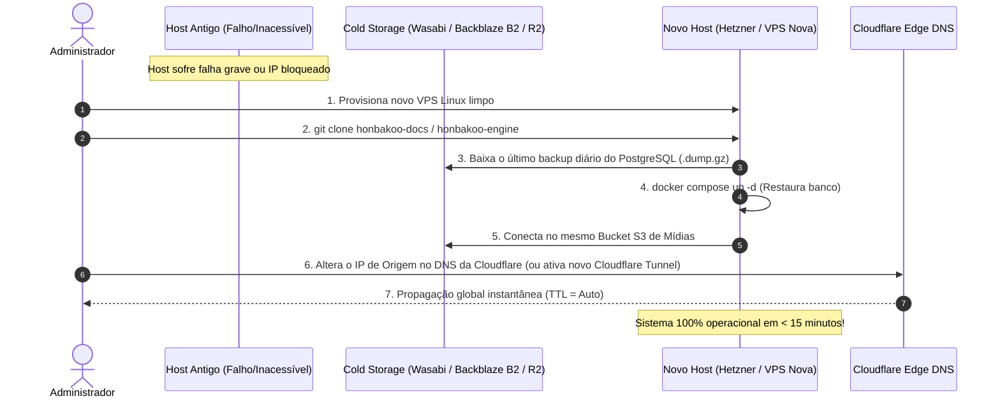

# 📈 Honbakoo Scaling, Partitioning & Disaster Recovery (DR)

> **Estratégia de Longo Prazo:** Arquitetura de particionamento de banco para volumes acima de 10 milhões de registros e plano de Disaster Recovery (DR) para migração entre datacenters em menos de 15 minutos.

---

## 1. Estratégia de Particionamento de Banco (Quando o Catálogo Escalar)

Em plataformas que operam por anos, tabelas de log e dados transacionais tornam-se gargalos de disco se mantidas em partições únicas. O PostgreSQL 16+ oferece suporte nativo a **Declarative Partitioning**.

### 1.1 Tabela `reading_history` (Particionamento por Hash)
Quando o sistema atinge mais de 500.000 usuários ativos e dezenas de milhões de registros de leitura:
* **Gatilho:** Tabela `reading_history` ultrapassa 10GB em disco ou 20 milhões de linhas.
* **Técnica:** Particionamento por HASH no `user_id`:
  ```sql
  CREATE TABLE reading_history (
      user_id UUID NOT NULL,
      manga_id UUID NOT NULL,
      last_chapter_id UUID NOT NULL,
      last_page INT NOT NULL DEFAULT 1,
      last_video_position_seconds INT NOT NULL DEFAULT 0,
      updated_at TIMESTAMPTZ NOT NULL DEFAULT NOW(),
      PRIMARY KEY (user_id, manga_id)
  ) PARTITION BY HASH (user_id);

  -- 4 Partições balanceadas (podem expandir para 16)
  CREATE TABLE reading_history_p0 PARTITION OF reading_history FOR VALUES WITH (MODULUS 4, REMAINDER 0);
  CREATE TABLE reading_history_p1 PARTITION OF reading_history FOR VALUES WITH (MODULUS 4, REMAINDER 1);
  CREATE TABLE reading_history_p2 PARTITION OF reading_history FOR VALUES WITH (MODULUS 4, REMAINDER 2);
  CREATE TABLE reading_history_p3 PARTITION OF reading_history FOR VALUES WITH (MODULUS 4, REMAINDER 3);
  ```
* **Benefício:** Consultas `WHERE user_id = '...'` tocam apenas **1 partição** (Partition Pruning), reduzindo o uso de cache de buffer do banco em 75%.

### 1.2 Auditoria e Logs de Visualizações (Particionamento por Faixa Temporal)
* Tabelas de auditoria de acessos são particionadas por mês (`PARTITION BY RANGE (created_at)`).
* Partições com mais de 6 meses são automaticamente arquivadas ou transformadas em tabelas comprimidas (`pg_dump` para cold storage no S3/B2 e `DROP PARTITION`), mantendo o disco principal leve.

---

## 2. Pool de Conexões de Alta Escala (PgBouncer)

Quando a aplicação cresce de 1 instância para 5 réplicas atrás de um Load Balancer:
* O PostgreSQL cria 1 processo por conexão aberta no Linux (~10MB de RAM por conexão).
* **Solução:** Introdução do **PgBouncer** em modo `transaction pooling`:
  * A API mantém conexões leves com o PgBouncer.
  * O PgBouncer multiplexa 5.000 conexões de clientes em apenas **50 conexões reais** com o PostgreSQL.
  * O consumo de memória do banco cai de 2GB para menos de 100MB.

---

## 3. Plano de Disaster Recovery (DR) & Continuidade de Negócio

### Cenário: Datacenter Cai, VPS é Suspensa ou Hardware Falha



### Métricas de DR (RPO e RTO):
* **RPO (Recovery Point Objective):** Máximo de **24 horas** de dados (frequência do dump automatizado) ou **1 hora** se o WAL Archiving para S3 estiver ativado.
* **RTO (Recovery Time Objective):** Menos de **15 minutos** para subir a nova instância e apontar o DNS.

### Como as mídias ficam seguras durante o DR?
Como o Honbakoo adota o padrão **Content-Addressed Storage (CAS)** e **Zero-Egress S3 (Cloudflare R2 / Backblaze B2)**:
* Os arquivos de imagem e vídeo **nunca ficam presos na VPS**.
* Eles residem no bucket S3 independente. Ao subir o novo host, a nova API simplesmente lê o mesmo bucket, sem necessidade de transferir terabytes de imagens durante o desastre.
