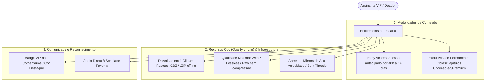

# ADR-0016 — Modelo de Monetização VIP: Early Access, Exclusividade Permanente e QoL

- **Status:** Aceito
- **Data:** 2026-11-06
- **Relacionado:** `ARCHITECTURE.md` §4.2; `DATABASE_SCHEMA.md` §1, §6 e §7; `API_SPECIFICATION.md` §3.2

---

## 1. Contexto

Plataformas de entretenimento visual (mangá, manhwa, doujinshi e anime-h) necessitam de fontes sustentáveis de receita para cobrir custos operacionais de servidores e recompensar scanlators/criadores. O mercado tradicional comete dois erros frequentes:
1. **Ad-Overload (Poluição de Anúncios):** Pop-ups abusivos e redirecionamentos maliciosos que expulsam usuários legítimos e provocam uso em massa de AdBlockers.
2. **Hard Paywall Rígido:** Trancar todo o catálogo atrás de assinatura impede o crescimento orgânico e a indexação de busca (SEO).

É necessário um modelo de monetização híbrido, ético e atraente, combinando o que funciona nos líderes de mercado (Fakku, E-Hentai/ExHentai, MangaDex e Patreon/Fanbox).

---

## 2. As 3 Camadas do Modelo VIP Honbakoo

### Camada 1: Early Access (Acesso Antecipado Temporal)
* O capítulo novo é lançado com `is_vip_early_access = TRUE` e uma data futura `available_public_at` (ex: 7 dias após o upload).
* Assinantes VIP lêem imediatamente; leitores free visualizam a contagem regressiva para liberação gratuita.
* Gera tração e conversão orgânica sem criar ressentimento na base gratuita.

### Camada 2: Exclusividade Permanente (Paywall Seletivo / Uncensored)
* Obras ou capítulos marcados com `is_vip_exclusive = TRUE` permanecem restritos permanentemente.
* **Casos de Uso Típicos em Hentai/Doujinshi:**
  * Versões oficiais sem censura (*uncensored / decensored*).
  * Obras autorais exclusivas de criadores parceiros ou doujinshis independentes.
  * Capítulos bônus / extras de bastidores.

### Camada 3: Recursos de Infraestrutura e QoL (Quality of Life)
* **Download de Pacotes `.cbz` / `.zip`:** Leitores gratuitos lêem página por página no navegador. Assinantes VIP possuem a rota `GET /chapters/{id}/download` para baixar o capítulo completo em 1 clique para leitura offline em leitores de desktop/tablet.
* **Resolução Original (Lossless):** O manifesto permite que VIPs solicitem `quality=original`, recebendo as páginas na resolução bruta enviada pela scanlator, sem a compressão perceptual aplicada para usuários gratuitos.
* **Isenção Total de Anúncios:** Experiência 100% limpa.

---

## 3. Decisão de Engenharia & Armazenamento

1. **Separação de Mídia Restrita:**
   * Imagens de capítulos `is_vip_exclusive` ou `is_vip_early_access` são armazenadas sob o prefixo privado `/media/restricted/{chapter_id}/{sha256}.webp`.
   * A entrega exige validação de assinatura HMAC gerada dinamicamente pelo manifesto (`GET /chapters/{id}/pages`), que valida a claim `is_vip: true` do usuário.
2. **Download em Batch via Streams:**
   * A geração do arquivo `.cbz` (container zip de imagens) é realizada em streaming assíncrono diretamente da origem, com rate limiting por usuário (ex: máx. 5 downloads por hora) para evitar abusos de banda.
3. **Repasse e Monetização de Scanlators:**
   * O sistema suporta modelo de divisão de assinatura: o leitor pode escolher destinar uma fatia da sua assinatura VIP para sua scanlator favorita (`scanlation_groups`), criando um incentivo financeiro para que os grupos tragam lançamentos rápidos com exclusividade para a plataforma.

---

## 4. Consequências

- **Positivas:** Modelo de monetização sustentável e transparente; 3 a 5 assinantes cobrem o custo de uma VPS modesta; incentiva doações sem degradar a experiência pública.
- **Negativas:** Exige controle estrito de validação de tokens nas rotas de mídia e download; geração de arquivos CBZ consome I/O se não houver rate limiting.
